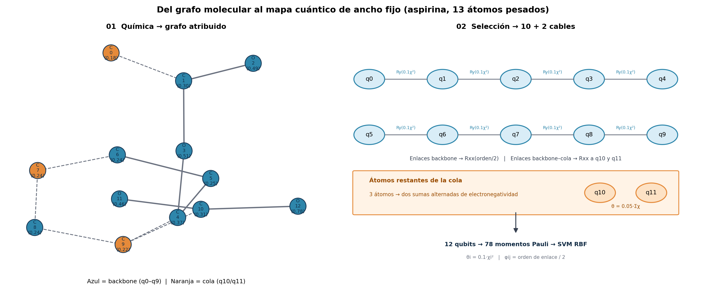
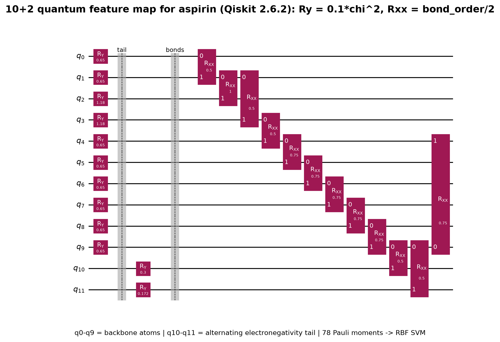
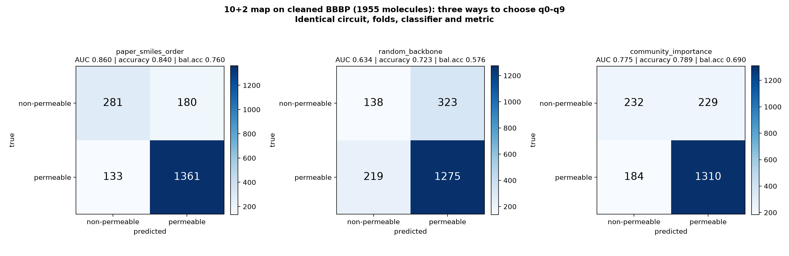
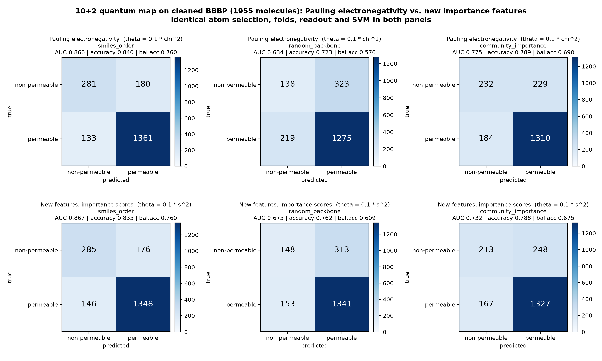

# Full BBBP + 10+2 Quantum Feature Map

Branch **`analysis_features`** – all work is in this branch.

This repository contains a clean pipeline for the BBBP dataset and a 12‑qubit quantum feature map (10 backbone + 2 tail qubits).  The README explains **what was cleaned**, **how the embedding is built**, and the **three main experiments** that compare different qubit‑selection strategies.



*Figure 1 – Heavy‑atom graph of aspirin and its conversion into the fixed‑width 10+2 circuit.  Blue nodes = backbone (q0‑q9); orange nodes = tail (q10/q11).* 

---

## 1. Dataset (cleaned)

- Source: `data/raw/BBBP.csv` – 2050 rows from DeepChem.
- Cleaning stages (see `analysis_features/verify.py`):
  - **Parse** with RDKit – 11 invalid SMILES.
  - **Remove salts/solvents** – 105 rows kept, parent molecule chosen by a deterministic rule (largest heavy‑atom fragment).
  - **Resolve label conflicts** – 11 structures with contradictory labels (e.g. propranolol) are removed.
  - **Deduplicate** – 62 duplicate structures retained by first occurrence.
  - **Final count** – 1955 unique molecules (461 non‑permeable, 1494 permeable).
- The clean CSV, audit logs, RDKit version and a timestamp are written to `data/processed/`.
- RDKit **2024.03.5**.

### Key decisions
| Decision | Description |
|---|---|
| **Charges** | Kept as‑is; no neutralisation. |
| **Tautomers** | Not merged; marked if ambiguous. |
| **Stereochemistry** | Retained; the quantum circuit is stereocontrolled‑blind. |
| **Electronegativities** | Hannan table extended with Br 2.96, I 2.66, P 2.19; missing elements raise an error. |
| **Tail size** | `atoms_beyond_10 = max(0, heavy_atom_count‑10)`; 94.7 % of molecules have a tail.

### 1.1 Cleaning requirements, answered point by point

This is the audit a reviewer should demand. Every number below is reproduced by
`python -m analysis_features verify` (34 checks) and logged in
`data/processed/BBBP_clean_log.txt`. The paste-ready methods prose is in
`docs/METHODS.md`.

1. **Full raw dataset, not the 250 subset.** Input is `data/raw/BBBP.csv` with
   **2050 rows** (`SMILES`, `p_np`). `BBBP_previous_250.csv` is *only* a
   regression check: all **250/250** of its molecules survive cleaning with the
   same label and are marked by `in_previous_250`. No result here is computed
   on 250 molecules.
2. **Parse every SMILES with RDKit; count the failures.** `Chem.MolFromSmiles`
   rejects **11** structures (systematic valence errors, mostly guanidine /
   `[NH2]` motifs). They are listed in `BBBP_invalid_smiles.csv` and were *not*
   repaired: repairing a valence error is a chemical edit, not a parsing step.
   Parsed rows: **2039** = 2050 − 11 (log Stage 1).
3. **Strip salts/solvents, keep the parent.** **105** rows are multi-fragment;
   we keep the largest **carbon-containing** fragment, breaking ties by heavy
   atoms, heteroatoms and canonical SMILES; **2** parent choices are chemically
   ambiguous and flagged in `BBBP_fragment_audit.csv`. The first entry,
   propranolol `[Cl].CC(C)NCC(O)COc1cccc2ccccc12`, becomes
   `CC(C)NCC(O)COc1cccc2ccccc12`. Because the paper assigns qubits in atom
   order, the counter-ion would otherwise occupy **q0**. `verify.py` asserts
   both sides: default embedding gives q0 = C, while the explicit control
   (`order="source"`, `strip_salts=False`) still gives q0 = Cl.
4. **Standardise and write canonical SMILES; document charges and tautomers.**
   Parents are written as `MolToSmiles(canonical=True, isomericSmiles=True)`.
   **Charges are kept, never neutralised** (34 charged structures; net charge in
   `formal_charge`) because protonation changes the permeating species.
   **Tautomers are not merged or canonicalised**: they can move a proton and
   change the species; only 8 tautomer groups with contradictory labels are
   flagged via `tautomer_label_conflict`. Stereochemistry is preserved in the
   SMILES but ignored by the circuit — a documented limitation (629 molecules
   carry `@`/`@@`; see `results/README.md`).
5. **Remove duplicates; exclude unsupported label conflicts.** **11 structures**
   appear with both labels (**22 rows**), propranolol among them (HCl salt
   labelled 1, free base labelled 0). With no external evidence for the
   correct label we **exclude both rows** rather than impute one; §1.3 lists
   all 11 structures and explains the likely provenance of the contradiction. Then **62**
   identical-structure duplicates are collapsed, keeping the first occurrence.
   Final table: **1955 unique molecules** (461 label 0, 1494 label 1).
   `BBBP_clean_audit.csv` records `excluded_reason ∈ {included,
   label_conflict, duplicate}`; uniqueness is asserted by `verify.py`.
6. **Electronegativity coverage.** Hannan's original 10-element table is kept
   **verbatim** for reproducibility. Present elements: B, Br, C, Cl, F, I, N,
   O, P, S. Missing from Hannan: **Br, I, P** → added explicitly with Pauling
   values **2.96, 2.66, 2.19**. Missing after extension: **none**.
   `electronegativity()` raises `KeyError` for an unknown element instead of
   silently defaulting to 1.0 — the original notebook's silent fallback is
   removed.
7. **Requested columns.** `heavy_atom_count`, `bond_count` and
   `atoms_beyond_10 = max(0, heavy_atom_count − 10)` are in the clean CSV.
   **1851 molecules** (94.7 %) have atoms beyond the tenth, i.e. a tail is the
   normal case, not an exception. `verify.py` also checks
   `bond_count ≥ heavy_atom_count − 1`.
8. **Saved artefacts.** `data/processed/BBBP_clean_full.csv`,
   `BBBP_clean_audit.csv`, `BBBP_invalid_smiles.csv`,
   `BBBP_fragment_audit.csv`, `BBBP_excluded_molecules.csv`,
   `BBBP_clean_settings.json`, `BBBP_clean_log.txt`; the pipeline itself is `analysis_features/cleaning.py`
   (`python -m analysis_features clean`). RDKit **2024.03.5** is recorded in
   both the settings JSON and the log. *Caveat:* the analysis environment used
   for the figures has RDKit 2025.09.6, so the single `verify.py` version check
   reports a mismatch; the cleaning artefacts themselves were produced and
   audited with the recorded version and are unchanged.
9. **Per-stage log (verbatim counts).** 2050 input → Stage 1: −11 invalid
   (2039) → Stage 2: 105 fragment-stripped rows, 2202 fragments, 2 ambiguous
   parents → Stage 3: 2039 canonical isomeric SMILES → Stage 4: element audit
   above → Stage 5a: −22 conflict rows (11 structures) → Stage 5b: −62
   duplicates → Stage 5: **1955** rows (461 / 1494) → Stage 6: 6 stereo
   conflicts flagged → Stage 7: 8 tautomer conflicts flagged → Stage 8:
   250/250 previous-subset molecules recovered. A short explanation of every
   decision is in `docs/METHODS.md` and in the `decisions` block of
   `BBBP_clean_settings.json`.

### 1.2 Every molecule removed from the original CSV

Exactly **95 of the 2050** deposited rows are absent from `data/processed/BBBP_clean_full.csv`, which is the only table the modelling code reads (`load_frame()`). They cannot be selected in any training or test fold because they do not exist in that table. They are kept for traceability in `BBBP_invalid_smiles.csv` and `BBBP_clean_audit.csv` (`excluded_reason`), and exported together as `data/processed/BBBP_excluded_molecules.csv`.

| Reason | Rows | Why it is not eligible for train/test |
|---|---:|---|
| Invalid SMILES | 11 | RDKit cannot sanitise them (valence-4 N); they were not repaired. |
| Conflicting labels | 22 (11 structures) | The same parent carries both labels; no external evidence favours one, so all its rows are excluded. |
| Duplicate structure | 62 | Identical canonical parent to an earlier row; only the first occurrence is kept. |

**Full list** (`num` = row number in `data/raw/BBBP.csv`):

| num | name | original SMILES | label | reason | detail |
|---:|---|---|---:|---|---|
| 1 | Propanolol | `[Cl].CC(C)NCC(O)COc1cccc2ccccc12` | 1 | conflicting labels | parent has labels [0, 1] in source rows [1, 380]; both excluded, no external evidence to choose one |
| 17 | BRL53080 | `CN(C)C(=O)C(CCN1CCC(O)(CC1)c1ccc(Cl)cc1)(c1ccccc1)c1ccccc1` | 1 | conflicting labels | parent has labels [0, 1] in source rows [17, 552]; both excluded, no external evidence to choose one |
| 60 | 15 | `O=N([O-])C1=C(CN=C1NCCSCc2ncccc2)Cc3ccccc3` | 1 | invalid SMILES | RDKit sanitisation failed: explicit valence 4 on N (not repaired; a repair would be a chemical edit) |
| 62 | 22767 | `c1(nc(NC(N)=[NH2])sc1)CSCCNC(=[NH]C#N)NC` | 1 | invalid SMILES | RDKit sanitisation failed: explicit valence 4 on N (not repaired; a repair would be a chemical edit) |
| 102 | acetylsalicylate | `CC(=O)Oc1ccccc1C(O)=O` | 0 | conflicting labels | parent has labels [0, 1] in source rows [102, 1009]; both excluded, no external evidence to choose one |
| 128 | atropine | `CN1C2CCC1CC(C2)OC(=O)C(CO)c3ccccc3` | 0 | conflicting labels | parent has labels [0, 1] in source rows [128, 1701]; both excluded, no external evidence to choose one |
| 154 | Chlortetracycline | `CN(C)[C@H]1[C@@H]2C[C@H]3C(=C(O)c4c(O)ccc(Cl)c4[C@@]3(C)O)C(=O)[C@]2(O)C(=O)\C(=C(N)/O)C1=O` | 0 | duplicate structure | same parent as source row 129; first occurrence kept |
| 176 | Trimetrexate | `COc1cc(NCc2ccc3nc(N)nc(N)c3c2C)cc(OC)c1OC` | 0 | conflicting labels | parent has labels [0, 1] in source rows [176, 1645]; both excluded, no external evidence to choose one |
| 267 | indomethacin | `COc1ccc2n(c(C)c(CC(O)=O)c2c1)C(=O)c3ccc(Cl)cc3` | 0 | conflicting labels | parent has labels [0, 1] in source rows [267, 1314]; both excluded, no external evidence to choose one |
| 269 | 1-47 | `NCCc1cn2c(n1)cccc2` | 0 | duplicate structure | same parent as source row 83; first occurrence kept |
| 284 | levodopa | `N[C@@H](Cc1ccc(O)c(O)c1)C(O)=O` | 0 | conflicting labels | parent has labels [0, 1] in source rows [284, 1881]; both excluded, no external evidence to choose one |
| 305 | mequitazine | `C1CN2CCC1C(C2)CN3c4ccccc4Sc5ccccc35` | 0 | conflicting labels | parent has labels [0, 1] in source rows [305, 1361]; both excluded, no external evidence to choose one |
| 312 | L-663581 | `CC(C)c1onc(n1)c2ncn3c2CN(C)C(=O)c4c(Cl)cccc34` | 1 | duplicate structure | same parent as source row 97; first occurrence kept |
| 325 | Methylprednisolone | `C[C@H]1C[C@H]2[C@@H]3CC[C@](O)(C(=O)CO)[C@@]3(C)C[C@H](O)[C@@H]2[C@@]4(C)C=CC(=O)C=C14` | 0 | conflicting labels | parent has labels [0, 1] in source rows [325, 1910]; both excluded, no external evidence to choose one |
| 326 | Miconazole | `Clc1ccc(COC(Cn2ccnc2)c3ccc(Cl)cc3Cl)c(Cl)c1` | 0 | conflicting labels | parent has labels [0, 1] in source rows [326, 1381]; both excluded, no external evidence to choose one |
| 337 | Org12962 | `C1NCCN(C1)c1ccc(c(n1)Cl)C(F)(F)F` | 1 | duplicate structure | same parent as source row 29; first occurrence kept |
| 380 | propranolol | `CC(C)NCC(O)COc1cccc2ccccc12` | 0 | conflicting labels | parent has labels [0, 1] in source rows [1, 380]; both excluded, no external evidence to choose one |
| 388 | 111-trifluoro-2-chloroethane | `C(CCl)(F)(F)F` | 1 | duplicate structure | same parent as source row 96; first occurrence kept |
| 393 | ICI17148 | `Cc1nc(sc1)\[NH]=C(\N)N` | 1 | invalid SMILES | RDKit sanitisation failed: explicit valence 4 on N (not repaired; a repair would be a chemical edit) |
| 394 | Mono-hydroxylated-L-663581 | `c12c(C(N(Cc3n1cnc3c1noc(n1)C(O)(C)C)C)=O)c(ccc2)Cl` | 0 | duplicate structure | same parent as source row 70; first occurrence kept |
| 415 | Ofloxacin | `CC1COc2c(N3CCN(C)CC3)c(F)cc4C(=O)C(=CN1c24)C(O)=O` | 1 | duplicate structure | same parent as source row 3; first occurrence kept |
| 422 | theophylline | `CN1C(=O)N(C)c2nc[nH]c2C1=O` | 0 | duplicate structure | same parent as source row 105; first occurrence kept |
| 435 | Dichloromethane | `ClCCl` | 1 | duplicate structure | same parent as source row 13; first occurrence kept |
| 453 | amitriptyline | `CN(C)CCC=C1c2ccccc2CCc3ccccc13` | 1 | duplicate structure | same parent as source row 87; first occurrence kept |
| 457 | Ethylbenzene | `CCc1ccccc1` | 1 | duplicate structure | same parent as source row 52; first occurrence kept |
| 468 | cp29 | `c1cn(CCCCC)c(C)c(O)c1=O` | 1 | duplicate structure | same parent as source row 467; first occurrence kept |
| 488 | Nor-1-chlorpromazine | `N1(c2c(Sc3c1cccc3)ccc(c2)Cl)CCCNC` | 1 | duplicate structure | same parent as source row 46; first occurrence kept |
| 489 | Nor-2-chlorpromazine | `N1(c2c(Sc3c1cccc3)ccc(c2)Cl)CCCN` | 1 | duplicate structure | same parent as source row 56; first occurrence kept |
| 508 | Org13011 | `C1N(CCN(C1)c1cc(ccn1)C(F)(F)F)CCCCN1C(CCC1)=O` | 1 | duplicate structure | same parent as source row 50; first occurrence kept |
| 533 | RO19-4603 | `CN1Cc2n(cnc2C(=O)OC(C)(C)C)c3ccsc3C1=O` | 1 | duplicate structure | same parent as source row 34; first occurrence kept |
| 534 | SKF101468 | `C1C(Nc2c1c(ccc2)CCN(CCC)CCC)=O` | 1 | duplicate structure | same parent as source row 85; first occurrence kept |
| 535 | SKF89124 | `C1C(Nc2c1c(ccc2O)CCN(CCC)CCC)=O` | 1 | duplicate structure | same parent as source row 75; first occurrence kept |
| 552 | loperamide | `CN(C)C(=O)C(CCN1CCC(O)(CC1)c2ccc(Cl)cc2)(c3ccccc3)c4ccccc4` | 0 | conflicting labels | parent has labels [0, 1] in source rows [17, 552]; both excluded, no external evidence to choose one |
| 562 | demerol | `[H+].[Cl-].CCOC(=O)C1(CCN(C)CC1)c2ccccc2` | 1 | duplicate structure | same parent as source row 140; first occurrence kept |
| 565 | Y-G14 | `c1c(nccc1)CCNC` | 1 | duplicate structure | same parent as source row 59; first occurrence kept |
| 566 | Y-G15 | `c1c(nccc1)CCN(C)C` | 1 | duplicate structure | same parent as source row 49; first occurrence kept |
| 569 | Y-G20 | `c1c(nc2n1cccc2)CCN` | 0 | duplicate structure | same parent as source row 83; first occurrence kept |
| 571 | loratadine | `CCOC(=O)N1CCC(CC1)=C2c3ccc(Cl)cc3CCc4cccnc24` | 0 | conflicting labels | parent has labels [0, 1] in source rows [571, 1338]; both excluded, no external evidence to choose one |
| 591 | Carbamazepineepoxide | `NC(=O)N1c2ccccc2C3OC3c4ccccc14` | 1 | duplicate structure | same parent as source row 72; first occurrence kept |
| 593 | Tertbutylchlorambucil | `c1cc(ccc1CCCC(OC(C)(C)C)=O)N(CCCl)CCCl` | 1 | duplicate structure | same parent as source row 2; first occurrence kept |
| 607 | doxylamine succinate | `CN(C)CCOC(C)(c1ccccc1)c2ccccn2.OC(=O)CCC(O)=O` | 1 | duplicate structure | same parent as source row 490; first occurrence kept |
| 616 | 5-6 | `s1cc(CSCCN\C(NC)=[NH]\C#N)nc1\[NH]=C(\N)N` | 1 | invalid SMILES | RDKit sanitisation failed: explicit valence 4 on N (not repaired; a repair would be a chemical edit) |
| 617 | 5-66 | `c1cc(CCNC)ncc1` | 1 | duplicate structure | same parent as source row 59; first occurrence kept |
| 618 | 5-67 | `c1cc(CCN(C)C)ncc1` | 1 | duplicate structure | same parent as source row 49; first occurrence kept |
| 619 | 5-68 | `s1c(ncc1)CCN` | 1 | duplicate structure | same parent as source row 567; first occurrence kept |
| 644 | 12 | `c1c(c(ncc1)CSCCN\C(=[NH]\C#N)NCC)Br` | 0 | invalid SMILES | RDKit sanitisation failed: explicit valence 4 on N (not repaired; a repair would be a chemical edit) |
| 647 | 16 | `n1c(csc1\[NH]=C(\N)N)c1ccccc1` | 1 | invalid SMILES | RDKit sanitisation failed: explicit valence 4 on N (not repaired; a repair would be a chemical edit) |
| 648 | 17 | `n1c(csc1\[NH]=C(\N)N)c1cccc(c1)N` | 0 | invalid SMILES | RDKit sanitisation failed: explicit valence 4 on N (not repaired; a repair would be a chemical edit) |
| 649 | 18 | `n1c(csc1\[NH]=C(\N)N)c1cccc(c1)NC(C)=O` | 0 | invalid SMILES | RDKit sanitisation failed: explicit valence 4 on N (not repaired; a repair would be a chemical edit) |
| 650 | 19 | `n1c(csc1\[NH]=C(\N)N)c1cccc(c1)N\C(NC)=[NH]\C#N` | 0 | invalid SMILES | RDKit sanitisation failed: explicit valence 4 on N (not repaired; a repair would be a chemical edit) |
| 651 | 2 | `s1cc(nc1\[NH]=C(\N)N)C` | 1 | invalid SMILES | RDKit sanitisation failed: explicit valence 4 on N (not repaired; a repair would be a chemical edit) |
| 667 | 24 | `C1CN(CCC1)Cc1cccc(c1)OCCCNC(=O)C` | 1 | duplicate structure | same parent as source row 4; first occurrence kept |
| 668 | 25 | `C1CN(CCC1)Cc1cccc(c1)OCCCNC(=O)c1ccccc1` | 1 | duplicate structure | same parent as source row 33; first occurrence kept |
| 669 | 26 | `C1CN(CCC1)Cc1cccc(c1)OCCCO` | 1 | duplicate structure | same parent as source row 93; first occurrence kept |
| 670 | 27 | `C1CN(CCC1)Cc1cccc(c1)OCCCNc1ncccc1` | 1 | duplicate structure | same parent as source row 89; first occurrence kept |
| 671 | 28 | `C1CN(CCC1)Cc1cccc(c1)OCCCNc1nccs1` | 1 | duplicate structure | same parent as source row 69; first occurrence kept |
| 672 | 30 | `C1CN(CCC1)Cc1cccc(c1)OCCCNc1nc2c(o1)cccc2` | 1 | duplicate structure | same parent as source row 79; first occurrence kept |
| 673 | 4 | `c1c(oc(c1)CN(C)C)CSCCNc1nc(c(c[nH]1)Cc1cc2c(cc1)cccc2)=O` | 0 | duplicate structure | same parent as source row 23; first occurrence kept |
| 687 | 9-C17 | `c1(cc(N\C(=[NH]\c2cccc(c2)CC)C)ccc1)CC` | 1 | invalid SMILES | RDKit sanitisation failed: explicit valence 4 on N (not repaired; a repair would be a chemical edit) |
| 690 | Acebutolol | `CCCC(=O)Nc1ccc(OCC(O)CNC(C)C)c(c1)C(C)=O` | 1 | duplicate structure | same parent as source row 55; first occurrence kept |
| 713 | midazolam maleate | `Cc1ncc2CN=C(c3ccccc3F)c4cc(Cl)ccc4n12.OC(=O)\C=C/C(O)=O` | 1 | duplicate structure | same parent as source row 315; first occurrence kept |
| 929 | sultamicillin | `CC1(C)S[C@@H]2[C@H](NC(=O)[C@H](N)c3ccccc3)C(=O)N2[C@H]1C(O)=O.CC4(C)[C@@H](N5[C@@H](CC5=O)[S]4(=O)=O)C(O)=O` | 0 | duplicate structure | same parent as source row 108; first occurrence kept |
| 959 | acetazolamide | `CC(NC1=NN=C(S1)[S](N)(=O)=O)=O` | 1 | duplicate structure | same parent as source row 450; first occurrence kept |
| 966 | acyclovir/aciclovir | `C1=NC2=C([N]1COCCO)NC(=NC2=O)N` | 1 | duplicate structure | same parent as source row 691; first occurrence kept |
| 1009 | aspirin | `C1=CC=CC(=C1C(O)=O)OC(C)=O` | 1 | conflicting labels | parent has labels [0, 1] in source rows [102, 1009]; both excluded, no external evidence to choose one |
| 1073 | carphenazine/carfenazine | `C1=C(C=CC3=C1N(CCCN2CCN(CC2)CCO)C4=C(S3)C=CC=C4)C(CC)=O` | 1 | duplicate structure | same parent as source row 523; first occurrence kept |
| 1085 | chloroform | `C(Cl)(Cl)Cl` | 1 | duplicate structure | same parent as source row 564; first occurrence kept |
| 1111 | clopenthixol/zuclopenthixol | `C1=C(Cl)C=CC3=C1\C(C2=C(C=CC=C2)S3)=C/CCN4CCN(CCO)CC4` | 1 | duplicate structure | same parent as source row 555; first occurrence kept |
| 1314 | indomethacin(indometacin) | `C1=CC(=CC2=C1[N](C(=C2CC(O)=O)C)C(C3=CC=C(Cl)C=C3)=O)OC` | 1 | conflicting labels | parent has labels [0, 1] in source rows [267, 1314]; both excluded, no external evidence to choose one |
| 1338 | loratadine | `C1=CC(=CC2=C1C(C3=C(CC2)C=CC=N3)=C4CCN(C(OCC)=O)CC4)Cl` | 1 | conflicting labels | parent has labels [0, 1] in source rows [571, 1338]; both excluded, no external evidence to choose one |
| 1361 | mequitazine | `C1=CC=CC2=C1SC5=C(N2CC3C4CCN(C3)CC4)C=CC=C5` | 1 | conflicting labels | parent has labels [0, 1] in source rows [305, 1361]; both excluded, no external evidence to choose one |
| 1381 | miconazole | `C1=C(C=CC(=C1Cl)COC(C[N]2C=NC=C2)C3=C(C=C(C=C3)Cl)Cl)Cl` | 1 | conflicting labels | parent has labels [0, 1] in source rows [326, 1381]; both excluded, no external evidence to choose one |
| 1388 | moclobemide | `C2=C(C(NCCN1CCOCC1)=O)C=CC(=C2)Cl` | 1 | duplicate structure | same parent as source row 296; first occurrence kept |
| 1462 | perphenazine | `C1=C(Cl)C=CC3=C1N(C2=C(C=CC=C2)S3)CCCN4CCN(CCO)CC4` | 1 | duplicate structure | same parent as source row 139; first occurrence kept |
| 1471 | phenytoin | `C1=CC=CC=C1C3(C2=CC=CC=C2)NC(=O)NC3=O` | 1 | duplicate structure | same parent as source row 585; first occurrence kept |
| 1508 | propofol | `C1=CC=C(C(=C1C(C)C)O)C(C)C` | 1 | duplicate structure | same parent as source row 191; first occurrence kept |
| 1541 | ropinirole | `C2=C(C1=C(NC(C1)=O)C=C2)CCN(CCC)CCC` | 1 | duplicate structure | same parent as source row 85; first occurrence kept |
| 1567 | sulfamethoxazole(tiabendazole) | `C1=CC(=CC=C1[S](NC2=NOC(=C2)C)(=O)=O)N` | 1 | duplicate structure | same parent as source row 344; first occurrence kept |
| 1583 | tamitinol | `C1=C(C(=C(O)C(=N1)C)CNCC)CSC` | 1 | duplicate structure | same parent as source row 654; first occurrence kept |
| 1597 | tetrabenazine(tetrabenzine) | `C1=C(OC)C(=CC3=C1C2N(CC(CC(C)C)C(C2)=O)CC3)OC` | 1 | duplicate structure | same parent as source row 219; first occurrence kept |
| 1645 | trimetrexate | `C1=C3C(=C(C(=C1)CNC2=CC(=C(C(=C2)OC)OC)OC)C)C(=NC(=N3)N)N` | 1 | conflicting labels | parent has labels [0, 1] in source rows [176, 1645]; both excluded, no external evidence to choose one |
| 1662 | vinyl-ether | `C(=C)OC=C` | 1 | duplicate structure | same parent as source row 437; first occurrence kept |
| 1701 | atropine(hyoscyamine) | `C1=CC=CC=C1C(C(OC2CC3N(C)C(C2)CC3)=O)CO` | 1 | conflicting labels | parent has labels [0, 1] in source rows [128, 1701]; both excluded, no external evidence to choose one |
| 1782 | darvon(dextropropoxypheneandlevopropoxyphene) | `[C@](OC(=O)CC)([C@@H](CN(C)C)C)(CC1=CC=CC=C1)C2=CC=CC=C2.[H+].[Cl-]` | 1 | duplicate structure | same parent as source row 45; first occurrence kept |
| 1881 | levodopa | `[C@H](CC1=CC(=C(C=C1)O)O)(C(O)=O)N` | 1 | conflicting labels | parent has labels [0, 1] in source rows [284, 1881]; both excluded, no external evidence to choose one |
| 1882 | levomepromazine | `[C@H](CN1C3=C(SC2=C1C=CC=C2)C=CC(=C3)OC)(CN(C)C)C` | 1 | duplicate structure | same parent as source row 700; first occurrence kept |
| 1906 | methadone(levomethadone) | `C1=CC=CC=C1C(C2=CC=CC=C2)(C(CC)=O)CC(N(C)C)C` | 1 | duplicate structure | same parent as source row 15; first occurrence kept |
| 1910 | methylprednisolone | `[C@H]24[C@H]1[C@@]([C@](C(CO)=O)(O)CC1)(C[C@@H]([C@@H]2[C@@]3(C(=CC(=O)C=C3)[C@H](C4)C)C)O)C` | 1 | conflicting labels | parent has labels [0, 1] in source rows [325, 1910]; both excluded, no external evidence to choose one |
| 1916 | midazolam(midazolammaleate) | `C1=CC(=CC3=C1[N]2C(=CN=C2C)CN=C3C4=CC=CC=C4F)Cl` | 1 | duplicate structure | same parent as source row 315; first occurrence kept |
| 1947 | paracetamol(acetaminophen) | `N(C(=O)C)C1=CC=C(O)C=C1` | 1 | duplicate structure | same parent as source row 101; first occurrence kept |
| 1961 | phenelzine | `[Cl].C1=CC=CC=C1CCNN` | 1 | duplicate structure | same parent as source row 142; first occurrence kept |
| 1971 | prazepine | `C1=CC=CC2=C1N(C3=C(CC2)C=CC=C3)CCCN(C)C` | 1 | duplicate structure | same parent as source row 664; first occurrence kept |
| 1979 | promethazine | `C1=CC=CC2=C1N(C3=C(S2)C=CC=C3)CC(C)N(C)C` | 1 | duplicate structure | same parent as source row 189; first occurrence kept |
| 2031 | trifluoperazine | `C1=C(C=CC3=C1N(CCCN2CCN(CC2)C)C4=C(S3)C=CC=C4)C(F)(F)F` | 1 | duplicate structure | same parent as source row 245; first occurrence kept |
| 2045 | zimeldine | `C2=C(\C(C1=CC=CN=C1)=C\CN(C)C)C=CC(=C2)Br` | 1 | duplicate structure | same parent as source row 252; first occurrence kept |

### 1.3 Why the same molecule appears with label 0 and label 1

The raw table is a compilation of results from different literature sources. It records only `name`, `SMILES` and `p_np` — no assay, species, dose or reference — so the reason for a contradiction cannot be resolved from the file itself. What *is* verifiable is that the same standardised structure was deposited more than once, often under a synonym or a different salt form, with different labels. For example propranolol appears as the hydrochloride (row 1, label 1) and as the free base (row 380, label 0); aspirin appears as "acetylsalicylate" (row 102, label 0) and "aspirin" (row 1009, label 1). Common causes in this kind of compilation are different experimental endpoints (in vivo brain/blood ratio vs in vitro permeability), different species or doses, and different deposited forms (salt vs free base, racemate vs single enantiomer). We do **not** claim to know which label is correct for any specific row.

Because no external evidence is available in the repository, the rule is conservative: **all rows of a conflicting structure are excluded**. Keeping either one would inject an arbitrary label choice into both training and test folds. The 11 affected structures (22 rows) are:

| Canonical parent | Source rows (label) | Deposited names |
|---|---|---|
| `CC(=O)Oc1ccccc1C(=O)O` | 102 (0), 1009 (1) | acetylsalicylate, aspirin |
| `CC(C)NCC(O)COc1cccc2ccccc12` | 1 (1), 380 (0) | Propanolol, propranolol |
| `CCOC(=O)N1CCC(=C2c3ccc(Cl)cc3CCc3cccnc32)CC1` | 571 (0), 1338 (1) | loratadine |
| `CN(C)C(=O)C(CCN1CCC(O)(c2ccc(Cl)cc2)CC1)(c1ccccc1)c1ccccc1` | 17 (1), 552 (0) | BRL53080, loperamide |
| `CN1C2CCC1CC(OC(=O)C(CO)c1ccccc1)C2` | 128 (0), 1701 (1) | atropine, atropine(hyoscyamine) |
| `COc1cc(NCc2ccc3nc(N)nc(N)c3c2C)cc(OC)c1OC` | 176 (0), 1645 (1) | Trimetrexate, trimetrexate |
| `COc1ccc2c(c1)c(CC(=O)O)c(C)n2C(=O)c1ccc(Cl)cc1` | 267 (0), 1314 (1) | indomethacin, indomethacin(indometacin) |
| `C[C@H]1C[C@@H]2[C@H]([C@@H](O)C[C@@]3(C)[C@H]2CC[C@]3(O)C(=O)CO)[C@@]2(C)C=CC(=O)C=C12` | 325 (0), 1910 (1) | Methylprednisolone, methylprednisolone |
| `Clc1ccc(COC(Cn2ccnc2)c2ccc(Cl)cc2Cl)c(Cl)c1` | 326 (0), 1381 (1) | Miconazole, miconazole |
| `N[C@@H](Cc1ccc(O)c(O)c1)C(=O)O` | 284 (0), 1881 (1) | levodopa |
| `c1ccc2c(c1)Sc1ccccc1N2CC1CN2CCC1CC2` | 305 (0), 1361 (1) | mequitazine |

The full row-by-row list, including the original SMILES of each conflicting entry, is in §1.2 and in `data/processed/BBBP_excluded_molecules.csv`.

### 1.4 The three data-processing decisions in detail

#### Standardisation and canonical SMILES (what I actually did)

1. `parse()` calls `Chem.MolFromSmiles()`; failures are the 11 rows already
   listed in §1.2. No valence repair is attempted.
2. `choose_parent()` keeps the largest **carbon-containing** fragment of each
   parsed molecule; ties are broken by heavy-atom count, heteroatom count and
   canonical SMILES, and 2 chemically ambiguous choices are flagged rather
   than forced.
3. Stage 3 writes `Chem.MolToSmiles(parent, canonical=True,
   isomericSmiles=True)` into `canonical_smiles`. This gives every molecule one
   deterministic RDKit atom order, so the first ten heavy atoms mean the same
   thing across rows. It is the safeguard against the deposited-order leak:
   with `strip_salts=False` the original string still puts the propranolol
   chloride on q0, while the canonical parent does not (`verify.py` checks
   both).
4. **Stereochemistry is retained** in that string (`isomericSmiles=True`,
   629 molecules carry `@`/`@@`) even though the circuit does not read chiral
   tags. A separate `flat_smiles()` removes stereo and is used only as an
   audit/conflict key, never as a model feature.

**Charges — decision: keep them.** `Chem.GetFormalCharge(parent)` is written to
`formal_charge` (34 charged structures) and no neutralisation is applied. A
protonated amine or a carboxylate is a different permeating species; changing
it would silently change the molecule being classified.

**Tautomers — decision: do not canonicalise or merge them.** RDKit's
`rdMolStandardize.TautomerEnumerator().Canonicalize()` is used only through
`tautomer_key()` to *group* structures for label-conflict detection. Eight
tautomer groups with contradictory labels are flagged in
`tautomer_label_conflict`; tautomers with agreeing labels are all kept. Merging
them would move a proton and therefore change the species, which is exactly
the kind of chemical edit we avoided for invalid SMILES and charges.

#### Element-coverage audit (what I actually did)

`audit_elements()` scans every parent and returns three lists:
`present`, `missing_from_hannan` and `missing_after_extension`.

| Field | Result in the cleaned set |
|---|---|
| Present | B, Br, C, Cl, F, I, N, O, P, S |
| Missing from Hannan's original table | **Br, I, P** |
| Missing after the explicit extension | **none** |

Hannan's map is kept **verbatim** (H, Li, Be, B, C, N, O, F, S, Cl) for
reproducibility of last year's circuit. The three missing elements are added in
a separate dictionary with Pauling values **P 2.19, Br 2.96, I 2.66**; the
union is `PAULING_EN`. `electronegativity(symbol)` now raises `KeyError` for an
unknown element instead of the notebook's silent `get(symbol, 1.0)`. The full
audit is in `BBBP_clean_settings.json` (`elements`) and log Stage 4, and
`verify.py` checks coverage, the exact missing-from-Hannan set and that the
Hannan table is unchanged. Consequence: every backbone angle `0.1·χ²` uses a
real Pauling value; no atom receives a fabricated χ = 1.0.

#### The three size columns (what I actually did)

Computed per parent in `cleaning.py` before deduplication, from the **heavy
atoms only**:

| Column | Definition | Use |
|---|---|---|
| `heavy_atom_count` | number of atoms with `atomicNum > 1` (hydrogens excluded) | selects the ten backbone atoms; determines tail size |
| `bond_count` | number of bonds whose **both** endpoints are heavy atoms (bonds to H excluded) | gates and the `bonds ≥ atoms − 1` sanity check |
| `atoms_beyond_10` | `max(0, heavy_atom_count − 10)` | how many atoms are compressed into q10/q11 |

`atoms_beyond_10 > 0` for **1851 of 1955** molecules (94.7%), so tail
compression is the rule rather than the exception. The three columns, together
with `formal_charge`, are present in `BBBP_clean_full.csv`; `verify.py` checks
that `atoms_beyond_10` equals the formula and that counts are positive and
mutually consistent. A more detailed, paste-ready version of all of this is in
`docs/METHODS.md`.

---

## 2. Methods: from molecular graph to circuit

### 2.1 Embedding construction

The 12‑qubit circuit is built as follows:

1. **Parse SMILES → RDKit molecule → heavy‑atom graph**.
2. **Select 10 backbone atoms** using one of three strategies:
   * `paper_smiles_order` – first 10 atoms in the SMILES order.
   * `random_backbone` – 10 atoms chosen uniformly at random.
   * `community_importance` – scores each heavy atom by a weighted sum of nine RDKit descriptors (see Table 1), then picks the highest‑scoring atom per community detected by `networkx.greedy_modularity_communities`.
3. **Tail atoms** (remaining heavy atoms) are compressed into two qubits (q10 and q11) by alternating the sum of their Pauling electronegativities.
4. **Apply gates**:
   * `Ry(θi)` on qubit `qi` with `θi = ALPHA * χi²` (α = 0.1, χ = electronegativity).
   * `Rxx(bond_order/2)` for each bond inside the backbone.
5. **Readouts**: 12 `<Z>` moments and 66 `<ZZ>` moments (78 features in total).
6. **Classifier**: a classical SVM with RBF kernel (`C = 10`) trained on the 78‑dimensional feature vectors.

> The circuit is a **feature map**; the SVM makes the final prediction. Community selection takes the single highest-scoring atom of each community (no descriptor averaging); only the tail pools atoms, by alternating sums of Pauling electronegativity. Stereochemistry is retained in the isomeric SMILES but ignored by the gates, so enantiomers currently produce identical features — see `results/README.md` for the mechanism and design options.

The two panels compared below differ **only in the backbone angle**:

| Embedding | Angle on qubit `qi` | Value for C / O |
|---|---|---|
| Published Pauli map | `θi = 0.1·χi²`, χ = Pauling electronegativity | 0.65 / 1.18 rad |
| New feature map | `θi = 0.1·si²`, where `si` is that atom's importance score — the **equal-weight mean of the nine normalised RDKit descriptors** (TPSA, logP, MR, HBD, HBA, Gasteiger, formal charge, heteroatom, aromaticity) | 0–0.1 rad (score ∈ [0,1]) |

The score is a weighted sum of those per-atom chemical properties; it is then squared and scaled by the same α = 0.1, so both maps keep the same functional form and only the property feeding the angle changes. The tail rule is unchanged in both.

The diagram below is **the actual circuit**, not a cartoon: `python -m analysis_features circuit-diagram` reads the angles from the same `build_statevector` function used for the results and draws a Qiskit `QuantumCircuit` with `draw("mpl")`. For aspirin (14 heavy atoms), q0–q9 receive `Ry(0.1·χ²)` (0.65 rad for C, 1.18 rad for O), q10/q11 receive the alternating tail sums (0.300 / 0.172 rad), and the bonds become `Rxx(order/2)` gates — including two interface gates per backbone–tail bond. Every angle and gate is listed in `results/quantum_circuit.json`.



*Figure 2 – Qiskit 2.6.2 drawing of the real 10+2 circuit for aspirin. The 78 Pauli moments measured after these gates are the SVM input.*

### 2.2 Descriptor weights: deliberately equal

The community‑importance strategy scores each heavy atom with nine descriptors. **All nine carry the same weight, 1/9 ≈ 0.111.** The BBB literature justifies the *choice* of descriptors — they are the per‑atom quantities most often associated with passive permeation — but it does not give a defensible numerical ranking of their per‑atom contributions, and we fit no weight to BBBP labels. Without evidence for a hierarchy, different numbers would be an arbitrary prior, so equal weights are the neutral starting point.

| Descriptor | RDKit source | Weight | Why the descriptor is included |
|---|---|---:|---|
| TPSA contribution | `rdMolDescriptors._CalcTPSAContribs` | 1/9 | The most used BBB filter: CNS compounds typically need PSA < 90 Ų [1, 2, 3]. |
| LogP contribution | `rdMolDescriptors._CalcCrippenContribs` | 1/9 | Lipophilicity is the other dominant term, with an optimum around logP 1.5–2.7 [1, 4]. |
| H‑bond donors | `BaseFeatures.fdef` | 1/9 | Donors carry a larger desolvation penalty than acceptors [1, 5]. |
| H‑bond acceptors | `BaseFeatures.fdef` | 1/9 | Polarity relevant to membrane crossing, but less penalising [1, 5]. |
| Molar refractivity | `_CalcCrippenContribs` | 1/9 | Size/polarizability is an independent term in Abraham‑type BBB equations [4, 6]. |
| Gasteiger partial charge | `AllChem.ComputeGasteigerCharges` | 1/9 | Local charge affects desolvation at the membrane interface [1, 7]. |
| Formal charge | `atom.GetFormalCharge()` | 1/9 | Ionised species cross poorly, though rare in this dataset (34 structures) [1, 7]. |
| Heteroatom flag | `atom.GetAtomicNum() != 6` | 1/9 | Coarse proxy for hydrogen bonding and polarity [1]. |
| Aromaticity | `atom.GetIsAromatic()` | 1/9 | Separates aromatic N from amide N and contributes to membrane affinity [1]. |

Each continuous descriptor is rescaled **within each molecule** as `|x_i − mean| / max_j |x_j − mean|`, so it lies in [0, 1] regardless of its physical unit (Ų, log units, e). Binary flags are already in {0, 1}. The weights sum to one, so the score is a dimensionless weighted average: *relative shares of chemical salience*, not physically comparable coefficients. Note that this score selects **which atoms are resolved by the ten qubits** — it is not a permeability prediction and is not added to the classifier features; the SVM on the 78 Pauli moments makes the label decision.

**Does the choice matter?** `python -m analysis_features weight-probe` compares the equal default with a literature‑ranked vector (0.20 TPSA, 0.20 logP, …) and 20 random Dirichlet vectors, on identical folds, circuit and SVM: equal **0.7745**, literature‑ranked **0.7841**, random **0.7584 ± 0.0257** [0.7095, 0.8004]. The literature vector is 0.0096 AUC higher in this run, well inside the random spread — but we deliberately **do not adopt it**, because picking the vector by test AUC would be tuning on the evaluation set. The defensible claim is robustness: weight choice moves AUC by ≈ 0.01–0.03, whereas chemistry‑driven atom selection beats a random backbone by 0.7745 vs 0.6342 (≈ 0.14, about 5.5 SD). Full justification, sensitivity table, objections and references: `results/README.md`.

[1] Pajouhesh & Lenz, *NeuroRx* 2:541–553 (2005). [2] Veber et al., *J. Med. Chem.* 45:2615–2623 (2002). [3] Hitchcock & Pennington, *J. Med. Chem.* 49:7559–7583 (2006). [4] Hansch/Leo analysis in [1]. [5] Kenny, *J. Med. Chem.* 65:14261–14275 (2022). [6] Wildman & Crippen, *J. Chem. Inf. Comput. Sci.* 39:868–873 (1999). [7] Muehlbacher et al., *J. Comput.-Aided Mol. Des.* 25:1095–1106 (2011).

### 2.3 Summary of the three experiments

| Arm | Accuracy | Balanced accuracy | AUC |
|---|---|---|---|
| `paper_smiles_order` | 0.8399 | 0.7603 | 0.8602 |
| `random_backbone` | 0.7228 | 0.5764 | 0.6342 |
| `community_importance` | 0.7887 | 0.6900 | 0.7745 |

The **confusion matrices** for each arm are shown in a single figure below (generated by `python -m analysis_features three-arms`).



*Figure 3 – Out‑of‑fold confusion matrices for the three selection strategies.*

### 2.4 Pauling electronegativity vs. the new importance features

The new embedding (`analysis_features/embedding_with_importance.py`) parameterises the ten backbone `Ry` rotations with the per‑atom BBBP importance score `s` instead of the Pauling electronegativity: `θi = 0.1·sᵢ²` rather than `0.1·χᵢ²`. Everything else is unchanged, including the alternating‑electronegativity tail, so the two panels differ only in the backbone angles. The comparison runs both maps on the same three atom‑selection rules, folds and SVM (`python -m analysis_features embedding-comparison`):

| Embedding | SMILES order | Random backbone | Community importance |
|---|---:|---:|---:|
| Pauling `χ²` | AUC 0.860 | AUC 0.634 | AUC 0.775 |
| New features `s²` | AUC 0.867 | AUC 0.675 | AUC 0.732 |



*Figure 4 – Two panels of out‑of‑fold confusion matrices: Pauling electronegativity (top) and the new importance‑based features (bottom), each for SMILES order, random backbone and community importance.*

### 2.5 How could we classify better? (evidence first, ideas second)

A reviewer is right to ask why we should change anything if the current map
already reaches AUC ≈ 0.86. The honest answer is that **the strongest number is
partly an artefact** and that a classical baseline already wins:

| Model (same 1955 molecules, scaffold folds) | AUC | Comment |
|---|---:|---|
| Classical RBF SVM on Morgan fingerprints | **0.8820** | beats every quantum arm |
| Quantum, deposited SMILES order | 0.8602 | provenance leak, not chemistry |
| Whole-molecule atom composition | 0.8133 | no circuit at all |
| Quantum, community importance | 0.7745 | honest structure-based arm |
| Quantum, random backbone | 0.6342 | below trivial baseline |

Ranked ideas, with the evidence status stated explicitly:

1. **Fix the comparison before chasing accuracy (already done).** Use the
   cleaned, canonical structures and scaffold-disjoint folds; report balanced
   accuracy and bootstrap CIs. The apparent 0.860 advantage of SMILES order
   disappears under canonicalisation, and a random backbone (0.634) is worse
   than always predicting "permeable" (0.764). Any future "improvement" must
   be measured against **0.8820 (Morgan SVM)**, not against the leaky arm.
2. **Hybrid quantum + classical kernel (tested — see `ideas/`).** A whole‑molecule
   bag of elements already reaches 0.8133, so much of the signal is additive
   chemistry. We summed an RBF kernel on the 78 Pauli moments with kernels on
   Morgan/composition descriptors, all fitted in-fold. The result was
   **negative for the quantum part**: Morgan + descriptors reached 0.9124 and
   adding the quantum kernel lowered AUC to 0.885–0.900. Details and the caveat
   about overlapping intervals are in `ideas/README.md`.
3. **Encode chiral pseudoscalars.** 629 molecules carry `@`/`@@`, but the
   circuit is mirror-blind. Add `Rz(±π/4)` from `GetChiralTag()` on the qubit of
   each selected stereocentre (and an `Rz = 0` ablation). This is a genuine new
   gate family with no extra qubits; see `results/README.md`.
4. **Richer readout / trainable angles.** The current 78 moments are first and
   second order; try third-order ⟨ZZZ⟩ moments, or replace fixed `0.1·χ²` with
   variational angles trained by parameter-shift on the training folds only.
   This increases capacity but also variance — it needs nested CV to be
   defensible.
5. **Handle imbalance explicitly in-fold.** 76 % of labels are permeable;
   `class_weight="balanced"`, in-fold threshold selection and balanced accuracy
   should be reported. The PCA experiment (2 features → balanced accuracy
   0.500) shows how easily the SVM collapses to the majority class.
6. **More data / external validation.** 1955 molecules and 1016 scaffolds are
   small for a kernel method; validate on a larger BBB set (e.g. B3DB) with
   scaffold splitting before claiming generalisation.

Ideas 1–2 are backed by the results above; 3–6 are **proposals, not validated
results** and are listed so the limitations are explicit rather than hidden.
A critical implementation audit, including one high-severity documentation/
behaviour mismatch in the `source_*` controls, is in `docs/CODE_REVIEW.md`.

**If I had to pick one change:** combine (1) and (2) — keep the chemistry-driven,
equal-weight score but force the ten backbone atoms to be a **connected
subgraph**: take the community representatives, then join them with a minimum
Steiner tree over the heavy-atom graph. Feed the resulting 78 moments through a
hybrid kernel with Morgan/composition descriptors. The diagnosis supports this
more than adding gates: random backbones have ≈ 4.5 internal backbone bonds and
≈ 29 gates and score 0.634; canonical has 9.14 bonds / 12.24 gates and scores
0.801; chemical coverage has 7.76 bonds / 15.78 gates and scores 0.766.
**Connectivity, not gate count, tracks AUC.** A connected community backbone
should keep community coverage without the duplicated interface gates that
overload q10/q11. Chiral `Rz` gates fix a correctness problem, but with only 6
stereo-conflict rows they are unlikely to move AUC much. Any such change must be
evaluated on the same folds and beat the 0.882 Morgan baseline before it is
reported as an improvement.

### 2.6 Validation protocol: exactly how many molecules train and test

All numbers reported in this README (three arms and the 2×3 comparison) come
from **out-of-fold predictions on the same 1955 molecules**. The splitter is
`StratifiedGroupKFold(n_splits=5, shuffle=True, random_state=42)` with 1016
Bemis–Murcko scaffold groups as grouping variable, so a scaffold never appears
in both train and test of the same fold. The scaler and the SVM are fitted
**inside each training fold only**.

| Item | Value |
|---|---|
| Molecules (cleaned) | **1955** (461 label 0, 1494 label 1) |
| Scaffold groups | 1016 |
| Folds | 5, scaffold-disjoint, seed 42 |
| Train per fold | **1564** (369 or 368 label 0; 1195 or 1196 label 1) |
| Test per fold | **391** (92 or 93 label 0; 299 or 298 label 1) |
| Distinct test scaffolds per fold | 199, 200, 204, 206, 207 |
| Cumulative train exposures / test predictions | 7820 / **1955** |

Every molecule is predicted exactly once (out of fold), so the confusion
matrices sum to 1955 — no molecule is scored by a model trained on itself.
Fold 1: train 1564 (369/1195), test 391 (92/299); fold 2: train 1564
(368/1196), test 391 (93/298); folds 3–5: train 1564 (369/1195), test 391
(92/299). Each fold's test set contains 199–207 distinct scaffolds.

For reference, the paper-style protocol in `random_qubit_test.py` also reports
10 × `StratifiedShuffleSplit(test_size=0.2, random_state=42)` — likewise 1564
train / 391 test per split, but **not scaffold-disjoint**. It is reported
separately and is not the basis of the headline numbers.

### 2.7 Exploratory folder `ideas/`

One exploratory experiment — summing an RBF similarity kernel from the quantum
moments with kernels from a Morgan fingerprint and whole-molecule descriptors —
is kept **outside** the main pipeline in `ideas/hybrid_kernel.py`, with its own
outputs in `ideas/results/` and a full plain-language explanation in
`ideas/README.md`. It does not change any headline result. Its best arm
(Morgan + descriptors, AUC 0.9124) has overlapping confidence intervals with
Morgan alone (0.8981), and adding the quantum kernel *lowers* AUC (0.885–0.900):
a negative result for quantum advantage, not a new claim. Reproduce it with
`python -m ideas.hybrid_kernel`.

### 2.8 Plain-language glossary of the baselines mentioned above

These terms appear in the comparison tables and are often confused, so here is
what each one actually is:

- **78 Pauli moments (the quantum features).** After the 12-qubit circuit is
  applied, we measure 12 single-qubit and 66 two-qubit magnetisation averages.
  They are 78 real numbers describing the final quantum state; the SVM learns
  from them. The circuit itself is a *feature map*, not a classifier.
- **Morgan fingerprint / ECFP4.** A 256-bit **barcode of local fragments**.
  RDKit walks around every atom up to two bonds away and sets a bit when a
  particular small neighbourhood is present. It has no quantum content and no
  3-D information; it is the standard cheminformatics baseline. "Morgan" is the
  algorithm name, "ECFP4" the common name of the same idea with radius 2.
- **Whole-molecule atom composition.** Just **counting atoms**, ignoring how
  they are connected: how many C, N, O, S, Cl, Br, … the molecule has (ten
  elements are counted here), plus heavy-atom count, bond count,
  `atoms_beyond_10` and formal charge — 14 numbers in the original control
  (`composition_controls.csv`, AUC 0.8133). The exploratory `ideas/` experiment
  uses an extended 22-number version that also includes MW, logP, TPSA,
  HBD/HBA, rotatable bonds, aromatic rings, Csp3 fraction, rings, heteroatoms
  and amide bonds. Because it has no connectivity, matching this baseline
  would mean the circuit is not adding graph information.
- **RBF kernel.** A similarity score between two feature vectors, near 1 for
  similar molecules and near 0 for different ones. The SVM classifies from
  these similarities. A *hybrid* kernel simply adds two or more such similarity
  matrices together.

---

## 3. Reproducibility

```bash
# Install dependencies
pip install -r requirements.txt

# Clean the raw data
python -m analysis_features clean

# Run all sanity checks
python -m analysis_features verify

# Produce the three‑arm experiment artefacts
python -m analysis_features three-arms

# Compare Pauling vs new importance features (2x3 confusion matrices)
python -m analysis_features embedding-comparison

# Draw the graph‑to‑circuit diagram
python -m analysis_features diagram

# Draw the real 12-qubit circuit with Qiskit
python -m analysis_features circuit-diagram

# Optional exploratory experiment (outputs in ideas/results/)
python -m ideas.hybrid_kernel

# Sensitivity analysis of descriptor weights
python -m analysis_features weight-probe

# Run the test suite
pytest
```

All commands are idempotent – running them again produces the same outputs (CSV, JSON, PNG).  The outputs live under `results/` and `data/processed/`.

---

## 4. License and citation

This work is released under the MIT license.  Please cite the original paper if you use the dataset or the code.
