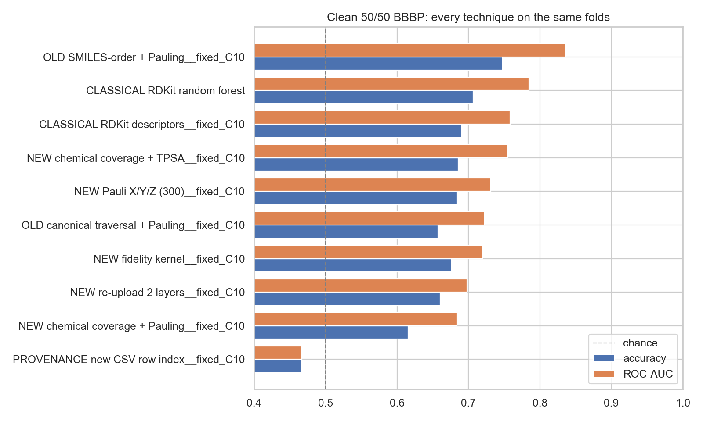
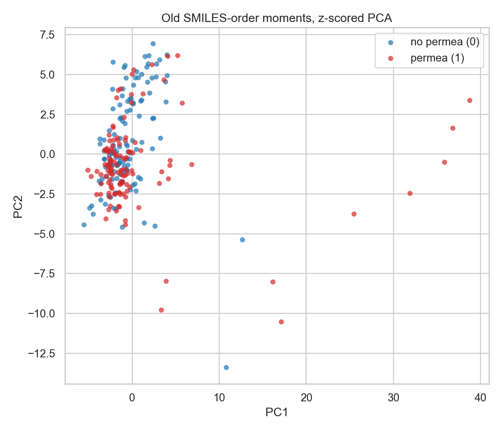
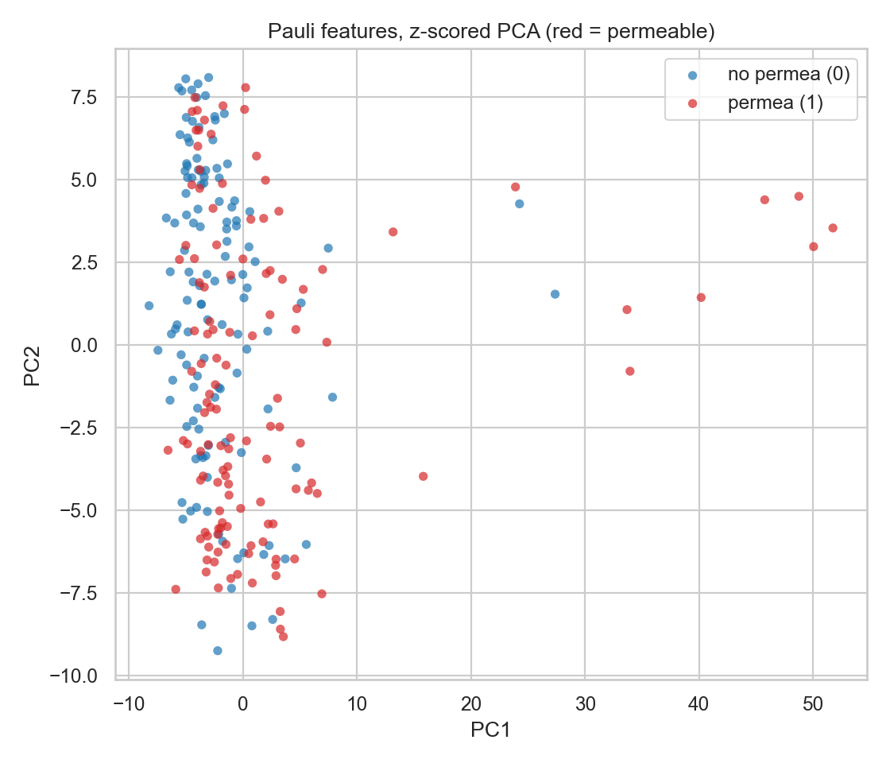
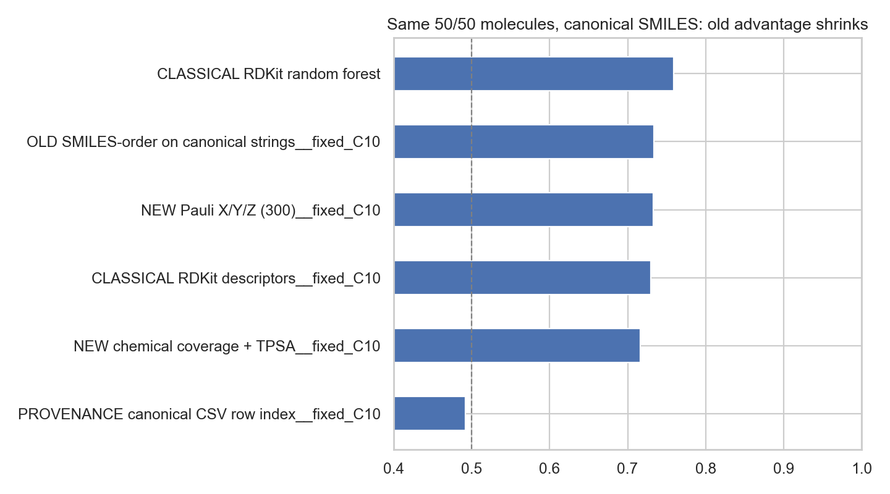

# Clean 50/50 BBBP benchmark

Generated by `python -m experiments.run_balanced_dataset_comparison`.

Two CSVs are written at the repository root:

| File | Contents |
|---|---|
| `BBBP_balanced_50_50.csv` | 125 permeable + 125 non-permeable, rows shuffled, **original `num` removed** |
| `BBBP_balanced_50_50_canonical.csv` | Same molecules, every SMILES rewritten in canonical form |

All results below use the same ten stratified folds, fixed C=10 and nested C.
Red = permeable (`p_np=1`), blue = non-permeable (`p_np=0`) in the figures.

## Dataset 1: balanced rows, original SMILES strings

| Technique | Acc, C=10 | AUC, C=10 | Acc, nested | AUC, nested |
|---|---:|---:|---:|---:|
| **OLD SMILES-order + Pauling** | **0.748** | **0.836** | **0.770** | **0.842** |
| OLD canonical traversal + Pauling | 0.657 | 0.723 | 0.646 | 0.717 |
| NEW chemical coverage + Pauling | 0.616 | 0.684 | 0.627 | 0.686 |
| NEW chemical coverage + TPSA | 0.686 | 0.754 | 0.689 | 0.778 |
| NEW Pauli X/Y/Z (300) | 0.684 | 0.731 | 0.700 | 0.749 |
| NEW re-upload 2 layers | 0.660 | 0.698 | 0.656 | 0.732 |
| NEW fidelity kernel | 0.676 | 0.719 | 0.684 | 0.747 |
| CLASSICAL RDKit descriptors (SVM) | 0.690 | 0.758 | 0.705 | 0.772 |
| CLASSICAL RDKit random forest | 0.706 | 0.785 | — | — |
| PROVENANCE new CSV row index | 0.467 | 0.466 | 0.462 | 0.464 |

The new row index is at chance, confirming that the original row-number leak is
gone. But the old SMILES-order arm still scores 0.836 because this dataset kept
the **source strings verbatim**. The two leaks are not independent: see
"One provenance, two measurements" below.

## Dataset 2: balanced rows and canonical SMILES

| Technique | Acc, C=10 | AUC, C=10 | Acc, nested | AUC, nested |
|---|---:|---:|---:|---:|
| OLD SMILES-order on canonical strings | 0.667 | 0.734 | 0.663 | 0.722 |
| NEW chemical coverage + TPSA | 0.657 | 0.716 | 0.697 | **0.772** |
| NEW Pauli X/Y/Z (300) | 0.687 | 0.733 | **0.700** | 0.749 |
| CLASSICAL RDKit descriptors (SVM) | 0.667 | 0.730 | 0.668 | 0.739 |
| CLASSICAL RDKit random forest | 0.695 | 0.759 | — | — |
| PROVENANCE canonical CSV row index | 0.489 | 0.492 | 0.487 | 0.491 |

Canonicalizing the strings removes the remaining serialization signal: the old
control drops from **0.836 to 0.734 AUC**, while the new chemistry-aware and
quantum-feature arms are unchanged (TPSA nested 0.772, Pauli 0.749, RF 0.759).
On a genuinely clean 50/50 dataset there is no old-technique advantage.

Note: canonicalization merges a few source-SMILES aliases of the same
structure, so the canonical CSV is read directly (125/125 rows) rather than
through the deduplication pipeline.

## One provenance, two measurements

A common misconception is that the row number and the writing style are two
separate leaks. They are the same leak seen from two angles. In the raw file
(`tables/smiles_row_provenance.csv`, generated by
`python -m experiments.run_smiles_causality_test`):

| Measurement | Value |
|---|---:|
| AUC of the row number for the label | 0.795 |
| Correlation(row number, lowercase notation) among aromatic molecules | −0.794 |
| First half of file: fraction lowercase / permeable | 89.7% / 53.0% |
| Second half of file: fraction lowercase / permeable | 3.9% / 100% |

The file was assembled in blocks from different sources: late rows are 100%
permeable and almost all written in Kekulé uppercase; early rows are mostly
non-permeable and written in aromatic lowercase. The row number is a proxy for
*which source block a molecule came from*; the writing style is another proxy
for the same thing. The SMILES-order model never sees the row number — it reads
the string — which is why removing `num` did not hurt it, while canonicalizing
the strings did.

The reason a string can matter at all: RDKit assigns atom indices in the order
atoms appear in the SMILES. `assign_qubits` canonicalizes and reparses for
every chemistry-aware strategy, so those are traversal-invariant; for
`SMILES_ORDER` it deliberately keeps the source string, so the first ten atoms
—and therefore the qubit rotations—depend on how the string was written.

## What exactly was wrong with the SMILES

`python -m experiments.run_smiles_style_audit` measures the writing style of
the source strings (results in `tables/smiles_style.csv` and
`figures/smiles_style.png`):

| Style flag | Non-permeable | Permeable | AUC |
|---|---:|---:|---:|
| Aromatic lowercase `c` | 83.2% | 24.0% | **0.796** |
| Kekulé `C1=CC` | 0.8% | 32.0% | **0.656** |
| Stereochemistry `@` | 40.8% | 20.8% | 0.600 |
| Starts with `[` | 6.4% | 17.6% | 0.556 |

The same aromatic ring was written in two different notations depending on the
source that curated the molecule: non-permeable molecules mostly use aromatic
lowercase (`c1ccccc1`), permeable ones often use Kekulé uppercase
(`C1=CC=CC=C1`). A classifier on raw string characters reaches **AUC 0.887** on
source strings but only **0.788** on canonical strings: about 0.10 of the score
is pure writing style. Canonicalization also changes the element at **22.3% of
the first ten atom positions** on average, which is why the old "first ten
atoms" encoding changes completely. This is provenance (different sources with
different conventions), not chemistry.

### Causal confirmation (not just correlation)

`python -m experiments.run_smiles_causality_test` runs three checks that rule
out "it is real structure, not writing style" (`figures/smiles_causality.png`,
`tables/smiles_*_contradiction.csv`, `smiles_cross_representation.csv`,
`smiles_random_traversal.csv`):

1. **Notation contradiction.** Restricting to molecules that RDKit *agrees*
   are aromatic (so chemistry is held fixed), 98.1% of non-permeable source
   strings use lowercase aromatic notation versus 28.6% of permeable ones.
   The same aromatic chemistry is written two different ways depending on the
   label — that is notation, not structure.
2. **Cross-representation transfer.** The SMILES-order model scores 0.746
   accuracy / 0.848 AUC when train and test use the same writing. Training on
   source strings and testing on canonical strings of the *same* molecules
   drops to 0.602 / 0.643; the reverse direction drops as well. If the model
   had learned chemistry, the score would transfer.
3. **Random traversals.** Rewriting each molecule into up to four different
   valid SMILES flips at least one prediction for 76.2% of molecules (40.9% of
   all variants) and drops accuracy to 0.560. Same molecule, same label,
   different prediction.

The three results together establish that the surviving advantage of the old
technique comes from how the strings were written, not from molecular
structure.

## Files

- `tables/balanced_summary.csv`, `balanced_per_split.csv` — dataset 1.
- `tables/balanced_canonical_summary.csv`, `balanced_canonical_per_split.csv` — dataset 2.
- `settings.json` — sample statistics and color convention.
- `figures/` — the three comparison charts and two PCA maps.
