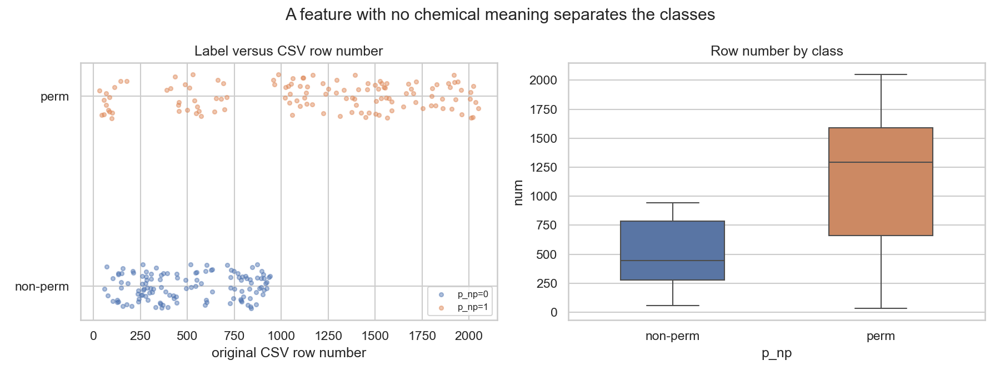
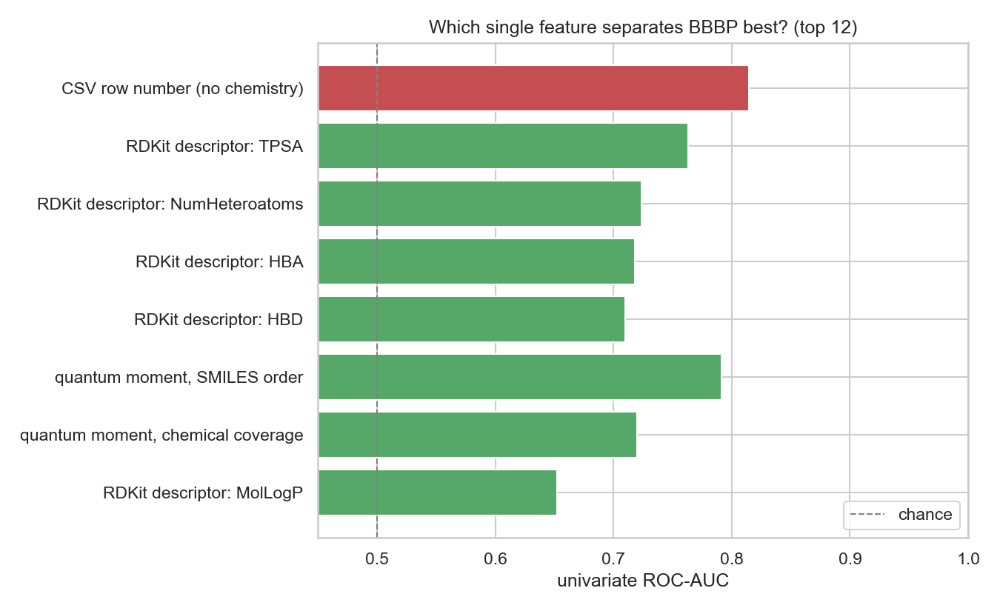
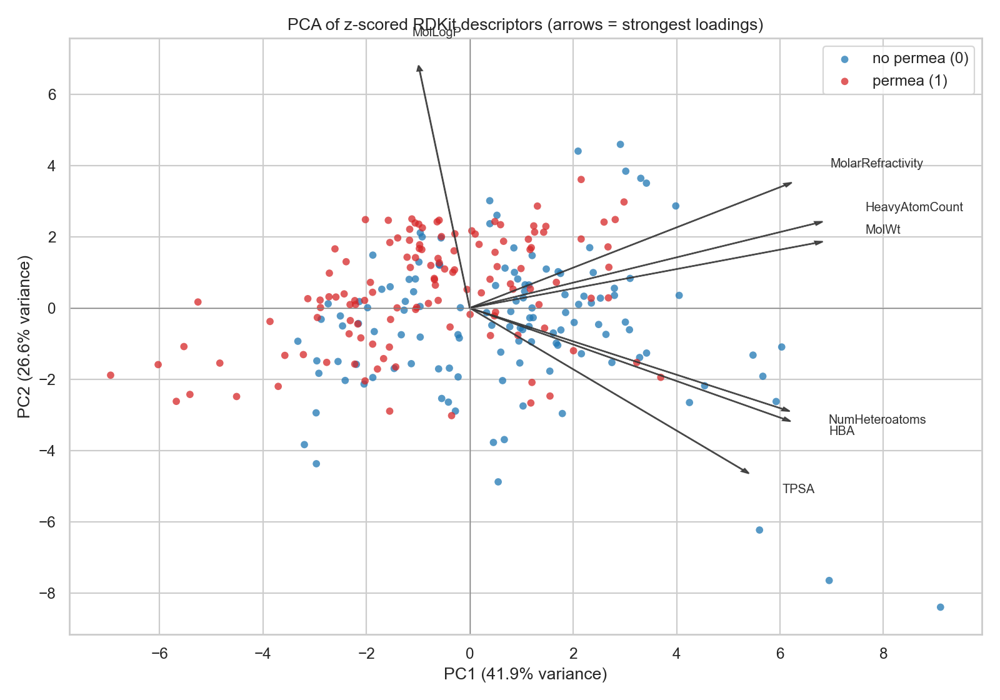
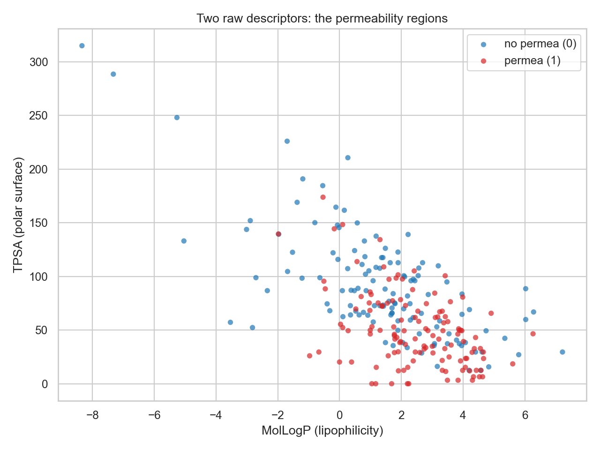
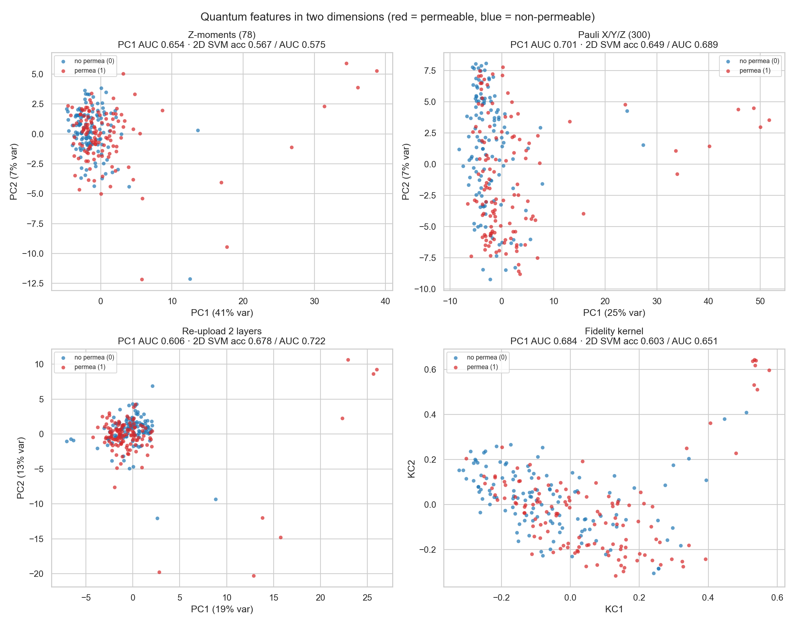

# BBBP feature audit

Self-contained audit of the 250 balanced BBBP molecules used throughout the
benchmark. Every table and figure here is regenerated by:

```bash
python -m experiments.run_bbbp_feature_audit
```

## Question

The historical "native order" control scores better than any chemistry-aware
selector or RDKit descriptor set. Is that because it reads chemistry better,
or because the source CSV carries non-chemical information?

## Contents

| Path | Contents |
|---|---|
| `tables/molecules_features.csv` | The 250 molecules: `num`, `name`, `p_np`, SMILES and 13 RDKit descriptors |
| `tables/feature_auc.csv` | Univariate ROC-AUC of every candidate feature |
| `tables/model_comparison.csv` | Fixed-C SVM scores per feature on the same ten folds |
| `tables/descriptors_by_class.csv` | Mean and standard deviation of each descriptor by class |
| `figures/row_number_leakage.png` | Label versus original CSV row number |
| `figures/feature_auc_ranking.png` | Top single features by AUC |
| `figures/model_comparison.png` | Accuracy and AUC per feature family |
| `figures/rdkit_confusion_matrix.png` | Random forest on RDKit descriptors, one held-out fold |
| `figures/pca_2d_map.png` | PC1 vs PC2 after z-scoring, red = permeable, blue = non-permeable, arrows = strongest loadings |
| `figures/two_feature_map.png` | The same colors on raw MolLogP vs TPSA |
| `tables/pca_coordinates.csv` | PC1/PC2 coordinate of every molecule |
| `tables/pca_loadings.csv` | Loading of each descriptor on the first two PCs |

## Result



The original CSV row number (`num`) has **AUC 0.814** on these 250 molecules
and 0.914 in the full ten-fold classifier comparison — higher than the 78
quantum moments from SMILES order (0.815) and far higher than the 13 RDKit
descriptors (0.738) or the chemistry-aware quantum map (0.697). The same
molecules shuffled sit at chance (AUC 0.46).



`num` has no chemical meaning: the BBBP file is ordered, so permeable
molecules cluster toward higher row numbers. The SMILES-order quantum arm
partly inherits that provenance signal because the strings and the file order
come from the same curation process. A model with access to the source file
order is therefore not learning BBBP chemistry, and its higher score must not
be presented as a predictive advantage.



## 2D coordinate map (z-score then PCA)

Every descriptor was standardized to z-score (mean 0, SD 1 over the 250
molecules) before PCA, so no column dominates only because of its units. PC1
explains 41.9% of the variance and PC2 26.6%; PC1 alone separates the classes
with AUC 0.680. Red dots are permeable (`p_np=1`), blue dots non-permeable
(`p_np=0`), as in the source CSV.

The arrows are the strongest loadings: **TPSA, HBA and NumHeteroatoms** point
toward the non-permeable region (high polarity), while **MolWt,
HeavyAtomCount and MolarRefractivity** point the opposite way (size). The map
therefore shows the same chemistry as the AUC table: polarity and hydrogen
bonding separate the classes better than size or lipophilicity.



The raw two-axis view (MolLogP vs TPSA) makes it concrete: red molecules
cluster at TPSA below ~100 Ų and moderate-to-high logP; blue ones populate
the high-TPSA region. A linear boundary on these two axes already captures
most of the separation, which is why a simple classifier on a handful of
descriptors approaches the quantum readouts.

## Quantum features in two dimensions

`python -m experiments.run_quantum_pca_audit` applies the same red/blue
treatment to the quantum representations. Each feature matrix is z-scored
before PCA (the fidelity kernel is already a normalized Gram matrix, so it
uses kernel PCA instead). See
[`docs/QUANTUM_FEATURES.md`](../../docs/QUANTUM_FEATURES.md) for how these
features are extracted.



Individual versions: `figures/quantum_pca_z_moments__78.png`,
`quantum_pca_pauli_x_y_z__300.png`, `quantum_pca_re_upload_2_layers.png` and
`quantum_pca_fidelity_kernel.png`. In all of them red = permeable (`p_np=1`)
and blue = non-permeable (`p_np=0`).

| Representation | PC1 variance | PC1 AUC | SVM on 2 dims: acc / AUC |
|---|---:|---:|---:|
| Z moments (78) | 41% | 0.654 | 0.567 / 0.575 |
| Pauli X/Y/Z (300) | 25% | **0.701** | 0.649 / 0.689 |
| Re-upload 2 layers | 19% | 0.606 | **0.678 / 0.722** |
| Fidelity kernel | — | 0.684 | 0.603 / 0.651 |

Two dimensions are not enough for the 78 Z moments (2D AUC 0.575, versus 0.697
with all components): the separating information is spread over many
components. The phase-sensitive Pauli features give the best single-component
separation, and re-uploading gives the best 2D classifier. Neither produces a
clean visual split — the classes overlap in every projection — which is why
the row-number leak looks so much stronger: it is not a genuine chemical
boundary. Per-molecule coordinates are in `tables/quantum_pca_*.csv`.

The best defensible chemistry-only model here is the random forest on the 13
RDKit descriptors (mean AUC 0.742 with nested C). For a real performance
claim, validate with scaffold-held-out folds as well.
