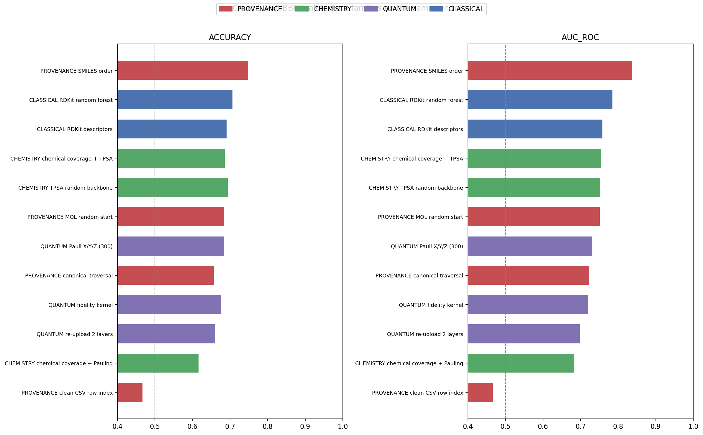

# Master BBBP comparison on the clean 50/50 dataset

The full methods section — what each model sees, the three circuit stages and
the evaluation protocol — is in
[`docs/METHODOLOGY.md`](../../docs/METHODOLOGY.md). Metric definitions and
formulas are in [`docs/METRICS_AND_MODELS.md`](../../docs/METRICS_AND_MODELS.md).

Generated by `python -m experiments.run_final_comparison`. All arms use the
same 250 balanced molecules (125/125, `BBBP_balanced_50_50.csv`), the same ten
stratified folds, fixed C=10 and leak-safe nested C. Random-start arms average
five seeds (per-seed scores in `tables/random_seed_scores.csv`).

## Full results

| Family / arm | Acc, C=10 | AUC, C=10 | Acc, nested | AUC, nested |
|---|---:|---:|---:|---:|
| PROVENANCE clean CSV row index | 0.467 | 0.466 | 0.462 | 0.464 |
| PROVENANCE SMILES order (source) | 0.748 | **0.836** | 0.770 | **0.842** |
| PROVENANCE canonical traversal | 0.657 | 0.723 | 0.646 | 0.717 |
| PROVENANCE MOL random start (5 seeds) | 0.683 | 0.751 | — | — |
| CHEMISTRY chemical coverage + Pauling | 0.616 | 0.684 | 0.627 | 0.686 |
| CHEMISTRY chemical coverage + TPSA | 0.686 | 0.754 | 0.689 | **0.778** |
| CHEMISTRY TPSA, random backbone (5 seeds) | 0.694 | 0.752 | — | — |
| QUANTUM Pauli X/Y/Z (300) | 0.684 | 0.731 | 0.700 | 0.749 |
| QUANTUM re-upload 2 layers | 0.660 | 0.698 | 0.656 | 0.732 |
| QUANTUM fidelity kernel | 0.676 | 0.719 | 0.684 | 0.747 |
| CLASSICAL RDKit descriptors (SVM) | 0.690 | 0.758 | 0.705 | 0.772 |
| CLASSICAL RDKit random forest | 0.706 | 0.785 | — | — |

Bold marks the maximum in each column.

## What the comparison says

1. **The primitive arm is fragile.** Its 0.836 AUC comes from the atom that
   RDKit numbers 0. Starting at a random MOL atom (keeping the same molecules)
   drops it to 0.751; using canonical traversal gives 0.723. The clean CSV row
   index sits at chance (0.466), so the remaining signal is in the atom order,
   not in the file.

2. **The chemical arm is robust.** Randomly rotating the chemical-coverage
   backbone hardly changes it: 0.754 → 0.752 AUC. The selector derives the
   backbone from the molecular graph, so the atom numbering carries no
   provenance signal. It also scores 0/248 flips under SMILES rewriting.

3. **On clean data the old technique does not win.** The best scores are the
   classical random forest (0.785 AUC) and chemical-coverage + TPSA with nested
   C (0.778). The phase-sensitive Pauli readout (0.749) is the best quantum
   processing arm. The old SMILES-order arm only stays highest if the source
   strings and their atom ordering are kept.

4. **No quantum advantage is demonstrated.** All quantum arms are below the
   classical random forest; the quantum part changes the representation, not
   the information available. The value of the chemical selector is
   invariance, not a higher score on a contaminated split.

## Files

- `tables/master_summary.csv` — the table above with F1 and standard deviations.
- `tables/master_per_split.csv` — all ten folds of every arm.
- `tables/random_seed_scores.csv` — the five random-start seeds per family.
- `figures/master_comparison.png` — accuracy and AUC, colored by family.
- `settings.json` — sample statistics and family definitions.
