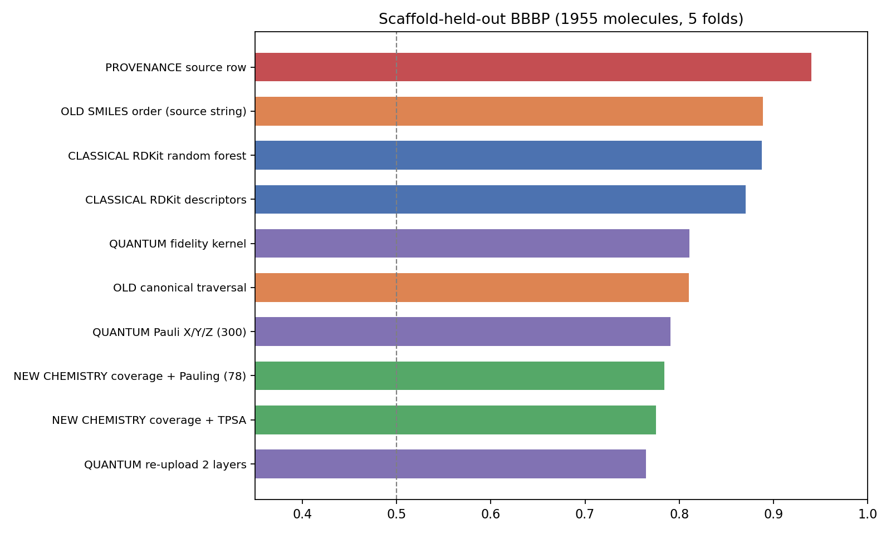

# Scaffold-held-out benchmark on the full cleaned BBBP dataset

Generated by `python -m experiments.run_full_dataset_scaffold`.

Uses all **1955** structures from `data/BBBP_clean_full.csv`, 1016 Bemis-Murcko
scaffold groups (acyclic molecules share one group) and five
`StratifiedGroupKFold` folds. No scaffold appears in both training and test.
Values are mean ± sample SD over the five folds.

## Results

| Family / arm | Acc, C=10 | AUC, C=10 | Acc, nested | AUC, nested |
|---|---:|---:|---:|---:|
| PROVENANCE source row | 0.858 | **0.940** | 0.881 | **0.951** |
| OLD SMILES order (source string) | 0.864 | 0.889 | 0.871 | 0.895 |
| OLD canonical traversal | 0.830 | 0.810 | 0.829 | 0.815 |
| NEW chem coverage + Pauling (78) | 0.803 | 0.784 | 0.804 | 0.795 |
| NEW chem coverage + TPSA | 0.797 | 0.775 | 0.788 | 0.808 |
| QUANTUM Pauli X/Y/Z (300) | 0.813 | 0.791 | 0.832 | 0.809 |
| QUANTUM fidelity kernel | 0.815 | 0.811 | 0.835 | 0.820 |
| QUANTUM re-upload 2 layers | 0.792 | 0.765 | 0.806 | 0.791 |
| CLASSICAL RDKit descriptors (SVM) | 0.865 | **0.870** | 0.865 | 0.870 |
| CLASSICAL RDKit random forest | 0.863 | 0.887 | — | — |

Bold marks the maximum in each column.

## Reading

1. **The row-number leak survives the cleaning.** The `source_row` column
   still reaches AUC 0.940 / 0.951 because the cleaned CSV keeps the original
   file order (first occurrence of each structure). Scaffold grouping does not
   remove it: whole provenance blocks map to folds. **Any model must drop
   `source_row` and use shuffled rows**; this column is kept only for tracing
   molecules back to the raw file.
2. **The old arm is still between the leak and clean chemistry.** Source-order
   SMILES gives 0.889 AUC, canonical traversal gives 0.810. As in the 250-
   molecule audits, the difference is the writing style of the source strings.
3. **On a hard split the representations converge.** Chemistry arms sit at
   0.775–0.820 AUC, and the best classical descriptor model is 0.870. The
   quantum Pauli and kernel readouts are close to the chemical baseline; the
   re-uploading arm remains the weakest.
4. **No quantum advantage.** Every quantum arm is below the classical SVM on
   RDKit descriptors; the quantum module changes the representation, not the
   information available.

## Caveat on nested C

The inner 3-fold CV used to tune `C` is stratified but **not** group-aware, so
two scaffolds from the same outer training fold can appear in different inner
folds. The outer test fold is still completely disjoint by scaffold, so the
reported estimate is not contaminated; only the choice of `C` can be slightly
optimistic. A fully group-aware inner CV would be a straightforward refinement.

## Files

- `tables/full_scaffold_summary.csv`, `full_scaffold_per_split.csv`.
- `tables/full_scaffold_folds.csv` — train/test sizes and scaffold counts.
- `figures/full_scaffold_comparison.png`.
- `settings.json` — dataset, fold protocol and the inner-C caveat.
