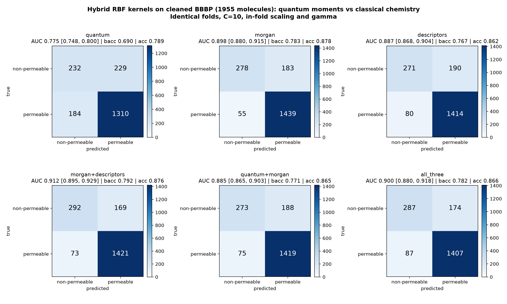

# ideas/ — optional experiments, not part of the main result

This folder keeps one exploratory experiment separate from the main pipeline.
The headline result of the project is still in `analysis_features/`:

- the cleaned 1955-molecule BBBP table;
- `three-arms`: three atom-selection rules with **Pauling electronegativity**
  angles (`θ = 0.1·χ²`);
- `embedding-comparison`: the same three rules again, but with the **RDKit
  importance scores** that were used to build the communities as the angle
  (`θ = 0.1·s²`, s = equal-weight mean of nine normalised per-atom descriptors).

Nothing here is needed to reproduce those numbers. Run this experiment with:

```bash
python -m ideas.hybrid_kernel
```

It writes its own outputs to `ideas/results/`.

## The idea, in plain language

The 78 numbers produced by the quantum circuit (the Pauli moments) are fed to
an SVM with an RBF kernel. An RBF kernel is simply a **similarity score**
between two molecules: close feature vectors get a score near 1, distant ones
near 0. The SVM decides the label from those similarities.

The question tested here was: *what if we add classical chemical similarities
to the quantum ones instead of comparing them?* Three sets of features were
turned into three similarity matrices, and the matrices were added together
with fixed weights (no weight was chosen because it looked good on the test
set). Exactly the same 1955 molecules, 1016 scaffold groups, five folds and
`C = 10` were used, with scaling and kernel width fitted inside each fold.

### What the three feature sets are

1. **Quantum (78 numbers).** The output of the 10+2 circuit described in the
   main README: 12 single-qubit and 66 two-qubit Pauli moments.
2. **Morgan fingerprint (256 bits).** In plain language, a *barcode of local
   fragments*. RDKit looks at every atom, records the small neighbourhood
   around it up to two bonds away (radius 2, "ECFP4"), and sets one of 256
   bits when that neighbourhood is present. It is a standard cheminformatics
   way to describe a molecule; it is **not** quantum and it does not use the
   circuit. Two molecules with the same bits share the same fragments.
3. **Whole-molecule atom composition (22 numbers).** Just a *counting table*
   of the whole molecule: how many B, Br, C, Cl, F, I, N, O, P and S atoms it
   has, plus twelve ordinary whole-molecule properties (molecular weight,
   logP, TPSA, H-bond donors/acceptors, rotatable bonds, aromatic rings,
   fraction Csp3, heavy atoms, rings, heteroatoms and amide bonds). It has
   **no connectivity information**: it does not know which atom is bonded to
   which. In the earlier benchmark a simpler 14-number version of this idea
   (element counts + heavy atoms + bonds + charge) reached AUC 0.8133, which
   is why it is a serious baseline rather than a toy.

## Result

| Arm | Kernel weights (quantum/Morgan/composition) | AUC [95 % CI] | Balanced accuracy |
|---|---|---:|---:|
| quantum only | 1/0/0 | 0.775 [0.748, 0.800] | 0.690 |
| Morgan only | 0/1/0 | 0.898 [0.880, 0.915] | 0.783 |
| composition only | 0/0/1 | 0.887 [0.868, 0.904] | 0.767 |
| **Morgan + composition** | **0/1/1** | **0.912 [0.895, 0.929]** | **0.792** |
| quantum + Morgan | 1/1/0 | 0.885 [0.865, 0.903] | 0.771 |
| all three | 1/1/1 | 0.900 [0.880, 0.918] | 0.782 |



Full counts and configuration: `ideas/results/kernel_comparison.csv` and
`.json`.

**Reading (including the bad news).** Morgan + composition has the best point
estimate (+0.014 AUC over Morgan alone), but the confidence intervals overlap,
so this is **not** a statistically established improvement. Adding the quantum
kernel *lowers* AUC: 0.885 with quantum + Morgan and 0.900 with all three,
both below the purely classical combination. In other words, on this dataset
the 78 Pauli moments do not add information beyond ordinary chemically
computed descriptors. A 2:1 weighting in favour of Morgan gave 0.913 during
exploration, but we deliberately did **not** adopt it — choosing the weight by
test AUC would be tuning on the evaluation data.

The intervals use the repository's existing i.i.d. bootstrap, which ignores
scaffold clustering and is therefore optimistic (see `docs/CODE_REVIEW.md`,
issue 6). Treat this folder as a recorded idea and a negative result, not as a
new headline claim.
