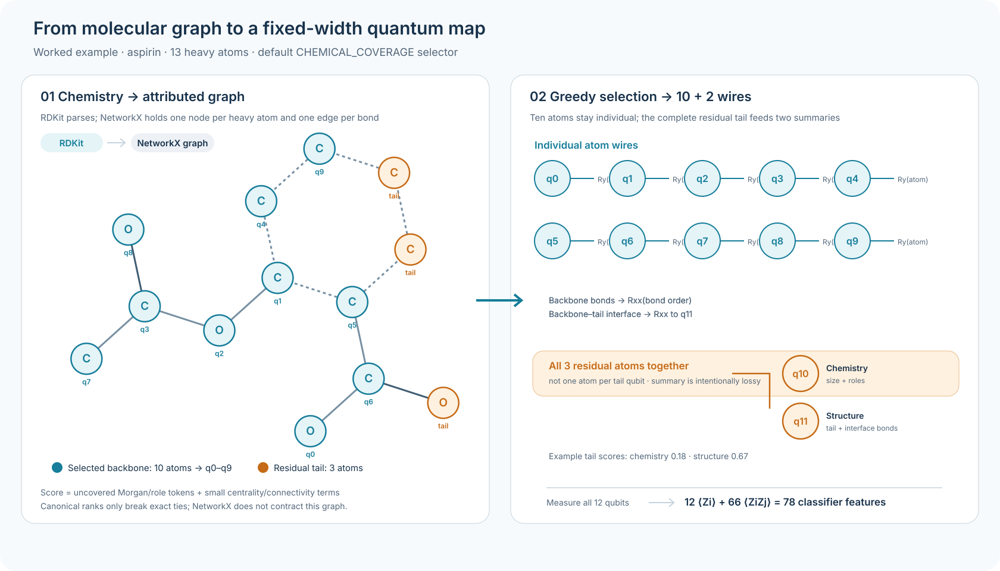
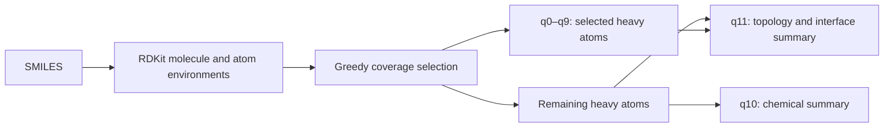

# molecular_encoding
### Chemically Grounded Quantum Feature Mapping for Molecular Classification

A self-contained Python module designed for the **QAMP 2027** follow-up study to evaluate exponential expressivity and representation bias in the 10+2 Quantum Feature Map on NISQ hardware.

## Package map

The package is organized by responsibility; experiment outputs are kept out of
the Python source directories:

```text
molecular_encoding/
├── chemistry/   # RDKit preprocessing, atom selection, properties, tail summaries
├── graph/       # molecular graph operations and optional graph pooling
├── quantum/     # circuit construction, feature uploads, measurement readout
├── analysis/    # collision/capacity diagnostics, PCA, plotting
├── results/     # versioned CSV metrics and JSON run settings
└── tests/       # unit and invariance tests
```

The stable convenience API is exported from `molecular_encoding`; for focused
work, import from the relevant subpackage, e.g.
`molecular_encoding.chemistry.atom_selection` or
`molecular_encoding.quantum.readout`. Run tests from the repository root with
`python -m pytest molecular_encoding/tests -q`. Benchmark entry points live in
`experiments/` and are invoked as `python -m experiments.run_<name>`; outputs default to
`molecular_encoding/results/`.

---

## 1. Core Mathematical and Chemical Concepts

### 1.1 Chemistry-aware 10-atom backbone selection

The default strategy is `Strategy.CHEMICAL_COVERAGE`, implemented in
`chemistry/backbone_selection.py`. It combines RDKit Morgan atom environments at radii
0, 1, and 2 (including stereochemistry and bond types); donor/acceptor feature roles; formal charge; aromaticity; ring
membership; graph centrality; and connectivity. A deterministic greedy
marginal-coverage procedure selects at most ten heavy atoms. Canonical ranks
only resolve exact score ties; they are not interpreted as atom importance.

The weights are fixed, transparent, and not fitted to BBBP labels. This makes
the default task-agnostic, but does not establish that it is chemically optimal
for every endpoint. Task-specific weights must be evaluated on held-out splits.
For symmetry-equivalent atoms, a unique chemical identity may not exist;
canonical tie-breaking supplies a reproducible representative.

#### Methodological description

Let a sanitized molecule be a heavy-atom graph $G=(V,E)$, with $|V|=N$.
For every atom $i$, define a token set $T_i$ consisting of (i) its radius-0,
radius-1, and radius-2 Morgan environments, with bond types and stereochemistry,
and (ii) the chemical-role indicators charge, hydrogen-bond donor, acceptor,
heteroatom, aromatic atom, and ring atom. The implementation uses RDKit's
standard chemical feature definitions for donor/acceptor perception. Morgan
environments are sparse identifiers associated with their central atom, so
distinct local environments are not merged by a fixed-length fingerprint.

The selector grows a set $S$ greedily, starting from $S_0=\varnothing$. At
iteration $t$, the marginal score for an unselected atom is

$$
J(i\mid S_t)=\sum_{u\in T_i\setminus C(S_t)} w(u)
              +0.15\,\widetilde C_i
              +0.20\,\frac{|N(i)\cap S_t|}{\max(1,\deg(i))},
$$

where $C(S_t)=\bigcup_{j\in S_t}T_j$ is the set of already covered tokens,
$\widetilde C_i$ is normalized graph centrality, and $N(i)$ is the heavy-atom
neighborhood. The standalone selector falls back to degree centrality when no
values are supplied; the public `assign_qubits` path supplies NetworkX
betweenness centrality.
For a Morgan token occurring $f(u)$ times in the molecule,
$w(u)=f(u)^{-1/2}$, which reduces the marginal value of repeated environments.
Role-token weights are fixed as follows: formal charge 3.0, donor 2.5,
acceptor 2.0, heteroatom 1.25, aromaticity 0.75, and ring membership 0.50.
At each step the atom maximizing $J$ is added and its tokens become covered;
the procedure stops after $\min(10,N)$ atoms. Exact score ties are broken by
RDKit canonical atom rank. Ranks therefore make the selection reproducible,
but do not enter the chemical score. See the [RDKit Morgan fingerprint
documentation](https://www.rdkit.org/docs/GettingStartedInPython.html#morgan-fingerprints)
for the underlying circular-environment construction.

This is a deterministic, label-free heuristic—not an optimality guarantee or
a claim that the selected atoms are universally the most predictive. The
coverage term rewards chemical diversity, while the small graph terms retain
central and connected context. It is permutation-independent after canonical
SMILES reparsing, except for the unavoidable representative choice among
symmetry-equivalent atoms. The ten-atom limit is an architectural bottleneck:
all remaining heavy atoms are compressed into two scalar tail channels and
some atom-level detail is lost. Consequently, selection quality must be
evaluated together with classification and information-retention diagnostics.

#### Visual abstract: what happens when a molecule exceeds ten heavy atoms?

The two tail qubits are **not** five atoms each and they do not represent ten
extra atoms individually. The selector chooses up to ten atoms from the full
graph, one at a time, by the marginal score above. For 20 heavy atoms, the
other ten form one residual tail set: q10 summarizes its chemistry and q11
summarizes its internal connectivity/interface with the selected backbone.
Tail-to-backbone bonds are connected to q11; tail-to-tail bonds are summarized
in the structural score, not emitted as individual gates.



The figure is generated from the actual implementation and canonical aspirin
SMILES by `python docs/generate_encoding_visual.py`. It intentionally shows
NetworkX as the attributed-graph/centrality layer, not as a graph-contraction
algorithm: the three orange nodes remain a residual tail and are summarized
lossily by chemistry and topology/interface channels.

For molecules with at most ten heavy atoms, every heavy atom gets a backbone
qubit and the unused backbone wires remain idle; there is no residual tail if
all atoms fit. For more than ten, all residual heavy atoms contribute to both
global summary calculations, but the summary is lossy: exact tail atom
identities, which tail atom carries which role, and individual tail-tail bond
orders are not retained. The selector ranks atoms for coverage; it is not a
graph coarsening or a guarantee that a medicinal-chemistry “pharmacophore
core” is always preserved.

#### RDKit, NetworkX, and what “reduction” means here

`assign_qubits` parses the input with RDKit. For every strategy except the
intentional `SMILES_ORDER` control, it converts the molecule to canonical
SMILES and reparses it before atom assignment; equivalent traversals therefore
start from the same atom ordering. RDKit supplies molecular sanitization,
elements, charges, bond orders, stereochemistry, aromaticity/rings, Morgan
environments and donor/acceptor roles. The separate `preprocess_smiles`
function can also strip salts/counterions, optionally apply the repository's
simple N/O-neutralization rules, filter by molecular weight/heavy-atom count,
and canonicalize. It is not the selector itself; its neutralization is
approximate and can erase ionization states, so use `neutralize=False` when
those states must be retained.

The public assignment path builds a NetworkX graph of heavy atoms and bonds
and calculates unweighted betweenness centrality, used as the small centrality
term in the selector. **NetworkX does not simplify or contract the molecule**
in the default path. Here, “10+2” means ten selected atoms remain individually
represented on `q0–q9`; the other heavy atoms are summarized by two global
tail channels on `q10–q11`, and tail-to-tail bonds are not individually
encoded. This is a fixed-width, lossy feature representation—not a chemically
exact reduced molecule.

The optional `GRAPH_POOLED` map is the path that actually coarsens the graph.
It contracts only adjacent low-salience atoms into at most ten connected
clusters, builds a quotient graph, and aggregates atom/bond descriptors per
cluster/edge. This is implemented directly on RDKit's molecular graph, not
with NetworkX. The same operation could use NetworkX, but it must merge only
bonded clusters, preserve edge types, protect important roles where possible,
and preprocess disconnected salts rather than inventing edges between them.
This pooled prototype remains experimental and has not improved BBBP so far.
For a bond joining endpoint atoms $i$ and $j$, its contraction cost is:

```text
c_ij = 8(s_i + s_j)
       - 1[both endpoints are carbon]
       - 0.75[aromaticity_i == aromaticity_j]
       - 0.50[ring_i == ring_j]
       - 0.50[bond is aromatic or conjugated]
```

Here $s_i$ counts charged, donor, acceptor, heteroatom, and stereogenic flags;
lower-cost bonds are contracted first, with canonical ranks resolving ties.
This is a fixed heuristic: it delays merging salient atoms but cannot
guarantee that every donor/acceptor remains a singleton at a strict
ten-cluster limit.

The implemented contraction is deterministic: begin with one cluster per
heavy atom; repeatedly enumerate bonds joining different clusters; assign
each candidate a cost that penalizes charged, donor, acceptor, heteroatom and
stereogenic endpoints, while preferring compatible carbon, aromatic, ring,
and conjugated environments; merge the lowest-cost adjacent pair; break ties
with canonical ranks; stop at ten clusters. Since only adjacent clusters are
merged, every cluster remains connected. A NetworkX version would preserve
the same node/bond attributes and use the same contraction invariant; it is
not required for this implementation. Molecules with more than ten
disconnected heavy-atom components are rejected by the pooling function
rather than joined artificially. The quotient graph stores aggregated bond
order, aromatic/conjugated/ring/stereo character and edge counts; the two
remaining qubits carry whole-molecule context.

#### Controlled comparison against source-SMILES order

To isolate the effect of atom assignment, `experiments/run_selection_comparison.py`
compares `SMILES_ORDER` (the ten atoms encountered first in the input SMILES)
and `CHEMICAL_COVERAGE` on the same 250 balanced BBBP molecules, canonical
structure deduplication, ten stratified 75/25 splits, SVC with an RBF kernel
($C=10$), standardization fitted within each training split, and the same
global two-channel tail encoding. The quantum feature map is exactly evolved
as a 12-qubit statevector and the classifier uses the default 78-dimensional
`z_zz` readout. This controlled ablation changes only the backbone-selection
strategy; it does not reproduce the older tail encoding or hardware noise.

| Backbone selection | Accuracy | F1 | ROC-AUC |
|---|---:|---:|---:|
| Source-SMILES order | 0.732 ± 0.055 | 0.725 ± 0.054 | 0.815 ± 0.044 |
| Chemical coverage | 0.632 ± 0.037 | 0.632 ± 0.048 | 0.697 ± 0.043 |
| Paired difference (coverage − SMILES) | −0.100 ± 0.068 | −0.093 ± 0.075 | −0.118 ± 0.049 |

Values are mean ± sample standard deviation across the ten repeated splits;
chemical coverage won on 0/10 accuracy folds, 1/10 F1 folds and 0/10 AUC
folds. These results do **not**
support the claim that this selector improves BBBP prediction in the current
pipeline. They motivate further ablations (including the fixed weights, tail
features, and representation/readout), not a post-hoc change of weights based
on the reported test splits. The balanced 250-molecule subset is a small
benchmark sample, and repeated shuffle-splits are correlated; these summary
statistics are descriptive rather than a formal significance test. Exact
per-split results and settings are saved in
`results/selection_vs_smiles_per_split.csv`,
`results/selection_vs_smiles_summary.csv`, and
`results/selection_vs_smiles_settings.json`. Reproduce from the repository root with
`python -m experiments.run_selection_comparison`.

The comparison uses NumPy exact statevector evolution of the circuit's $Ry$
and $Rxx$ gates because Qiskit could not be imported in the execution
environment. It follows their Qiskit matrix conventions, but a direct
cross-check against Qiskit's `Statevector` should be run when a working Qiskit
installation is available.

This is a random stratified split comparison, not a scaffold-held-out test.
It initially shows the traversal-ordered control ahead on this split protocol;
the scaffold-grouped validation later in the README tests generalization to
new frameworks and reaches a different conclusion.

```python
from molecular_encoding import encode_molecule
from molecular_encoding.chemistry.atom_selection import Strategy, assign_qubits, describe_assignment

assignment = assign_qubits("CC(=O)Nc1ccccc1", strategy=Strategy.CHEMICAL_COVERAGE)
print(describe_assignment(assignment))  # Includes per-qubit selection rationale.
for qubit, atom_idx in enumerate(assignment.backbone_indices):
    atom = assignment.mol.GetAtomWithIdx(atom_idx)
    reasons = assignment.selection_metadata["selection_reasons"].get(atom_idx, ())
    print(qubit, atom_idx, atom.GetSymbol(), reasons)
print("tail atom indices:", assignment.tail_indices)
qc, metadata = encode_molecule("CC(=O)Nc1ccccc1")
```

`CANONICAL_RANK`, `PHARMACOPHORE_FIRST`, `SCAFFOLD_CENTRALITY`, `SMILES_ORDER`,
and `RANDOM` remain available as baselines and controls. Selection is performed
on heavy atoms; implicit or explicit hydrogens are represented through RDKit's
features of their bonded heavy atoms.

Two further strategies are used by the connected-core ablation below.
`CANONICAL_TRAVERSAL` selects the first ten heavy atoms of RDKit's canonical
SMILES output: it is invariant to the input string but keeps the "first ten"
rule, unlike the source-file `SMILES_ORDER` control. `CONNECTED_CORE` starts at
the heavy atom of highest supplied betweenness centrality and, at each step,
picks the best-scoring atom among the heavy-atom *neighbors* of the already
selected set, using the same coverage score as `select_backbone_atoms`. If the
frontier is empty because the molecule is fragmented, a new component is
seeded the same way. Qubit order is growth order rather than input order. The
result is a backbone that is connected within a molecular component (99.6% of
this benchmark sample); a multi-fragment input can still end up with a
disconnected backbone if the ten-atom budget spans more than one component.
`backbone_is_connected` exposes the check used in the diagnostics.



### 1.2 Two general tail channels

All unselected heavy atoms form a single tail set; atoms are no longer
alternated between two arbitrary groups in the recommended `global` mode.
`q10` receives a bounded chemical/composition summary combining tail size and
the fractions of heteroatoms, charged atoms, donors, and acceptors. `q11`
receives a bounded topology summary combining internal tail bonds and bonds
crossing the backbone–tail boundary. Backbone–tail Rxx gates connect to `q11`.
Individual tail–tail bonds are summarized instead of encoded one by one, so
this remains a deliberately lossy representation for large tails.

The `sum`, `stats`, and `pharm` modes remain available for baseline comparison.

---

### 1.3 Bemis-Murcko Molecular Scaffold & Betweenness Centrality (Baseline Controls)

#### Bemis-Murcko Scaffold:
Decomposes drug molecules into cyclic ring systems, linkers, and side chains (**Bemis & Murcko, J. Med. Chem. 1996**). Available as `Strategy.SCAFFOLD_CENTRALITY`. While chemically intuitive, it discards polar substituents on acyclic chains and suffers from carbon-angle degeneracy in unsubstituted rings.

#### Betweenness Centrality:
Quantifies the fraction of topological shortest paths passing through atom $v$:
$$C_B(v) = \sum_{s \neq v \neq t \in V} \frac{\sigma_{st}(v)}{\sigma_{st}}$$
Used to identify bridgehead atoms connecting molecular subgraphs.

---

### 1.4 Readout: Computational Basis Probabilities vs. Pauli Expectations

The circuit still measures all 12 qubits in the computational ($Z$) basis. A
single shot returns one 12-bit string, not all 4096 outcomes. The updated
modular classification runners use the **78-dimensional $Z_i+Z_iZ_j$
readout as their default model input**; the 4096-bin distribution remains
available for historical and diagnostic comparisons. Both representations
are post-processing of the same measured strings. The Pauli readout compresses
them into moments:

$$\langle Z_i\rangle=\sum_{b\in\{0,1\}^{12}}p(b)(-1)^{b_i},\qquad
\langle Z_iZ_j\rangle=\sum_{b\in\{0,1\}^{12}}p(b)(-1)^{b_i\oplus b_j}.$$

There are 12 single-qubit moments and $\binom{12}{2}=66$ unordered pair
correlators. They are **estimated jointly from the same computational-basis
shots**—no additional measurement basis settings are needed. The default
therefore reduces the model input from up to 4096 bins to 78 moments. Ablations
can use 12 (`z` only), 66 (`zz` only), or 4096 (`full`) features. This changes
the SVM representation, not the quantum circuit or measurement basis.

The implementation is isolated in `quantum/readout.py`:

```python
from molecular_encoding.quantum.readout import features_from_counts

# `counts` is the result.get_counts() mapping from a 12-qubit measure_all run.
X = features_from_counts(counts, readout="z_zz")  # shape (1, 78)
```

For exact simulators, use `features_from_probabilities(p, readout="z_zz")`.
The project evaluation helper `statevector_features(...)` applies this
readout to simulated states. `statevector_probabilities(...)` remains the
explicit 4096-bin diagnostic API.

Paired experiment on the balanced 250-molecule BBBP sample, ten stratified
75/25 splits, chemical-coverage selector, exact NumPy statevector, and
`StandardScaler + RBF-SVC`; the nested column tunes $C$ only inside each outer
training fold. **These current modular-runner scores use the default 78-feature
$Z_i+Z_iZ_j$ readout.** The prior full-distribution and individual-moment
ablation scores below are retained as historical readout experiments, not as
the current default benchmark:

| Backbone property / readout | Features | Accuracy | F1 | ROC-AUC |
|---|---:|---:|---:|---:|
| Pauling / full probabilities | 4096 | 0.673 ± 0.064 | 0.654 ± 0.055 | 0.733 ± 0.060 |
| Pauling / $Z_i$ | 12 | **0.698 ± 0.044** | **0.702 ± 0.045** | 0.755 ± 0.057 |
| Pauling / $Z_iZ_j$ only | 66 | 0.563 ± 0.058 | 0.617 ± 0.035 | 0.665 ± 0.040 |
| Pauling / $Z_i$ + $Z_iZ_j$ | 78 | 0.625 ± 0.042 | 0.637 ± 0.036 | 0.702 ± 0.047 |
| TPSA / full probabilities | 4096 | **0.703 ± 0.061** | 0.674 ± 0.065 | 0.750 ± 0.076 |
| TPSA / $Z_i$ | 12 | 0.686 ± 0.042 | 0.681 ± 0.045 | **0.770 ± 0.049** |
| TPSA / $Z_iZ_j$ only | 66 | 0.670 ± 0.044 | 0.661 ± 0.050 | 0.740 ± 0.055 |
| TPSA / $Z_i$ + $Z_iZ_j$ | 78 | 0.686 ± 0.040 | **0.682 ± 0.038** | 0.760 ± 0.040 |

With fixed $C=10$, the full 4096-bin distribution is generally stronger than
the moment features (see `results/pauli_readout_summary.csv`). With nested $C$, only
$Z_i$ modestly raises the TPSA AUC (0.770 vs 0.750), while the full
distribution retains higher TPSA accuracy (0.703 vs 0.686). For Pauling,
$Z_i$ is better than full probabilities on these three metrics under nested
$C$. **There is no readout that wins consistently across properties, metrics,
and classifier tuning.** These are repeated random splits on a small sample,
not independent test sets or a significance test; validate with scaffold-held-
out data and finite-shot hardware counts before selecting a default. In
particular, the values above are exact-statevector estimates and do not
demonstrate reduced hardware shot noise.

We additionally sampled five independent 1024-shot histograms from each exact
statevector distribution and recomputed every readout from those same
histograms (fixed $C=10$ in all cases):

| Property / sampled readout | Accuracy | F1 | ROC-AUC |
|---|---:|---:|---:|
| Pauling / full 4096-bin counts | 0.658 ± 0.049 | 0.596 ± 0.066 | **0.718 ± 0.058** |
| Pauling / 12 $Z_i$ moments | **0.664 ± 0.054** | **0.662 ± 0.058** | 0.711 ± 0.057 |
| TPSA / full 4096-bin counts | **0.712 ± 0.051** | 0.663 ± 0.064 | **0.744 ± 0.078** |
| TPSA / 12 $Z_i$ moments | 0.650 ± 0.056 | 0.646 ± 0.053 | 0.711 ± 0.062 |
| TPSA / 78 $Z_i$ + $Z_iZ_j$ moments | 0.665 ± 0.055 | **0.669 ± 0.053** | 0.715 ± 0.059 |

These standard deviations span 5 shot repeats × 10 overlapping outer splits,
so they are descriptive and not independent-sample confidence intervals. The
finite-shot simulation suggests $Z_i$ can help Pauling F1 and accuracy a
little, but the full counts retain better AUC; for TPSA, full counts remain
stronger on accuracy and AUC. $Z_iZ_j$-only is poor for Pauling, and adding
correlators does not recover the full TPSA readout. Counts were sampled from
ideal NumPy statevectors, without device noise, readout error, or transpilation;
this is not hardware validation. Therefore the reduced moments are worth
testing on hardware for lower-dimensional downstream learning, but **these
results do not show a general predictive improvement**. The project now uses
the combined 78-feature readout as requested, not because the benchmark proves
it has the best prediction score. The full-output mode remains selectable for
ablation and legacy reproduction.

Reproduce with `python -m experiments.run_pauli_readout_comparison`; per-split metrics and
run settings are saved as `results/pauli_readout_*.csv/json`. The feature-extraction
unit tests check the parity convention and 12/66/78 dimensions.

### 1.5 What the literature suggests improving — and what is actually implemented

The earlier implementation and the new experiment are **different encodings**.
The original default continues to select ten individual atoms and uses one
scalar `Ry` per atom plus bond-order `Rxx` gates and a two-scalar tail. The
literature-motivated alternative is now implemented as an opt-in prototype in
`graph/graph_pooling.py`; it does not replace the default `encode_molecule` path.

| Component | Existing default | New experimental `GRAPH_POOLED` map |
|---|---|---|
| Meaning of `q0–q9` | Up to ten individually selected heavy atoms | Up to ten connected clusters/supernodes; all heavy atoms belong to a cluster |
| Atom encoding | One `Ry` per atom; by default angle $0.1\chi_i^2$ | Pooled cluster descriptors: element family, charge, donor/acceptor, aromatic/ring fractions, TPSA/logP, stereochemistry, cluster size, internal-bond density; projected to two blocks of non-commuting `RX/RY/RZ` rotations |
| Bond encoding | One `Rxx` per represented bond with angle `bond_order/2` | Quotient-graph edges aggregate bond order and aromatic/conjugated/ring character; encoded with `RXX` and `RZZ` |
| `q10–q11` | Chemical and structural summaries of atoms outside the backbone | Whole-molecule chemical and topological context (size, polarity, HBD/HBA, edge/ring/cycle counts and pooled boundary fraction); these are context channels, not a residual-atom tail |
| SMILES traversal | Canonical atom selection, but labeled qubit coordinates remain part of the feature vector | Canonical graph construction; exact gate sequences were unchanged in 1,000 randomized-SMILES checks on the benchmark sample |

This direction follows the molecular-graph literature's use of **atom and
bond attributes with permutation-invariant aggregation**, rather than relying
on a single scalar per atom ([Gilmer et al., 2017](https://proceedings.mlr.press/v70/gilmer17a.html)).
For a fixed 12-qubit budget, the prototype lets each backbone wire represent a
chemically connected pooled fragment, rather than using one atom as a proxy
for a local environment. Molecular pooling methods such as
[MESPool](https://pmc.ncbi.nlm.nih.gov/articles/PMC10753536/) motivate
preserving connected chemical substructures during compression. The cluster
merge rule is still a hand-designed, label-free heuristic; it is not MESPool
and is not a learned pooling method.

On the quantum side, [QMSE](https://arxiv.org/abs/2507.20422) encodes molecular
bond orders and interatomic couplings as one- and two-qubit rotations, while
[quantum graph feature maps](https://arxiv.org/abs/2211.16337) demonstrate
graph-structured quantum embeddings on a molecular toxicity task. These works
motivate making edges and graph structure first-class inputs; they do not show
that their circuits will outperform this 10+2 BBBP setup. Repeating data
encoding between shallow processing layers is another principled candidate:
[Pérez-Salinas et al.](https://doi.org/10.22331/q-2020-02-06-226) study data
re-uploading, and [Schuld et al.](https://doi.org/10.1103/PhysRevA.103.032430)
show that the encoding gates determine the accessible function frequencies.
More depth is not automatically better: expressive embeddings, entanglement,
global measurements, and noise can concentrate quantum kernels and make them
harder to estimate ([Thanasilp et al., 2024](https://doi.org/10.1038/s41467-024-49287-w)).

#### Prototype design and current performance

The prototype was evaluated on the same balanced 250-molecule BBBP sample,
ten stratified 75/25 splits, the default 78 exact statevector Pauli moments, and
`StandardScaler + RBF-SVC (C=10)`. We also selected `C` from
`{0.1, 1, 10, 100, 1000}` using three-fold CV **inside each outer training
fold**. The atom-selected TPSA comparator uses the best existing property from
the earlier ablation.

| Representation | Accuracy | F1 | ROC-AUC |
|---|---:|---:|---:|
| Source-SMILES order, fixed $C=10$ | 0.732 ± 0.055 | 0.725 ± 0.054 | 0.815 ± 0.044 |
| `CHEMICAL_COVERAGE` + `tpsa_contrib`, fixed $C=10$ | 0.667 ± 0.055 | 0.670 ± 0.053 | 0.716 ± 0.059 |
| `GRAPH_POOLED`, fixed $C=10$ | 0.548 ± 0.063 | 0.537 ± 0.064 | 0.576 ± 0.063 |
| Source-SMILES order, nested $C$ | 0.762 ± 0.052 | 0.759 ± 0.057 | 0.833 ± 0.046 |
| `CHEMICAL_COVERAGE` + TPSA, nested $C$ | 0.686 ± 0.051 | 0.682 ± 0.054 | 0.760 ± 0.049 |
| `GRAPH_POOLED`, nested $C$ | 0.487 ± 0.056 | 0.448 ± 0.073 | 0.552 ± 0.063 |

This first graph-pooling design **does not improve BBBP prediction**; it is
near chance and remains substantially below both controls, including after
leakage-safe tuning of $C$. This is evidence against this particular
coarsening/feature projection/circuit, not against graph pooling in general.
The result is a small-sample, random-split ablation rather than a significance
test or scaffold-generalization result. The exact statevector was simulated
with NumPy because Qiskit was unavailable, so this prototype has not been
validated against Qiskit's simulator or hardware. The graph feature-map
references motivate the design but do not predict its performance on BBBP.

#### Scaffold-held-out and randomized-SMILES validation

The random stratified split above can put close analogues in both train and
test sets. `python -m experiments.run_robustness_comparison` adds a five-fold
`StratifiedGroupKFold` evaluation grouped by Bemis–Murcko scaffold. Exact
duplicate canonical molecules and contradictory-label structures are removed
before splitting, as in the earlier benchmark. Acyclic molecules have an
empty Murcko scaffold and are kept together as one group. The sampled set has
250 molecules and 182 scaffold groups; fold test sizes are therefore unequal.
Separately, each held-out molecule is rewritten into up to four distinct
noncanonical randomized SMILES traversals; models are trained on canonical
strings and tested on each equivalent traversal. Prediction-flip fraction
measures how often a molecule's class prediction changes across its alternate
strings. This is a robustness test, not a new independent sample, and results
remain descriptive for this balanced sample. The fold-level outputs and
settings are saved as `results/robustness_*.csv/json`.

For the scaffold comparison, the SMILES-order control is deliberately given
the canonical SMILES string in both train and test: it still selects the first
ten heavy atoms of that traversal, but does not inherit arbitrary source-file
serialization. The separate randomized-SMILES test then changes only the
held-out strings, making traversal sensitivity directly visible.

| Evaluation | Representation | Accuracy | F1 | ROC-AUC |
|---|---|---:|---:|---:|
| Five-fold scaffold-held-out | SMILES-order + Pauling | **0.647 ± 0.126** | 0.634 ± 0.163 | 0.731 ± 0.103 |
| Five-fold scaffold-held-out | Chemical coverage + Pauling | 0.628 ± 0.074 | 0.617 ± 0.088 | 0.704 ± 0.054 |
| Five-fold scaffold-held-out | Chemical coverage + TPSA | 0.718 ± 0.074 | **0.701 ± 0.110** | **0.773 ± 0.087** |
| Randomized-SMILES inference test | SMILES-order + Pauling | 0.546 ± 0.084 | **0.617 ± 0.092** | 0.579 ± 0.115 |
| Randomized-SMILES inference test | Chemical coverage + Pauling | **0.624 ± 0.066** | 0.608 ± 0.083 | **0.701 ± 0.050** |

Across alternate traversals, **167/248** molecules with multiple distinct
randomized strings (67.3%) had at least one changed prediction with the
SMILES-order model; the chemistry-coverage model changed **0/248**. Four
distinct noncanonical traversals were generated for 246 molecules; four
molecules yielded fewer, for 990 molecule–traversal variants total. The
randomized inference scores average fold-by-traversal results after fitting on
canonical SMILES, so they quantify a deliberate representation-shift test;
they are not directly comparable to ordinary held-out CV scores. The
scaffold-held-out result is the more relevant evidence for generalization:
on this sample, chemistry coverage and TPSA beat the canonical-traversal
control. This supports choosing a SMILES-invariant selector for a robust,
defensible molecular representation, while still not proving that the current
fixed heuristic is universally optimal. A larger dataset and external or
scaffold-based validation are needed for a broad performance claim.

#### Multi-feature upload and optional physicochemical selector

##### ¿Tiene sentido combinar propiedades con PCA?

Sí, pero hay que distinguir dos operaciones que a menudo se confunden. En la
codificación multifeature existente no se hace PCA: las propiedades se
normalizan con escalas químicas fijadas de antemano y se suben por separado a
distintos ejes de rotación. Esto conserva la interpretación de cada canal. El
PCA, en cambio, es una proyección estadística aprendida de una colección de
moléculas y sus componentes no son propiedades químicas con nombre propio.

Para una matriz de descriptores moleculares $X\in\mathbb{R}^{n\times p}$,
primero se estandariza cada columna usando exclusivamente el conjunto de
entrenamiento:

$$z_{ij}=\frac{x_{ij}-\mu_j^{(train)}}{\sigma_j^{(train)}}.$$

Se diagonaliza la covarianza de $Z_{train}$,
$C=Z_{train}^{\mathsf T}Z_{train}/(n_{train}-1)$, y se ordenan sus autovectores
$v_k$ por autovalor descendente. El componente $k$ de una molécula nueva es
$s_{ik}=z_i v_k$. Se podría usar PC1, o los primeros $K$ componentes que
expliquen una fracción predefinida de varianza; esa decisión se toma dentro de
la validación, nunca mirando el test externo. Si se lleva un score a una
rotación, una opción acotada y reproducible es

$$\theta_{ik}=\pi\,\operatorname{sigmoid}(s_{ik}/\tau),\qquad
\operatorname{sigmoid}(u)=\frac{1}{1+e^{-u}},$$

donde $\tau$ se fija usando solo entrenamiento. No conviene aplicar min–max
por molécula: haría que la misma molécula cambiase de escala según sus
compañeras y borraría diferencias absolutas. Tampoco se deben ajustar el
escalador ni los autovectores con train+test: eso filtra información del test.

Una comparación defendible debe incluir (i) cada descriptor por separado,
(ii) la combinación directa por canales químicos ya disponible y (iii) PCA
ajustado dentro de cada fold, con el mismo selector, circuito, clasificador y
particiones. La elección entre propiedades o entre números de componentes es
selección de hiperparámetros y requiere validación interna anidada. Deben
publicarse media y dispersión entre folds, además de una evaluación agrupada
por scaffold; no escoger la variante por el mejor resultado sobre los mismos
folds y luego presentar ese resultado como una estimación imparcial.

#### Prueba exploratoria: PCA en los dos qubits auxiliares para BBBP

Se implementó y midió una variante experimental que conserva el selector
químico y el backbone atómico con `tpsa_contrib`, y sustituye solo los resúmenes
globales de q10/q11 por PC1/PC2. Se calcularon nueve descriptores RDKit por
molécula: peso molecular, MolLogP, TPSA, HBD, HBA, enlaces rotables, anillos
aromáticos, fracción C sp3 y carga formal total. En cada una de diez
particiones estratificadas (250 moléculas BBBP balanceadas, test 25%, semilla
42), el escalador y PCA se ajustan **solo sobre las moléculas de entrenamiento**.

Para descriptor $j$ se calcula $z_{ij}=(x_{ij}-\mu_j^{train})/\sigma_j^{train}$,
se diagonaliza $C=Z_{train}^{T}Z_{train}/(n_{train}-1)$ y el score de PC $k$ es
$s_{ik}=z_i v_k$. El score se transforma a rotación acotada usando la escala
RMS calculada sobre las puntuaciones de entrenamiento:

$$\theta_{ik}=\pi\,\sigma\!\left(\frac{s_{ik}}
{\sqrt{\operatorname{mean}_{train}(s_k^2)}}\right),\quad
\sigma(u)=\frac{1}{1+e^{-u}}.$$

Así, PC1 y PC2 se cargan a q10 y q11, respectivamente. También se probó una
selección supervisada exploratoria: se escoge, usando solo el fold de
entrenamiento, la PC con mayor correlación absoluta con BBBP y se coloca en
q10, conservando el resumen estructural de cola original en q11. Esta segunda
regla no convierte PCA en supervisado; es un filtro de selección posterior y
puede sobreajustar la selección, por lo que necesitaría validación nested y
scaffold antes de recomendarse.

Resultados con simulador exacto NumPy, mismo SVC RBF con $C=10$ y mismos folds:

| Mapa / representación | Accuracy | F1 | ROC-AUC |
|---|---:|---:|---:|
| TPSA backbone + resumen químico/estructural existente | 0.667 ± 0.055 | 0.667 ± 0.061 | 0.716 ± 0.062 |
| TPSA backbone + PCA PC1/PC2 en q10/q11 | 0.663 ± 0.061 | 0.667 ± 0.067 | 0.716 ± 0.062 |
| TPSA backbone + PC elegida en train + resumen estructural | 0.651 ± 0.055 | 0.649 ± 0.059 | 0.710 ± 0.060 |
| RDKit globales reducidos a PC1/PC2 + SVC (control clásico) | **0.676 ± 0.060** | **0.684 ± 0.060** | **0.728 ± 0.060** |

Lectura: en esta prueba PCA **no mejora de manera convincente** el embedding
actual. PC1 explica aproximadamente 37–41% de la varianza y PC2 23–26%; PC1
presenta correlación train-fold con la etiqueta cercana a −0.39…−0.44, pero
PC2 mucho menor. Esa correlación de PC1 no prueba utilidad generalizable y no
se debe interpretar su signo químicamente: el signo de un autovector es
arbitrario. La combinación PC1+PC2 sube AUC unos 0.008, dentro de la
variabilidad entre folds, mientras baja accuracy unos 0.024. La selección por
correlación tampoco supera al resumen original. Por ello, PCA queda como
opción experimental, no como embedding predeterminado ni como evidencia de
mejora BBB.

El paper adjunto reporta otro protocolo (hardware, selección/representación y
ejecuciones propias); estas cifras son una prueba local reproducible y no
validan ni refutan sus métricas de hardware. La evaluación actual es una
repetición estratificada pequeña, no scaffold-held-out. Antes de afirmar que
una PC “explica la absorción” o mejora BBBP haría falta nested CV para la
selección de PC, validación agrupada por scaffold y una cohorte independiente.
Reproducir con `python -m experiments.run_pca_bbbp_comparison`; resultados y metadatos se
guardan en `results/pca_bbbp_*.csv/json`.

The default `CHEMICAL_COVERAGE` selector remains unchanged: it greedily covers
distinct Morgan environments and chemical roles. The opt-in
`PHYSICOCHEMICAL_COVERAGE` adds coarse, fixed-scale atomwise bins for TPSA,
Crippen logP contribution, Gasteiger charge and degree, plus graph-distance
diversity. It is label-free and SMILES-invariant; it does not use BBBP labels.

The opt-in circuit property `multi_physchem` keeps Pauling electronegativity
but no longer asks one `Ry` angle to carry all atom chemistry. It uploads
Pauling polarity, signed Gasteiger charge and TPSA with `RY/RZ/RX`, applies
bond-order and aromatic/conjugated/ring interactions, then re-uploads local
Crippen lipophilicity, donor-minus-acceptor role and aromaticity on different
axes. The two tail wires retain the global chemistry/topology summaries and
the graph-boundary connection. Call it with
`encode_molecule(smiles, strategy=Strategy.CHEMICAL_COVERAGE,
prop="multi_physchem")`; the newer selector can be compared by substituting
`Strategy.PHYSICOCHEMICAL_COVERAGE`.

The controlled comparison (`python -m experiments.run_multifeature_comparison`) uses the
same balanced 250-molecule BBBP sample, ten stratified 75/25 splits, exact
NumPy statevector probabilities, StandardScaler + RBF-SVC, and a second
leakage-safe run that selects C inside each training fold:

| Representation | Accuracy, fixed C=10 | ROC-AUC, fixed C=10 | Accuracy, nested C | ROC-AUC, nested C |
|---|---:|---:|---:|---:|
| SMILES order + Pauling | 0.732 ± 0.055 | 0.815 ± 0.044 | 0.762 ± 0.052 | 0.833 ± 0.046 |
| Existing chemical coverage + Pauling | 0.632 ± 0.037 | 0.697 ± 0.043 | 0.625 ± 0.049 | 0.702 ± 0.056 |
| Existing chemical coverage + TPSA | **0.667 ± 0.055** | 0.716 ± 0.059 | **0.686 ± 0.051** | **0.760 ± 0.049** |
| Existing chemical coverage + multi-feature | 0.622 ± 0.057 | 0.640 ± 0.075 | 0.610 ± 0.064 | 0.638 ± 0.076 |
| New physicochemical coverage + Pauling | 0.597 ± 0.057 | 0.624 ± 0.069 | 0.568 ± 0.051 | 0.666 ± 0.072 |
| New physicochemical coverage + multi-feature | 0.568 ± 0.053 | 0.611 ± 0.080 | 0.497 ± 0.062 | 0.669 ± 0.061 |

This is a useful negative result: the richer multi-feature map and the new
selector did **not** beat the simpler chemistry baseline on this small BBBP
sample. The best tested chemistry arm remains the already-implemented TPSA
contribution (mean accuracy 0.667 fixed-$C$; mean ROC-AUC 0.760 with nested
$C$), while the traversal-dependent SMILES arm
is still higher. Therefore these additions are opt-in experiments, not a
claim that chemical invariance has already improved predictive performance.
More axes increase circuit complexity and may dilute useful signals; larger
scaffold splits, descriptor ablations, and a readout-aware model are needed
before making a general claim. Results/settings are saved in
`results/multifeature_comparison_*.csv/json`.

#### Single-angle mixtures: Pauling, TPSA and electronic descriptors

The preceding `multi_physchem` experiment is **not** a weighted sum of
properties in one angle: it applies several rotations on different axes and
re-uploads descriptors around graph interactions. To directly test whether
properties should be combined *inside the atomic input angle*,
`python -m experiments.run_angle_mixture_ablation` runs a separate controlled
ablation. All ten property and mixture arms use `CHEMICAL_COVERAGE`, the same
graph bond gates, global two-qubit tail, exact statevector, 78 Zi/ZiZj readout
features, balanced sample, and ten outer splits. Within these ten arms, only
the per-atom backbone $R_y$ angle changes. The historical SMILES/Pauling arm
is an additional reference control, not one of those ten matched selector arms.

For atom $i$, each channel $x_{ik}$ is mapped to a fixed chemistry-defined
range $[0,1]$ and combined with equal weights:

$$
u_i = \frac{1}{K}\sum_{k=1}^{K}x_{ik},\qquad
\theta_i=\pi u_i.
$$

The bounded channels are Pauling electronegativity divided by 4; RDKit atomic
TPSA contribution divided by 35 $\mathrm{\mathring A}^2$; clipped Gasteiger
partial charge mapped as $\mathrm{clip}((q_i+1)/2,0,1)$; and clipped Crippen
atomic logP contribution mapped as
$\mathrm{clip}((\ell_i+1.5)/3,0,1)$. TPSA and Crippen channels are capped at
the bounds shown by clipping. Aromaticity and donor/acceptor roles are also
available channels in the module, though not part of this initial comparison.
These are fixed scales, not z-scores estimated from the full dataset; no test
fold statistics or BBBP labels enter the angle construction. `StandardScaler`
in the classifier remains fitted on training data by its sklearn pipeline.

Ten alternatives were evaluated. `fixed C=10` holds the SVM setting constant;
`nested C` chooses it from $\{0.1,1,10,100,1000\}$ using only inner folds of
each outer training set. Values are mean $\pm$ sample standard deviation over
the ten outer random stratified splits (not confidence intervals).

| Atomic-angle input | Accuracy, fixed $C=10$ | ROC-AUC, fixed $C=10$ | Accuracy, nested $C$ | ROC-AUC, nested $C$ |
|---|---:|---:|---:|---:|
| Pauling only (new $\pi x$ scale) | 0.667 ± 0.043 | 0.729 ± 0.031 | 0.670 ± 0.050 | 0.725 ± 0.040 |
| TPSA only | 0.667 ± 0.068 | 0.716 ± 0.059 | **0.686 ± 0.040** | **0.760 ± 0.040** |
| Gasteiger charge only | 0.644 ± 0.043 | 0.704 ± 0.053 | 0.652 ± 0.049 | 0.702 ± 0.058 |
| Crippen logP only | 0.592 ± 0.052 | 0.646 ± 0.070 | 0.616 ± 0.046 | 0.651 ± 0.062 |
| Pauling + TPSA | **0.690 ± 0.039** | 0.739 ± 0.033 | 0.665 ± 0.027 | 0.729 ± 0.036 |
| Pauling + Gasteiger | 0.662 ± 0.054 | 0.717 ± 0.051 | 0.654 ± 0.051 | 0.706 ± 0.046 |
| TPSA + Crippen logP | 0.676 ± 0.044 | **0.742 ± 0.027** | **0.687 ± 0.037** | 0.756 ± 0.026 |
| Pauling + TPSA + Gasteiger | **0.698 ± 0.030** | **0.750 ± 0.038** | 0.684 ± 0.037 | 0.745 ± 0.043 |
| Pauling + TPSA + Crippen logP | **0.698 ± 0.045** | 0.740 ± 0.029 | 0.683 ± 0.068 | 0.750 ± 0.030 |
| Pauling + TPSA + Gasteiger + Crippen | 0.690 ± 0.030 | 0.726 ± 0.029 | 0.679 ± 0.051 | 0.743 ± 0.044 |
| Original source-SMILES + original Pauling encoding | 0.732 ± 0.055 | 0.815 ± 0.044 | 0.762 ± 0.067 | 0.833 ± 0.044 |

Interpretation: combining properties can help **relative to a single channel in
some settings**. Pauling+TPSA raises accuracy from 0.667 to 0.690 at fixed
$C$, while TPSA+Crippen gives the highest nested-$C$ accuracy (0.687 versus
0.686 for TPSA alone; effectively tied at this precision). However, the
Pauling+TPSA gain does not persist under nested tuning, and no combination
reliably beats the source-SMILES control. The best fixed-$C$ mean accuracy is
0.698 (Pauling+TPSA+Gasteiger or +Crippen), but its nested-$C$ accuracy is
0.684/0.683 and nested ROC-AUC stays below TPSA alone. Thus the result does
**not** justify saying “more chemical properties improve BBB prediction” or
that Pauling electronegativity is the best BBB signal. It shows a modest,
protocol-sensitive benefit from certain mixtures within this particular
embedding. Ten variants were examined on the same small benchmark, so the
apparent top result is exploratory; no multiple-comparison correction or
scaffold-held-out confirmation has been performed.

Also distinguish the **Pauling-only new-angle ablation** ($\theta=\pi\chi/4$)
from the historical encoding ($\theta=0.1\chi^2$). They are different angle
maps, so compare Pauling-only above with the explicitly labeled source-SMILES
historical reference, not as if they were identical implementations. The
older `multi_physchem` test also changed axes and interactions, so its lower
score did not isolate a simple property mixture; this new experiment does.
Reproduce with the command above. Per-split scores, aggregate scores, and
settings/scales are in `results/angle_mixture_ablation_per_split.csv`,
`results/angle_mixture_ablation_summary.csv`, and
`results/angle_mixture_ablation_settings.json`.

#### Connected-core backbone: connectivity versus predictive accuracy

The chemical-coverage selector optimizes chemical diversity, but it frequently
places atoms that are not bonded to each other on q0–q9. Because the circuit
can only emit an Rxx gate for a bond with at least one endpoint on the
backbone, a disconnected selection drops the bonds of the omitted skeleton.
`experiments/run_connected_core_comparison.py` tests whether keeping the
backbone connected (`Strategy.CONNECTED_CORE`, described in Section 1.1)
recovers accuracy. A canonical-traversal control separates "canonical input
string" from the source-file order used by the historical SMILES arm.

All six arms share the 250-molecule balanced BBBP sample, ten stratified 75/25
splits, exact NumPy statevector simulation, and the 78-feature `Zi + ZiZj`
readout. Only the atom-to-qubit map, the uploaded atomic property (Pauling or
TPSA), and the tail mode (global two-channel or alternating sum) change. Fixed
`C=10` and nested `C` (3-fold inner AUC over {0.1, 1, 10, 100, 1000}) are both
reported.

Backbone connectivity on the same 250 molecules, measured by
`backbone_connectivity_summary`:

| Strategy | Connected backbone | Represented bonds |
|---|---:|---:|
| `SMILES_ORDER` | 0.952 | 0.601 |
| `CANONICAL_TRAVERSAL` | 0.988 | 0.581 |
| `CHEMICAL_COVERAGE` | 0.360 | 0.707 |
| `CONNECTED_CORE` | 0.996 | 0.662 |

"Connected backbone" is the fraction of molecules whose selected heavy atoms
induce a connected subgraph; "represented bonds" is the mean fraction of all
heavy-atom bonds with an Rxx gate. The connected-core rule achieves its design
goal, but chemical coverage still represents more bonds because it can place
atoms at both ends of a path.

Classification results (mean ± sample SD over ten splits):

| Representation | Accuracy, fixed $C=10$ | ROC-AUC, fixed $C=10$ | Accuracy, nested $C$ | ROC-AUC, nested $C$ |
|---|---:|---:|---:|---:|
| SMILES order + Pauling + global | **0.732 ± 0.055** | **0.815 ± 0.044** | **0.762 ± 0.067** | **0.833 ± 0.044** |
| Canonical traversal + Pauling + global | 0.670 ± 0.025 | 0.731 ± 0.042 | 0.667 ± 0.043 | 0.730 ± 0.048 |
| Chemical coverage + Pauling + global | 0.632 ± 0.037 | 0.697 ± 0.043 | 0.625 ± 0.042 | 0.702 ± 0.047 |
| Connected core + Pauling + global | 0.629 ± 0.042 | 0.674 ± 0.039 | 0.587 ± 0.082 | 0.662 ± 0.044 |
| Connected core + TPSA + global | 0.619 ± 0.025 | 0.681 ± 0.050 | 0.600 ± 0.048 | 0.632 ± 0.065 |
| Connected core + Pauling + sum tail | 0.565 ± 0.048 | 0.583 ± 0.059 | 0.517 ± 0.049 | 0.633 ± 0.060 |

The canonical-traversal control scores well below the historical source-SMILES
arm with the same property, tail, and first-ten atoms rule applied to the
canonical string. This reproduces the earlier observation that traversal order
carries signal on this small sample and is not a SMILES-invariant feature.
The connected-core selector does **not** improve prediction over chemical
coverage despite making the backbone almost always connected, and the
alternating `sum` tail remains the weakest arm. Backbone connectivity alone is
therefore not a sufficient objective for this encoding.

The nested-$C$ connected-core arms show unusually large F1 dispersion (for
example, 0.515 ± 0.275 for Pauling + global). This is not a scoring bug: in two
splits the inner-CV choice $C=0.1$ made the SVM predict a single class on the
held-out fold (F1 = 0 under `zero_division=0`, accuracy ≈ 0.49). Inner CV
optimizes AUC, which can prefer the smoother model even when its test
predictions degenerate; report these means with that caveat rather than as
stable estimates. All numbers are exact-statevector, random-split results on a
balanced 250-molecule sample, with no scaffold-held-out confirmation or
hardware validation. Reproduce with
`python -m experiments.run_connected_core_comparison`; the saved artifacts are
`results/connected_core_per_split.csv`, `connected_core_summary.csv`,
`connected_core_connectivity.csv`, and `connected_core_settings.json`.

The graph-pooling comparison is reproduced with
`python -m experiments.run_graph_pooling_comparison`. The script also
checks four alternate SMILES traversals for each of the 250 molecules (1,000
checks total); all produced identical canonical pooled gate sequences. The
per-split metrics, selected inner-fold $C$ values, and run settings are stored
in `results/graph_pooling_comparison_per_split.csv`,
`results/graph_pooling_comparison_summary.csv`, and
`results/graph_pooling_comparison_settings.json`.

The graph-pooled path is opt-in. For inspection without Qiskit, use
`pool_molecule` and `gate_operations`; to build a measured circuit, install
Qiskit and call `encode_graph_pooled_molecule`. Molecules with more than ten
disconnected heavy-atom components are rejected rather than silently joining
unrelated components; salt/mixture handling should therefore happen in the
usual preprocessing step first.

```python
from molecular_encoding import (
    encode_graph_pooled_molecule,
    gate_operations,
    pool_molecule,
)

pooled = pool_molecule("CC(=O)Nc1ccccc1")
print(pooled.clusters)                 # connected atom-index groups
print(gate_operations(pooled))         # deterministic 12-qubit gate list
# Optional circuit construction (requires Qiskit):
# circuit, metadata = encode_graph_pooled_molecule("CC(=O)Nc1ccccc1")
```

#### Which RDKit descriptors actually matter? (classical diagnostic)

To interpret the chemical arms above, `experiments/run_rdkit_descriptor_ablation.py`
scores interpretable molecule-level descriptors on the **same** balanced
250-molecule sample and ten stratified splits. The first nine descriptors are
exactly those used by the fold-fitted PCA experiment; four BBB-relevant extras
(`RingCount`, `HeavyAtomCount`, `MolarRefractivity`, `NumHeteroatoms`) are
added. This is a classical diagnostic: no quantum circuit is involved except
in the two reference rows.

Univariate RBF-SVM scores (accuracy and AUC, mean over ten splits) and the
mean training-fold correlation with the BBBP label:

| Descriptor | Acc, C=10 | AUC, C=10 | AUC, nested C | Corr with label |
|---|---:|---:|---:|---:|
| **TPSA** | **0.670** | **0.719** | **0.735** | **−0.425** |
| NumHeteroatoms | 0.662 | 0.703 | 0.697 | −0.398 |
| HBA | 0.646 | 0.687 | 0.682 | −0.367 |
| HBD | 0.660 | 0.681 | 0.688 | −0.346 |
| MolLogP | 0.621 | 0.678 | 0.674 | +0.258 |
| MolWt | 0.600 | 0.635 | 0.624 | −0.254 |
| RotB | 0.591 | 0.607 | 0.613 | −0.246 |
| HeavyAtomCount | 0.589 | 0.601 | 0.605 | −0.218 |
| MolarRefractivity | 0.522 | 0.544 | 0.524 | −0.147 |
| FractionCSP3 | 0.529 | 0.528 | 0.511 | +0.030 |
| AromaticRings | 0.530 | 0.527 | 0.534 | +0.053 |
| RingCount | 0.502 | 0.518 | 0.510 | +0.054 |
| FormalCharge | 0.487 | 0.495 | 0.495 | −0.034 |

Aggregate and reference rows (same folds):

| Representation | Acc, C=10 | AUC, C=10 | AUC, nested C |
|---|---:|---:|---:|
| All 13 descriptors, RBF-SVM | 0.675 | 0.738 | 0.743 |
| All 13 descriptors, random forest | **0.703** | **0.767** | — |
| Quantum 78 moments, chem. coverage + TPSA | 0.667 | 0.716 | 0.760 |
| Quantum 78 moments, chem. coverage + Pauling | 0.632 | 0.697 | 0.702 |

Random-forest permutation importance, measured on each held-out fold (top
ranks; values are AUC drop when a descriptor is shuffled):

| Rank | Descriptor | Importance | Rank | Descriptor | Importance |
|---:|---|---:|---:|---|---:|
| 1 | TPSA | 0.051 ± 0.022 | 5 | RingCount | 0.011 ± 0.014 |
| 2 | RotB | 0.026 ± 0.015 | 6 | HBA | 0.006 ± 0.007 |
| 3 | HBD | 0.015 ± 0.015 | 7 | HeavyAtomCount | 0.005 ± 0.009 |
| 4 | NumHeteroatoms | 0.012 ± 0.012 | 8 | MolLogP | 0.005 ± 0.021 |

**Reading:** TPSA is the single most determinant parameter. It has the best
univariate score, the strongest (negative) label correlation — more polar
surface, less BBB permeation — and roughly twice the permutation importance of
the next descriptor. Polarity and hydrogen bonding (TPSA, HBD, HBA,
heteroatom count) dominate; size and lipophilicity (MolWt, logP,
refractivity) are much weaker individually. `RotB` is the notable case: weak
alone but second in the forest, so flexibility carries conditional information
that interacts with polarity. Formal charge and molar refractivity carry no
usable signal on this sample.

This also explains the quantum results: the best chemical quantum arm uses
TPSA because TPSA is where the label signal is, and a random forest on the raw
descriptors reaches AUC 0.767 versus 0.760 for the quantum 78-moment readout.
On this small random-split sample the classical descriptors already capture
the BBBP signal; no measurable quantum gain is observed. Correlations are
computed on training folds and permutation importance on held-out folds, but
thirteen descriptors were examined on the same small benchmark, so these
ranks are descriptive and need scaffold-held-out confirmation before being
treated as a stable chemical claim. Reproduce with
`python -m experiments.run_rdkit_descriptor_ablation`; outputs are
`results/rdkit_descriptor_{per_split,summary,importance,correlations}.csv` and
`rdkit_descriptor_settings.json`.

#### Optional molecular-length channel

Since the backbone is fixed at ten atoms, a molecule's length is only implicit
in the tail compression. `statevector_features(..., size_channel=...)` adds an
**opt-in** length signal without changing the qubit budget: a bounded Ry angle
from `heavy_atoms`, `graph_diameter` or `graph_radius` (`properties.py`,
scales 25 / 10 / 5) is blended into the q10 chemical tail rotation with weight
`size_weight`. For molecules with no tail, q10 would be idle, so it now carries
the length signal alone. `size_channel="none"` is the default and reproduces
the established embedding exactly. The same options exist in `build_circuit`
for Qiskit circuits.

`python -m experiments.run_length_channel_ablation` compares the variants on
the shared folds (chemical-coverage selector, 78 `Zi + ZiZj` moments):

| Arm | Acc, C=10 | AUC, C=10 | Acc, nested C | AUC, nested C |
|---|---:|---:|---:|---:|
| TPSA baseline | 0.667 | 0.716 | 0.686 | 0.760 |
| TPSA + size(heavy atoms) | 0.660 | 0.709 | 0.678 | 0.755 |
| **TPSA + size(diameter)** | **0.695** | **0.734** | 0.679 | **0.762** |
| TPSA + size(radius) | 0.683 | 0.730 | 0.667 | 0.745 |
| TPSA + size(diameter), weight 0.8 | 0.659 | 0.708 | 0.644 | 0.730 |
| Pauling baseline | 0.632 | 0.697 | 0.625 | 0.702 |
| Pauling + size(diameter) | 0.619 | 0.690 | 0.632 | 0.718 |

Topological **diameter** helps at a moderate weight: fixed-$C$ accuracy rises
from 0.667 to 0.695 and AUC from 0.716 to 0.734, while nested-$C$ AUC is
essentially unchanged (0.760 → 0.762). Heavy-atom count and radius are weaker,
and a weight of 0.8 overwrites too much of the chemical tail signal and hurts.
The practical reading is that length adds a small amount of signal that the
fixed-$C$ model can use, but retuning $C$ already absorbs most of it; with ten
correlated splits and seven arms examined, this is exploratory rather than a
significant gain. This does not contradict the descriptor study: length alone
is weak, but it can be conditionally useful inside the joint representation.

A note on qubit order, since it often causes confusion: a **global relabeling**
of all qubits simply permutes the coordinates of the 78-moment vector. Because
RBF kernels and Euclidean distances are invariant to coordinate permutations,
the SVM scores are exactly identical (verified: 0.6667 / 0.7162 before and
after a random permutation). What changes performance is the **per-molecule
atom-to-qubit rule**: `SMILES_ORDER` maps atoms according to the arbitrary
source-file traversal, so different molecules put different chemistry on the
same coordinate; the chemistry-aware selector derives the order from the
molecular graph and is invariant to the input string. The randomized-SMILES
test (167/248 flips versus 0/248) measures precisely this difference.

#### Alternative quantum feature algorithms (`quantum_algorithms`)

The default embedding measures only Z-basis moments of a single-layer state.
`molecular_encoding/quantum/quantum_algorithms.py` is a **separate, opt-in**
module with three feature extractors that use more of the quantum state and
then hand ordinary vectors (or a kernel matrix) to a classical classifier.
See [`docs/QUANTUM_FEATURES.md`](../docs/QUANTUM_FEATURES.md) for the full
step-by-step extraction pipeline and module layout:

1. **`fidelity_kernel(states)`** builds `K_ij = |⟨ψ_i|ψ_j⟩|²` from the full
   complex states (amplitudes *and* phases), then `SVC(kernel="precomputed")`
   learns from it. This is a different learning algorithm, not another readout:
   it works in the 4096-dimensional Hilbert space that the quantum state
   represents natively. This is the route most likely to show a genuine
   quantum advantage, provided the states are prepared on hardware.
2. **`pauli_feature_matrix(states)`** returns expectations of X, Y and Z Pauli
   strings on single qubits and pairs (300 features by default). Z and ZZ are
   what the standard readout captures; X/Y moments are sensitive to phases
   that computational-basis measurement throws away.
3. **`reupload_features(..., layers=2|3)`** repeats the same data-encoding
   block before readout, increasing the accessible function frequencies of the
   feature map without adding qubits. `layers=1` is exactly the default map.

```python
from molecular_encoding.quantum.quantum_algorithms import (
    encode_states, fidelity_kernel, pauli_feature_matrix, reupload_features,
)
from molecular_encoding.chemistry.atom_selection import Strategy

states = encode_states(smiles, Strategy.CHEMICAL_COVERAGE, prop="pauling_en")
kernel = fidelity_kernel(states)                 # for SVC(kernel="precomputed")
pauli, names = pauli_feature_matrix(states)      # phase-sensitive features
reuploaded = reupload_features(smiles, Strategy.CHEMICAL_COVERAGE, layers=2)
```

`python -m experiments.run_quantum_algorithm_comparison` evaluates all three
on the shared folds (chemical-coverage selector, Pauling angles, 78-moment
baseline; mean ± sample SD over ten splits):

| Representation | Acc, C=10 | AUC, C=10 | Acc, nested C | AUC, nested C |
|---|---:|---:|---:|---:|
| Baseline 78 Z moments | 0.632 | 0.697 | 0.625 | 0.702 |
| **Pauli X/Y/Z + pairs (300 features)** | **0.703** | **0.746** | 0.676 | **0.761** |
| Fidelity kernel (SVC precomputed) | 0.662 | 0.710 | 0.670 | 0.731 |
| Re-uploading, 2 layers | 0.657 | 0.697 | 0.640 | 0.725 |
| Re-uploading, 3 layers | 0.641 | 0.684 | 0.659 | 0.714 |

**Reading:** enriching the readout with phase-sensitive Pauli expectations is
the only alternative that clearly beats the default Z-moment vector: fixed-$C$
accuracy rises from 0.632 to 0.703 and AUC from 0.697 to 0.746; with nested
$C$ it reaches AUC 0.761, close to the 0.767 of a random forest on raw RDKit
descriptors. This supports the motivation for the module: the standard
computational-basis readout discards phase information that X/Y moments
recover. The fidelity kernel also helps versus baseline but less, and two or
three re-upload layers do not improve on this small sample. These are ten
correlated random splits on 250 molecules, so the ranking is exploratory and
needs scaffold-held-out confirmation; the classical RF on RDKit descriptors
still has the best AUC here.

These are exact NumPy simulations, so they demonstrate **statistical**
behaviour only; a computational speedup would require preparing states on
hardware. Outputs are
`results/quantum_algorithms_{per_split,summary,settings}.csv/json`. See
[`docs/DEVELOPMENT.md`](../docs/DEVELOPMENT.md) for the module layout and the
conventions for adding experiments.

#### Audit: the native-order advantage is dataset provenance

The historical SMILES-order control has repeatedly beaten chemistry-aware
selectors and RDKit descriptors on this benchmark. To find out why,
`experiments/run_native_order_audit.py` scores features on the **same** 250
molecules and ten folds:

| Feature | Acc, C=10 | AUC, C=10 | Acc, nested C | AUC, nested C |
|---|---:|---:|---:|---:|
| **CSV row number (`num`)** | **0.859** | **0.914** | **0.881** | **0.949** |
| Position after the benchmark shuffle | 0.467 | 0.466 | 0.462 | 0.464 |
| SMILES length | 0.562 | 0.614 | 0.565 | 0.596 |
| First character of source SMILES | 0.587 | 0.582 | 0.597 | 0.594 |
| 13 RDKit descriptors | 0.675 | 0.738 | 0.694 | 0.743 |
| Quantum 78 moments, SMILES order | 0.732 | 0.815 | 0.762 | 0.834 |
| Quantum 78 moments, chemical coverage | 0.632 | 0.697 | 0.625 | 0.702 |

The row number of the original CSV — a value with **no chemical meaning** — is
by far the best single feature. The BBBP file is ordered: permeable molecules
cluster toward the end, so `num` alone reaches AUC 0.914 (0.949 with nested
C). The control that shuffles the same molecules collapses to chance (0.46),
ruling out sample composition as the cause. The quantum SMILES-order arm
(0.815) sits between the row-number leak and real chemistry (0.738 for
descriptors, 0.697 for the chemistry-aware quantum map): it partly inherits
the provenance signal because the source strings and the file order come from
the same curation process. This is why a selector that looks "worse" is
actually the more defensible representation: the higher score is not
predictive chemistry. For any claim about BBBP performance, report a
scaffold-held-out result and check that no provenance feature is available to
the model. Reproduce with `python -m experiments.run_native_order_audit`;
settings and per-split metrics are in `results/native_order_audit_*`.

#### References

- Gilmer, J. et al. (2017). [Neural Message Passing for Quantum Chemistry](https://proceedings.mlr.press/v70/gilmer17a.html). *ICML / PMLR 70*, 1263–1272.
- Kim, J. et al. (2023). [MESPool: Molecular Edge Shrinkage Pooling for Hierarchical Molecular Representation Learning and Property Prediction](https://pmc.ncbi.nlm.nih.gov/articles/PMC10753536/).
- Choy, B. et al. (2025). [Encoding Molecular Structures in Quantum Machine Learning](https://arxiv.org/abs/2507.20422). Preprint.
- Albrecht, B. et al. (2022). [Quantum Feature Maps for Graph Machine Learning on a Neutral Atom Quantum Processor](https://arxiv.org/abs/2211.16337). Preprint.
- Pérez-Salinas, A. et al. (2020). [Data Re-uploading for a Universal Quantum Classifier](https://doi.org/10.22331/q-2020-02-06-226). *Quantum 4*, 226.
- Schuld, M., Sweke, R. & Meyer, J. J. (2021). [Effect of Data Encoding on the Expressive Power of Variational Quantum-Machine-Learning Models](https://doi.org/10.1103/PhysRevA.103.032430). *Physical Review A 103*, 032430.
- Thanasilp, S. et al. (2024). [Exponential Concentration in Quantum Kernel Methods](https://doi.org/10.1038/s41467-024-49287-w). *Nature Communications 15*, 5200.

---

## 2. Directory Structure

```
molecular_encoding/
├── __init__.py           # Stable public API and end-to-end encoder
├── chemistry/            # RDKit preprocessing, selection, properties, summaries
├── graph/                # Molecular graph tools and optional pooling prototype
├── quantum/              # Circuit builder, feature upload, Zi/ZiZj readout
├── analysis/             # Capacity, collision, PCA and plotting diagnostics
├── results/              # CSV metrics and JSON settings from experiment runs
└── tests/                # Unit, behavior and traversal-invariance tests

docs/
├── assets/               # README figures
└── generate_encoding_visual.py  # Rebuild RDKit/NetworkX visual abstract

experiments/
├── common.py              # Shared sample prep, exact simulator and SVM scorers
├── run_*.py               # Comparison-specific experiment orchestration
└── legacy/                # Qiskit-dependent historical comparisons
```

`experiments/README.md` gives the entry-point commands and describes the
shared evaluation layer.

`python -m experiments.run_multifeature_comparison` reproduces the paired selector/property
comparison and writes its fold metrics and settings to `molecular_encoding/results/`.

`python -m experiments.run_graph_pooling_comparison` reproduces the controlled baseline
comparison and writes split-level metrics and settings to the same results
directory.

`python -m experiments.run_robustness_comparison` performs scaffold-grouped validation and
randomized-SMILES inference testing; its fold assignments, performance, flip
rates, and run settings are also saved under `molecular_encoding/results/`.

### Capacity and collision reporting

The ten-atom backbone is an architectural choice, not a harmless preprocessing
detail: atoms beyond the backbone are pooled into two tail qubits and bonds
between two tail atoms are omitted. Report this loss beside every backbone-size
ablation rather than inferring it from classification accuracy alone:

```python
from molecular_encoding import (
    backbone_connectivity_summary, backbone_retention_profile,
    dataset_backbone_summary, select_connected_core, backbone_is_connected,
)

backbone_retention_profile(smiles, backbone_sizes=(6, 8, 10, 12))
dataset_backbone_summary(bbpb_smiles, backbone_sizes=(6, 8, 10, 12))
backbone_connectivity_summary(bbpb_smiles)  # connected fraction per strategy
```

`select_connected_core` and `backbone_is_connected` are also exported for callers
that need the connected selector directly.

`represented_bond_fraction` is the fraction of molecular bonds represented by
an Rxx gate (backbone--backbone or backbone--tail); `tail_tail_bonds_dropped`
is the graph connectivity lost by the fixed-width compression.

For a chemically motivated feature ablation, `prop="tpsa_contrib"` adds an
atomwise topological-polar-surface-area signal. Unlike the earlier per-molecule
min--max LogP scaling, this uses fixed chemical ranges, so equal angles retain
the same interpretation across molecules.

---

## 3. Historical BBBP benchmarks (legacy experiments)

The table below is retained from earlier exploratory runs and is **not a
controlled comparison of the current implementation**. In particular, its
selection, embedding, tail, and validation protocols differ from those in
Section 1.1 and the scaffold-held-out experiment above. Treat the values as
historical context only; use the paired, reproducible experiments above when
describing current performance.

| Method / Atom Selection Strategy | Accuracy | AUC-ROC | F1-Score | Status / Insight |
|---|:---:|:---:|:---:|---|
| **Classical (Random Forest + ECFP4)** | 0.625 ± 0.068 | 0.654 ± 0.091 | 0.632 ± 0.089 | Classical reference |
| **Quantum SMILES Original (Paper baseline)** | 0.570 ± 0.103 | 0.613 ± 0.110 | 0.524 ± 0.165 | SMILES-syntax dependent |
| **Quantum Murcko Scaffold + Centrality** | 0.595 ± 0.106 | 0.673 ± 0.070 | 0.587 ± 0.125 | Scaffold invariant, but suffers carbon-angle degeneracy |
| **Quantum Pharmacophore-First** | **0.675 ± 0.119** | **0.736 ± 0.095** | **0.697 ± 0.115** | Prioritizes heteroatoms & H-bonding |
| **Quantum Canonical Morgan Rank** | **0.695 ± 0.079** | **0.760 ± 0.093** | **0.725 ± 0.072** | Historical reported result; not reproduced in the controlled tests above |
| Negative Control (Random atom assignment) | 0.575 ± 0.060 | 0.559 ± 0.112 | 0.543 ± 0.106 | Topology scrambled (drops to random baseline) |

### 3.1 Ablation of implemented atomic properties and tail modes

The following controlled experiment holds `CHEMICAL_COVERAGE`, the balanced
250-molecule sample, ten 75/25 stratified splits, `StandardScaler`, and an RBF
SVC (`C=10`) fixed. It tests each implemented atom property with the `global`
tail, then each other implemented tail mode with the default `pauling_en`
property. Values are mean ± sample SD across splits; the experiment is
descriptive and not a significance test.

| Property / tail mode | Accuracy | F1 | ROC-AUC |
|---|---:|---:|---:|
| `pauling_en` / `global` (default) | 0.632 ± 0.037 | 0.632 ± 0.048 | 0.697 ± 0.043 |
| `gasteiger_charge` / `global` | 0.665 ± 0.048 | **0.676 ± 0.051** | 0.704 ± 0.076 |
| `crippen_logp` / `global` | 0.592 ± 0.052 | 0.612 ± 0.044 | 0.646 ± 0.070 |
| `tpsa_contrib` / `global` | **0.667 ± 0.068** | 0.670 ± 0.066 | **0.716 ± 0.059** |
| `combined_bbb` / `global` | 0.614 ± 0.040 | 0.621 ± 0.046 | 0.663 ± 0.044 |
| `composite_pharmacophore` / `global` | 0.633 ± 0.061 | 0.646 ± 0.062 | 0.699 ± 0.043 |
| `pauling_en` / `sum` | 0.621 ± 0.048 | 0.622 ± 0.038 | 0.660 ± 0.067 |
| `pauling_en` / `stats` | 0.583 ± 0.046 | 0.582 ± 0.046 | 0.630 ± 0.057 |
| `pauling_en` / `pharm` | 0.622 ± 0.029 | 0.614 ± 0.047 | 0.673 ± 0.037 |

**Direct answer: TPSA beats Pauling electronegativity on some BBBP metrics in
these tests, but not on every metric or protocol.** In the matched 10-split,
fixed-$C=10$ ablation above, TPSA improves mean accuracy from 0.632 to 0.667
(+0.035) and ROC-AUC from 0.697 to 0.716 (+0.020), while Gasteiger has a
slightly higher mean F1 (0.676 vs 0.670). With $C$ selected inside each
training fold, TPSA is higher than Pauling on accuracy (0.686 vs 0.625), F1
(0.682 vs 0.637), and ROC-AUC (0.760 vs 0.702).

On the separate scaffold-held-out test, TPSA is again higher on accuracy
(0.718 vs 0.628) and ROC-AUC (0.773 vs 0.704); F1 is also higher for TPSA
(0.701 vs 0.617) in the current scaffold folds. Thus, **TPSA is the stronger
tested choice for
accuracy and ranking (AUC) under the chemistry-based selector, but we cannot
claim it universally beats Pauling**: metric and validation protocol matter,
and the uncertainty intervals overlap. Neither feature beats the source-SMILES
control in the earlier random-split comparison, and the order-based control is
not traversal-invariant. Keep Pauling as the backward-compatible default;
TPSA is an opt-in, promising BBBP ablation, not a proven general improvement.

Results and settings are in `results/embedding_ablation_*.csv/json` and can be
reproduced with `python -m experiments.run_embedding_ablation`. Exact NumPy statevector
evolution was used because Qiskit was unavailable in the run environment.
