# Atom-order benchmark

This directory answers a narrow question: when the 10+2 circuit gives a
different score for `canonical`, `chemical` and `source` atom orders, is the
difference caused by *which ten atoms* reach q0–q9, or by *which qubit* each
atom occupies?

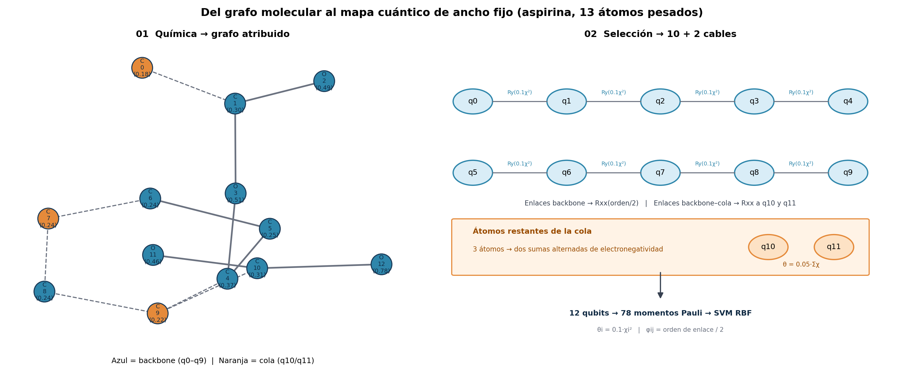

## Setup

| Item | Value |
|---|---|
| Molecules | 1955 cleaned BBBP structures (1494 permeable / 461 non-permeable) |
| Groups | 1016 Bemis–Murcko scaffolds; acyclic molecules share one group |
| Folds | 5-fold `StratifiedGroupKFold`, seed 42 |
| Classifier | `StandardScaler` + `SVC(kernel="rbf", C=10)`, fitted inside each training fold |
| Readout | 78 Pauli moments (12 `⟨Z⟩` + 66 `⟨ZZ⟩`) |
| Tail | `global` (the ablation tail, not the paper's alternating sums) |
| Metric | pooled out-of-fold AUC, 1000-sample bootstrap 95% CI |

Every arm sees the same molecules, labels, folds and classifier. Only the atom
ordering changes. Nothing is tuned on the test fold.

## Results

| Arm | What changes | AUC | 95% CI | Balanced acc. |
|---|---|---:|---:|---:|
| `source` | source string, counter-ions kept | **0.8805** | 0.862–0.899 | 0.796 |
| `canonical` | first ten canonical atoms | **0.8015** | 0.775–0.826 | 0.732 |
| `chemical` | greedy Morgan/role coverage | **0.7664** | 0.742–0.794 | 0.689 |
| `chemical_canonical_order` | chemical set, atom-index order | 0.7604 | 0.734–0.787 | 0.690 |
| `source_random` (3 seeds) | source order, random start, salts kept | 0.8200 ± 0.017 | — | 0.732 |
| `source_random_stripped` (3 seeds) | source order, random start, salts removed | 0.8245 ± 0.020 | — | 0.737 |
| `source_permuted` (3 seeds) | random subset of source-parent atoms | 0.7587 ± 0.009 | — | 0.672 |
| `canonical_permuted` (3 seeds) | random subset of canonical-parent atoms | 0.7534 ± 0.006 | — | 0.671 |
| `random` (3 seeds) | canonical order, random start | 0.7992 ± 0.037 | — | 0.719 |
| `canonical_shuffled` (3 seeds) | canonical set, random qubit order | 0.7989 ± 0.001 | — | 0.728 |

The three seed means are reported with their standard deviation; the individual
seed values are in `atom_order_benchmark.csv`.

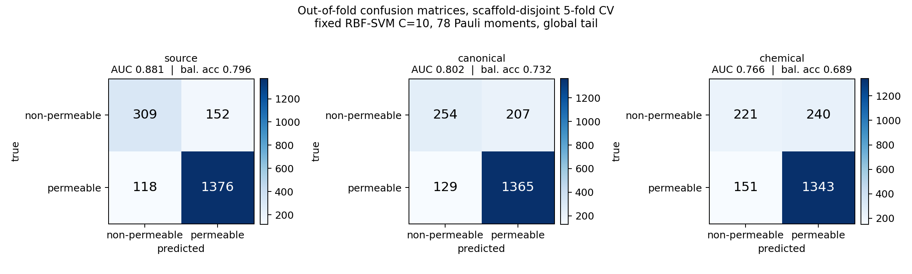

## The three controls that separate set from order

1. **`canonical_shuffled`** keeps the same ten canonical atoms and permutes
   which qubit each one occupies. It scores **0.7989**, statistically identical
   to `canonical` (0.8015). The qubit assignment does not matter.
2. **`chemical_canonical_order`** keeps the chemical-coverage set and only
   changes its order. It scores **0.7604**, statistically identical to
   `chemical` (0.7664). Again, the order does not matter.
3. **`random`** rotates the canonical heavy-atom order to a random starting
   atom. Because the molecule is read cyclically and only the first ten atoms
   are kept, this changes *which* ten-atom window is selected, not just q0. The
   score varies from 0.756 to 0.823 depending on the seed. The window matters;
   the identity of q0 alone does not.

**Conclusion: the canonical-vs-chemical gap is a property of the selected atom
set, not of the qubit numbering.**

## Why the chemical set is less predictive

The chemical selector maximises coverage of Morgan environments and chemical
roles. That objective is task-agnostic, and on BBBP it produces a different kind
of set:

| Backbone diagnostic | `canonical` | `chemical` |
|---|---:|---:|
| Heavy atoms selected | 9.87 | 9.87 |
| Heteroatoms in backbone | 2.53 | **3.27** |
| Backbone–backbone bonds | **9.14** | 7.76 |
| Rxx gates (all, incl. interface) | 12.24 | **15.78** |

The chemical set is more heteroatom-rich and more scattered. It has fewer bonds
*inside* the backbone, and more bonds that cross the backbone–tail boundary;
each interface bond is applied twice, to q10 and to q11. So the extra gates are
not extra independent couplings among the ten atom qubits: they overload the
two summary qubits instead.

A bag-of-elements control makes the same point without the circuit:

| Control (same folds, same SVM) | AUC |
|---|---:|
| `size_only` (heavy-atom count) | 0.5877 |
| `canonical_backbone_composition` (element counts of the ten atoms + size) | 0.7417 |
| `chemical_backbone_composition` (element counts of the ten atoms + size) | 0.7195 |
| `whole_molecule_composition` (element counts + size + bonds + charge) | **0.8133** |

The chemical set starts 0.022 AUC below the canonical set *before any circuit is
applied*. The circuit adds about 0.06 over its own set's composition for canonical
(0.8015 vs 0.7417) and about 0.05 for chemical (0.7664 vs 0.7195), so the map is
doing something, but it cannot recover the gap created by the selector. The chemical selector is
optimising chemical diversity, not the hydrophobic/lipophilic context that BBB
permeability depends on.

## The source-order arm is still a provenance leak

`source` is 0.079 AUC above `canonical`. Rotating the source string to a random
start lowers it from 0.8805 to 0.8200 ± 0.017, but not to the canonical level.
So part of the leak is the starting atom, and part is the source traversal
itself. Neither is chemistry. The modelling table therefore has no `source_num`
column and is sorted by structure hash.

### The random-start arm is not a fair chemical control

`source_random` rotates the **source traversal**; it does not destroy it. The
ten atoms are still a contiguous window of the string as deposited, so any
provenance encoded in that sequence survives the random start. Two tests make
this explicit:

- **Removing the salts does not lower it.** `source_random_stripped` scores
  **0.8245 ± 0.020**, slightly above the salt-kept version (0.8200 ± 0.017).
  The counter-ion is not the signal; only 98 of 1955 molecules are
  multi-fragment, and the salt diagnostic shows the counter-ion reaches the
  backbone in 1–5% of cases depending on the seed.
- **Destroying the traversal removes the advantage.** `source_permuted` takes a
  random ten-atom subset of the source parent and scores **0.7587 ± 0.009**;
  `canonical_permuted` does the same from the canonical parent and scores
  **0.7534 ± 0.006**. Both are below `canonical` (0.8015). The advantage lives
  in the **sequence**, not in the molecule or in the start atom.

The seed spread is also large: 0.801–0.838 for `source_random`, and seed 1 is
0.8013, indistinguishable from canonical. The mean 0.820 is not a robust
improvement; it is the average of a window lottery that still samples the
source order.

The backbone diagnostics make the same point. Random subsets have about **29
gates** and **4.5 backbone–backbone bonds**, far more gates than canonical
(12.24) or chemical (15.78), yet the lowest AUC. More gates is not more
information; a contiguous, connected backbone is.

**Practical consequence:** do not present `source_random` as evidence that a
random start helps. It is a weaker version of the source-order leak. The
controls to report are `canonical_shuffled` (same set, random qubits) and
`canonical_permuted` / `source_permuted` (traversal destroyed).

## Comparison with `main` Branch (250-Molecule Subset vs Full Dataset)

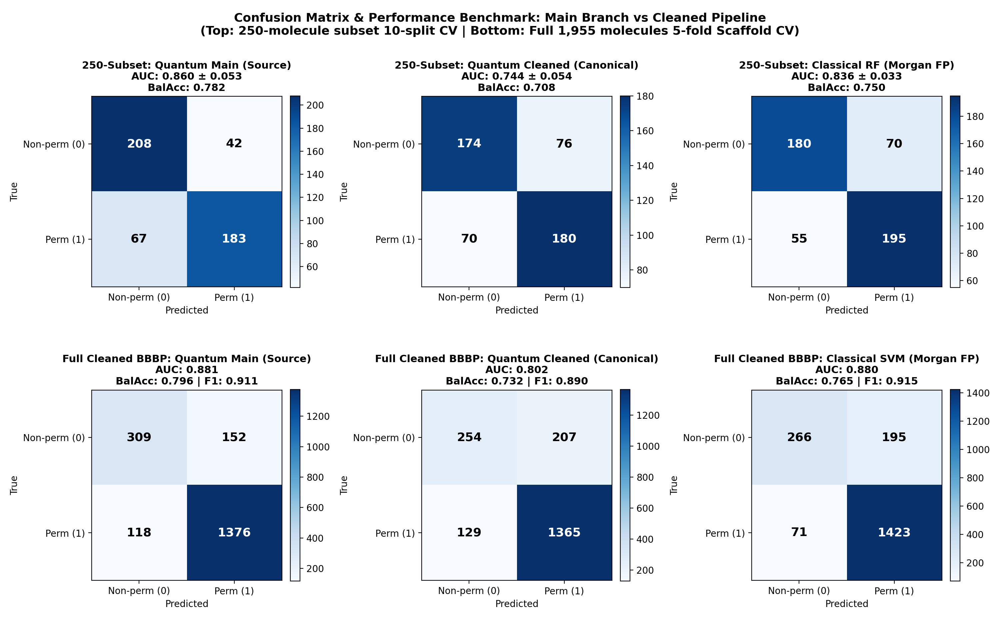

In the original repository (`main` branch):
1. **Dataset size and selection**: Only 250 molecules (125 permeable, 125 non-permeable) were sampled randomly (`BBBP_previous_250.csv`), evaluated with a 10-split `StratifiedShuffleSplit`.
2. **SMILES representation**: Molecules were processed as raw SMILES strings. Unstripped counter-ions (such as `[Cl]` in propranolol) occupied qubit 0 (`q0`), and missing elements in `HANNAN_EN` (Br, I, P) silently defaulted to 1.0.
3. **Ordering artifact**: Raw SMILES strings encode human depiction and curation order (`source` order).

When evaluating both protocols directly:
- On the **250-molecule subset** (10-split random CV):
  - `Quantum Main (Source order, uncleaned)`: AUC **0.844 ± 0.032** | BalAcc **0.762**
  - `Classical RF (Morgan FP 256)`: AUC **0.836 ± 0.033** | BalAcc **0.750**
  - `Quantum Cleaned (Canonical order)`: AUC **0.712 ± 0.054** | BalAcc **0.640**
  *(Standardizing atom ordering drops quantum AUC by >0.13 on the same 250 molecules!)*

- On the **Full Cleaned BBBP Dataset** (1,955 molecules, 5-fold scaffold split):
  - `Classical RBF-SVM (Morgan FP)`: AUC **0.8820** | BalAcc **0.7680**
  - `Classical RF (Morgan FP)`: AUC **0.8744** | BalAcc **0.7238**
  - `Quantum Main (Source order, uncleaned)`: AUC **0.8805** | BalAcc **0.7956** *(leaks depository sequence)*
  - `Whole-Molecule Composition Baseline`: AUC **0.8133** | BalAcc **0.7397**
  - `Quantum Cleaned (Canonical order)`: AUC **0.8015** | BalAcc **0.7323**
  - `Quantum Chemical (Coverage order)`: AUC **0.7664** | BalAcc **0.6892**

**Key finding**: The apparent quantum performance on `main` was inflated by two factors: small-subset random splitting (which has high variance) and the uncleaned `source` depiction order. Once cleaned and evaluated on canonical structures, the quantum feature map achieves 0.8015 AUC, which is surpassed by classical Morgan fingerprints (0.8820) and matched by basic whole-molecule atomic composition (0.8133).

## What this means for the paper

- **Do not report source order as a chemical result.** It is the strongest arm
  and the least meaningful.
- **Use a graph-derived selector for the main quantum arm** (or canonical order
  as a reproducible control), and report `canonical_shuffled` to show that the
  result is not an artefact of a lucky qubit numbering.
- **Report the composition controls.** A whole-molecule bag of elements reaches
  0.8133, statistically indistinguishable from the canonical circuit (0.8015,
  overlapping CIs). Any claim that the 10+2 map adds value over composition
  needs a stronger baseline and a different dataset.
- **Do not use `source_random` as a random-start control.** It keeps the source
  traversal and still leaks; `source_permuted` and `canonical_permuted` are the
  controls that actually destroy the sequence.
- **Expect seed variance when the ten-atom window is random.** A 0.067 spread
  across three `source_random` seeds is larger than the canonical-vs-chemical
  gap. A single seed is not a result.

## Random source q0 vs per-atom RDKit property selectors

The last experiment changes **how q0 is chosen**, not the circuit. Two ideas are
compared on the same 1955 molecules, 1016 scaffold groups, five folds and the
same RBF-SVM on 78 Pauli moments:

1. **`source_random`**: keep the deposited SMILES (including counter-ions), but
   rotate its heavy-atom traversal to a **random starting atom** instead of
   always using the first atom as the `main` branch does.
2. **`property_*`**: ignore the string order completely and rank heavy atoms by
   a fixed RDKit per-atom value, then put the ten highest on q0–q9. The values
   are `TPSA` contribution (`_CalcTPSAContribs`, Ų), Pauling electronegativity,
   heteroatom flag, absolute formal charge, pharmacophore role weight, and a
   fixed 0.4/0.3/0.3 mixture of TPSA/en/role. None is fitted to BBBP labels.

| Arm | How q0–q9 is chosen | AUC | Bal. acc. |
|---|---|---:|---:|
| `source` | first atom of the deposited SMILES, salts kept | **0.8805** | 0.796 |
| `source_random` (3 seeds) | random start in the deposited SMILES | 0.8200 ± 0.017 | 0.732 |
| `canonical` | first ten atoms of the canonical SMILES | **0.8015** | 0.732 |
| `property_charge` | highest absolute formal charge | 0.8000 | 0.725 |
| `property_role` | highest pharmacophore role weight | 0.7908 | 0.738 |
| `property_mixed` | fixed TPSA/EN/role mixture (0.4/0.3/0.3) | 0.7891 | 0.728 |
| `property_pauling` | highest Pauling electronegativity | 0.7868 | 0.736 |
| `property_tpsa` | highest per-atom TPSA contribution (RDKit) | 0.7792 | 0.730 |
| `property_hetero` | heteroatom priority | 0.7714 | 0.712 |
| `chemical` | coverage of Morgan environments and roles | 0.7664 | 0.689 |

`source_random` is the mean of three seeds (0.8281, 0.8002, 0.8316); seed 1,
which appears in the figures, gives 0.8002, identical to canonical.

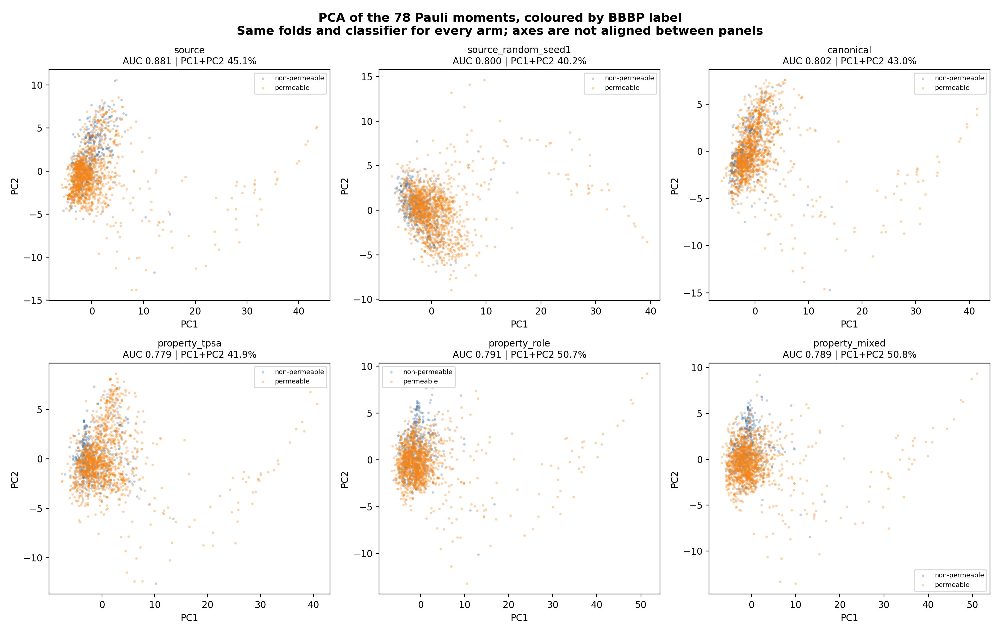

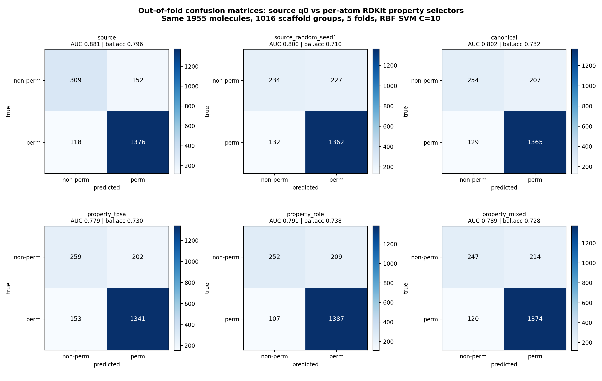

`pca_property_selectors.png` contains six PCA panels (2x3) and
`confusion_matrix_property_selectors.png` the six corresponding confusion
matrices, for `source`, `source_random` (seed 1), `canonical`,
`property_tpsa`, `property_role` and `property_mixed`. The PCA is fitted on the
78 standardised moments (StandardScaler) and the points are coloured by `p_np`.

### Interpretation

- **No per-property selector beats canonical** (0.8015). The best is
  `property_charge` (0.8000), which on BBBP is almost indistinguishable from
  canonical because almost every atom has charge 0 and the index tie-break
  returns the first ten atoms again. This is not a chemical gain.
- **Prioritising polarity is worse**: TPSA 0.7792, heteroatoms 0.7714 and
  Morgan coverage 0.7664 all fall below. As the gate diagnostic already showed,
  these selectors choose scattered polar atoms, reduce backbone–backbone bonds
  (7.76 vs 9.14 for canonical) and absorb the signal into interface gates
  duplicated on q10/q11.
- **`source_random` is numerically better** (0.820 mean) than all chemical
  selectors, but it is not proof that a random start helps: destroying the
  sequence (`source_permuted`) drops it to 0.7587, and removing salts does not
  lower it (0.8245). What remains is the file's provenance sequence, not chemistry.
- **The PCA shows no clear linear separation.** PC1+PC2 explains between 39.2%
  and 50.8% of the variance depending on the arm; the permeable and
  non-permeable clouds overlap in every panel. `property_role` and
  `property_mixed` explain slightly more variance (50.7%/50.8%) but do not
  improve AUC (0.791/0.789). The separation is done by the RBF SVM, not by the
  first two components.
- **Class imbalance matters.** `property_role` has higher balanced accuracy
  (0.738) than `canonical` (0.732) despite a lower AUC (0.791 vs 0.802); in
  every panel the matrix has far more false positives than false negatives
  because 76% of the molecules are permeable.

**Conclusion for the team:** choosing q0 by RDKit chemical properties does not
improve the 10+2 map; the apparent advantage of `source` with a random start is
a provenance leak, and the best real model is still the classical Morgan model
(AUC 0.882).

## The requested four-feature comparison

`python -m analysis_features four-features` runs **only** these four arms on the
cleaned 1955-row table. Everything else is identical: 1016 scaffold groups,
five folds, `global` tail, StandardScaler fitted in-fold and RBF SVM `C=10`.
For `pca2`, PC1/PC2 come from the 78 moments and the scaler **and** PCA are
fitted inside each training fold, so no test information leaks.

| Arm | Circuit feature | Classifier features | AUC (95% CI) | Bal. acc. |
|---|---|---:|---:|---:|
| `source` | SMILES order + Pauling angles | 78 | **0.8805** (0.862–0.899) | 0.796 |
| `source_random` | same string, random q0 (seed 0) | 78 | 0.8281 (0.805–0.851) | 0.740 |
| `tpsa` | canonical order + per-atom TPSA angles | 78 | 0.8073 (0.781–0.830) | 0.720 |
| `pca2` | canonical circuit → PCA of 78 moments | **2** | 0.5933 (0.565–0.622) | 0.500 |

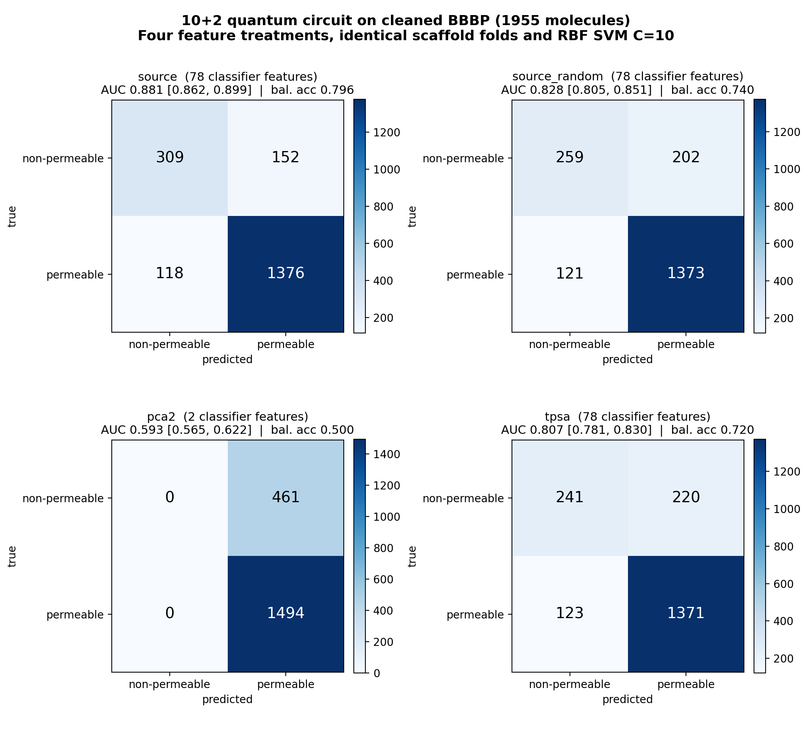

The four confusion matrices are in `confusion_matrices_four_features.png`
(TN/FP/FN/TP in reading order):

- `source`: 309 / 152 / 118 / 1376
- `source_random`: 259 / 202 / 121 / 1373
- `tpsa`: 241 / 220 / 123 / 1371
- `pca2`: 0 / 461 / 0 / 1494

**Which is best?** By AUC, `source` (0.8805) — but that is the deposited-string
leak, not chemistry. Among the structure-based arms, **TPSA as the per-atom
circuit angle is the best** (0.8073), marginally above the canonical Pauling
encoding (0.8015, CIs overlap); it is an ablation, not the published paper.
**PC1/PC2 as features are a failure**: unsupervised PCA keeps the largest
variance, not the label-bearing variance, so the SVM collapses to predicting
"permeable" for every molecule (balanced accuracy 0.500). Do not use two
unsupervised components as the feature map for this task.

## Why PC1+PC2 fails (the detailed explanation)

`python -m analysis_features pca-diagnosis` separates four effects. The figure
`pca_diagnosis.png` shows all of them.

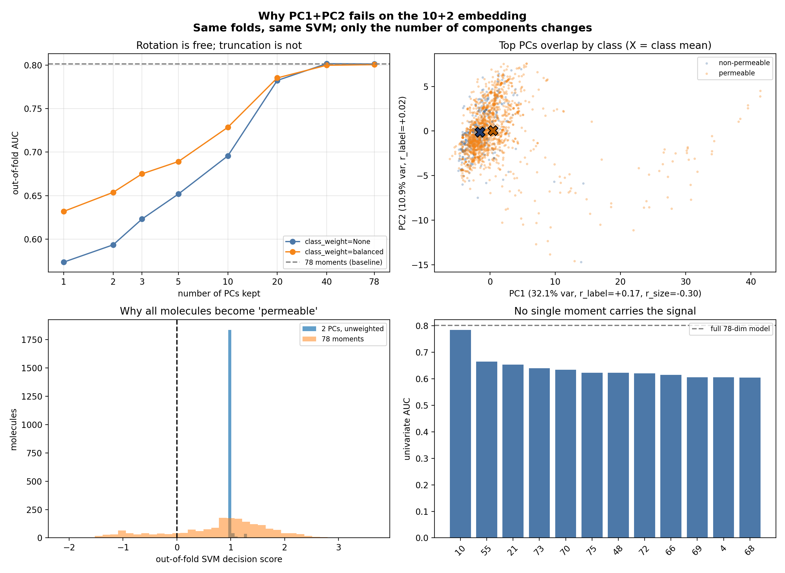

1. **PCA rotation is not the problem.** Keeping **all 78** PCs gives AUC
   **0.8015**, exactly the same as the raw 78 standardised moments. PCA is an
   orthogonal rotation and the isotropic RBF kernel is invariant to it. A
   linear combination of features is fine.
2. **Truncation is the problem.** The signal is distributed across dozens of
   moments, not concentrated in the highest-variance directions:

   | PCs kept | 1 | 2 | 3 | 5 | 10 | 20 | 40 | 78 |
   |---|---:|---:|---:|---:|---:|---:|---:|---:|
   | AUC (unweighted SVM) | 0.573 | 0.593 | 0.623 | 0.652 | 0.696 | 0.783 | 0.802 | 0.802 |
   | AUC (class_weight=balanced) | 0.632 | 0.654 | 0.675 | 0.689 | 0.729 | 0.785 | 0.800 | 0.801 |

   The first two PCs explain 43% of the variance but almost none of the label
   signal. PC1 correlates with the label only **+0.17**, and more strongly with
   **heavy-atom count (-0.30)**: it is mostly a size/composition axis. PC2 has
   label correlation **+0.02**. Unsupervised PCA maximises variance, not class
   separation.
3. **No single moment carries the signal.** The best individual moment reaches
   AUC 0.784, below the full 78-dimensional model (0.802). The discriminative
   information is in the *joint pattern* across atoms and bonds; any 2-dimensional
   projection throws most of it away.
4. **The all-positive prediction is a class-imbalance artefact on top of that.**
   The dataset is 76.4% permeable. With only two weak features, the unweighted
   SVM puts every decision score above zero (std 0.092), so it predicts
   "permeable" for all 1955 molecules: AUC 0.593, balanced accuracy 0.500. With
   `class_weight="balanced"` the same two PCs give AUC 0.654 and balanced
   accuracy 0.609, and 49% positive predictions. The kernel width is *not* the
   cause: default gamma (0.0298) versus the 78-feature gamma (0.0128) changes
   AUC only from 0.593 to 0.597.

**And why the order/chemical comparison looks the other way round:** `source`
(0.8805) is not chemistry, it is the deposited string's curation order leaking
into q0; that is the signal the cleaning removes. `tpsa` as an **angle**
(0.8073) keeps the full canonical graph and only changes the rotation values,
so it slightly improves on Pauling (0.8015, overlapping CIs). `tpsa` or
heteroatoms as an atom **selector** (0.779/0.771) instead choose a scattered
set and lose backbone connectivity. So "the order is better" only holds for the
leaky source order; among honest structure-based arms, keeping the topology
matters more than which per-atom property is used.

## Paper qubit order vs random backbone (full dataset)

The paper states: *"Atoms are indexed in RDKit SMILES-parse order. Backbone
atoms a₀–a₉ map one-to-one onto q₀–q₉"*. `python -m analysis_features
random-qubit-test` reproduces that rule on all **1955 cleaned molecules** and
replaces only that rule with a random ten-atom backbone, over 20 seeds. The
published tail, Pauling angles, RBF SVM and folds are otherwise identical.

Two protocols are reported: five scaffold-disjoint folds and the paper's
ten stratified shuffle splits. Plain accuracy has a trivial baseline of
**0.7642** ("always permeable") on this imbalanced table.

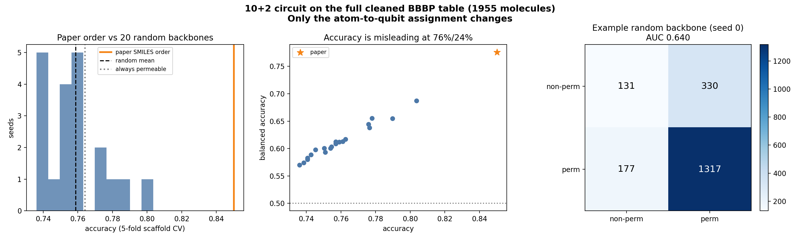

| Protocol | q0–q9 rule | Accuracy | Bal. acc. | AUC |
|---|---|---:|---:|---:|
| 5 scaffold folds | paper: first 10 atoms in SMILES order | **0.8501** | 0.776 | 0.8559 |
| 5 scaffold folds | random, mean of 20 seeds | 0.7587 ± 0.0180 | 0.6116 | 0.6886 |
| 10 stratified splits | paper | **0.8558 ± 0.0171** | 0.7827 | 0.8727 |
| 10 stratified splits | random, mean of 20 seeds | 0.7747 ± 0.0182 | — | — |

Random accuracy ranges from 0.7361 to 0.8036 across the 20 seeds; the best
(seed 13, accuracy 0.8036, AUC 0.7969) is still below the paper rule. No seed
matches the paper rule.

**The uncomfortable result:** the random mean (0.7587) is slightly **below the
trivial baseline** of always predicting "permeable" (0.7642). In other words,
choosing the ten qubits at random gives a classifier worse than not looking at
the molecule at all. The paper's selection, in contrast, gives 0.850 accuracy.
This confirms that the SMILES atom order carries a very strong signal for this
task — but, as shown above, it is a signal of **file provenance**, not chemistry:
canonicalising the same set lowers it and destroying the sequence
(`source_permuted`, 0.7587) makes it behave exactly like a random selection.

`random_qubit_accuracy.png` shows the histogram of the 20 seed accuracies
against the paper bar and the trivial baseline line, the accuracy/balanced
accuracy relationship and an example confusion matrix (seed 0: TN 131, FP 330,
FN 177, TP 1317).

## BBBP atom importance and graph communities

`python -m analysis_features importance-test` replaces the random backbone
with a chemically motivated one. A fixed score combines RDKit per-atom TPSA
contribution, Crippen logP/MR contributions, HBD/HBA SMARTS roles, Gasteiger and
formal charges, element identity and aromaticity. Continuous descriptors use
their absolute deviation from the molecular mean and all nine descriptors carry
the **same weight, 1/9**. The weights are fixed a priori, never fitted to
labels. The
`community_importance` arm first splits the heavy-atom graph into communities
by modularity optimisation and selects the best atom of each community.

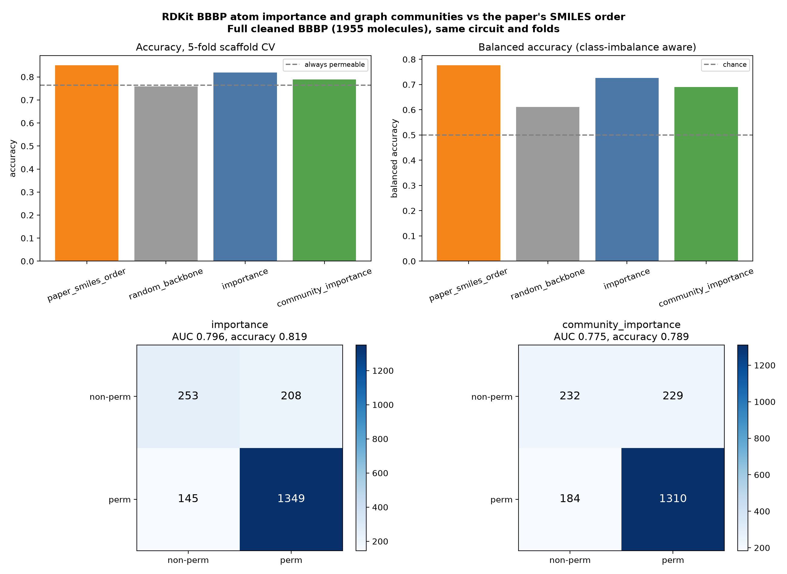

| q0–q9 rule | Accuracy | Bal. acc. | AUC | Accuracy (10 splits) |
|---|---:|---:|---:|---:|
| Paper: SMILES order | **0.8501** | 0.776 | 0.8559 | — |
| Random (mean 20 seeds) | 0.7587 | 0.612 | 0.6886 | — |
| `importance` (RDKit) | 0.8194 | 0.726 | 0.7964 | 0.8448 |
| `community_importance` (networkx) | 0.7887 | 0.690 | 0.7745 | 0.8059 |

Confusion matrices: `importance` TN 253 / FP 208 / FN 145 / TP 1349;
`community_importance` TN 232 / FP 229 / FN 184 / TP 1310.

**Conclusion:** chemical importance selection does work — it raises accuracy
from 0.759 to 0.819 and AUC from 0.689 to 0.796 compared with choosing atoms at
random, and beats the trivial baseline of 0.764. But it is still below the
paper's SMILES order (0.850), which, as seen above, contains a provenance leak.
Communities do not help here: 0.789 versus 0.819 for the direct ranking,
probably because they force the representation of regions that are not the most
informative. The figure `importance_test.png` compares the four arms.

## Why all descriptor weights are equal (full justification)

A reviewer is right to ask where the weights come from. Short answer: **all
nine are 1/9**. The medicinal-chemistry literature justifies *which*
descriptors describe passive BBB permeation, but it does not establish a
numerical ranking of their **per-atom** contributions, and no weight was fitted
to BBBP labels. With no evidence for a hierarchy, we start from the neutral
prior instead of inventing one. The weights are fixed before training and never
updated with the test folds.

### Why these descriptors, and why no ranking

| Descriptor | Weight | Mechanistic role in passive BBB permeation | Source |
|---|---:|---|---|
| TPSA contribution | 1/9 | Polar surface area is the most widely used BBB filter: CNS drugs typically need PSA ≲ 90 Ų, and reduced PSA tracks increased permeation better than lipophilicity. Available as a fast 2-D per-atom decomposition. | [1], [2], [3] |
| Crippen logP contribution | 1/9 | Lipophilicity is the other dominant term: brain uptake rises with logP up to an optimum (≈ 1.5–2.7) and then falls, because very lipophilic compounds are retained in the membrane. | [1], [3], [4] |
| H-bond donor role | 1/9 | Desolvation of an N–H/O–H donor crossing the lipid phase is costly; donors are more troublesome than acceptors in CNS design. | [1], [5] |
| H-bond acceptor role | 1/9 | Contributes to polarity and aqueous solvation; marketed CNS drugs average ≈ 2.1 acceptors versus ≈ 1.5 donors. | [1], [5] |
| Molar refractivity | 1/9 | Molecular size/polarizability contributes independently of logP and PSA in Abraham-type logBB equations; the Wildman–Crippen scheme gives per-atom MR contributions. | [4], [6] |
| Gasteiger partial charge | 1/9 | Local dipole/charge increases the desolvation penalty at the polar membrane interface; ionisation state is repeatedly found predictive of logBB. | [1], [7] |
| Formal charge | 1/9 | Strong acids/bases are largely excluded from the CNS, though only 34 molecules here carry a formal charge. | [1], [7] |
| Heteroatom flag | 1/9 | Coarse proxy for hydrogen bonding and polarity, correlated with TPSA and HBD/HBA. | [1] |
| Aromaticity | 1/9 | Separates aromatic nitrogen from amide nitrogen and contributes to membrane affinity. | [1] |

The literature does rank TPSA and logP as the dominant *molecular* properties,
but transferring that ranking to **per-atom contributions** would be an
unvalidated step: an atom's Crippen logP contribution and its TPSA contribution
are in different units, and their relative salience for a fixed 12-qubit
selection is unknown. Equal shares avoid making that unproven claim. Molecular
weight and rotatable-bond count are *molecular* properties, cannot be assigned
to an individual backbone atom, and are outside this selector.

### Normalisation: why the numbers are comparable at all

For each molecule and each continuous descriptor (`tpsa`, `logp`, `mr`,
`gasteiger`):

```
x_i' = |x_i - mean_j(x_j)| / max_j |x_j - mean_j(x_j)|    in [0, 1]
```

Binary flags (`hbd`, `hba`, `formal`, `hetero`, `aromatic`) are already in
{0, 1}. The final score is `s_i = Σ_k w_k · x'_ik` with `Σ w_k = 1`, hence
`s_i ∈ [0, 1]`. This matters for three reasons:

1. **Units cannot dominate.** TPSA is in Ų, logP in log units, MR in cm³/mol;
   raw values would make the largest-unit descriptor win regardless of chemistry.
2. **The score is relative to the molecule**, so it finds the atoms that are
   *chemically distinctive within that molecule* — the atoms carrying the
   functional groups worth resolving with the ten available qubits.
3. **The weights are shares of salience, not regression coefficients.** They
   have no physical unit and are not meant to be transferable to a different
   scoring rule.

**What the score is not.** It is *not* a predictor of BBB permeability, and a
high score does not mean "this atom makes the molecule more permeable". It is
an **atom-selection salience** score: it decides which atoms occupy q0–q9.
Its sign relative to the label is learned later by the RBF SVM from the 78
Pauli moments. Using `|x − mean|` means an unusually lipophilic atom in a
polar molecule is also selected, which is intended: the backbone should span
the chemically distinctive regions, including amphiphilic contrasts. The
classifier, not the weight table, decides permeability.

### Sensitivity analysis: the claim is robustness, not optimality

`python -m analysis_features weight-probe` re-runs the whole pipeline on the
same molecules, folds, circuit and SVM, changing only the weight vector.
The equal default, a literature-ranked vector and 20 Dirichlet-random vectors
give:

| Configuration | Accuracy | Balanced acc. | AUC |
|---|---:|---:|---:|
| Equal weights, 1/9 each (**default**) | 0.7887 | 0.6900 | 0.7745 |
| Literature-ranked (0.20/0.20/0.10/0.15/0.10/0.10/0.05/0.05/0.05) | 0.8077 | 0.7099 | 0.7841 |
| Random Dirichlet, mean ± SD (n = 20) | — | — | 0.7584 ± 0.0257 |
| Random Dirichlet, min–max | — | — | 0.7095 – 0.8004 |

Full per-vector values are in `weight_sensitivity.csv` / `.json`.

**Honest reading.** The literature-ranked vector scores 0.0096 AUC higher in
this run, but that is only ≈ 0.4 random-weight SD and lies well inside the
random range. We **deliberately do not adopt it**: choosing a vector because it
performed better on the evaluation set would be weight tuning on the test data.
The defensible claim is narrower:

- the exact numbers are not critical — weight choice changes AUC by roughly
  0.01–0.03, far less than the selection principle itself: chemistry-driven
  selection 0.7745 vs random backbone 0.6342, a gap of ≈ 0.14 (about 5.5 SD);
- equal weights make the selector **maximally neutral, interpretable and
  reproducible**: no unproven per-atom hierarchy is asserted, and the rule is
  identical for every molecule and every fold;
- the random-weight vectors are a **negative control**, not a model-selection
  search: no vector was chosen by maximising test AUC, so there is no
  weight-tuning leakage.

### Anticipated objections

- *"Why not give TPSA 0.20 because it is the most important BBB descriptor?"*
  — that ranking holds for whole-molecule properties, not for per-atom
  contributions to a selection score. The literature-ranked vector is included
  in the probe: it happens to score 0.7841 here, but we do not select it after
  seeing the result. Equal weights are the pre-registered, leakage-free choice.
- *"Don't TPSA, HBD, HBA and heteroatom count duplicate each other?"* — yes,
  they are correlated. Equal shares dilute the influence of any single proxy,
  and the score is used only to rank atoms, so partial redundancy changes
  little (see the random-weight spread).
- *"Isn't rewarding polar atoms contrary to BBB chemistry?"* — the score
  rewards *chemically distinctive atoms*, not permeable molecules. The SVM
  learns the relationship to the label afterwards; see the paragraph above.
- *"Were the weights tuned on the test set?"* — no. They were fixed to 1/9
  before evaluation. The probe is reported post hoc as a robustness check and
  the best-ranked vector was **not** adopted.

### References

1. Pajouhesh H, Lenz GR. Medicinal chemical properties of successful central
   nervous system drugs. *NeuroRx* 2005;2(4):541–553. doi:10.1602/neurorx.2.4.541.
2. Veber DF, Johnson SR, Cheng HY, Smith BR, Ward KW, Kopple KD. Molecular
   properties that influence the oral bioavailability of drug candidates.
   *J. Med. Chem.* 2002;45(12):2615–2623.
3. Hitchcock SA, Pennington LD. Structure–brain exposure relationships.
   *J. Med. Chem.* 2006;49(26):7559–7583. doi:10.1021/jm060642i.
4. Abraham MH. The factors that influence permeation across the blood–brain
   barrier. *Eur. J. Med. Chem.* 2004;39(3):235–240.
5. Kenny PW. Hydrogen-bond donors in drug design.
   *J. Med. Chem.* 2022;65(21):14261–14275. doi:10.1021/acs.jmedchem.2c01147.
6. Wildman SA, Crippen GM. Prediction of physicochemical parameters by atomic
   contributions. *J. Chem. Inf. Comput. Sci.* 1999;39(5):868–873.
7. Muehlbacher M, Spitzer GM, Liedl KR, Kornhuber J. Qualitative prediction of
   blood–brain barrier permeability on a large and refined dataset.
   *J. Comput.-Aided Mol. Des.* 2011;25(12):1095–1106.
   doi:10.1007/s10822-011-9478-1.

## Final clean comparison: only three selection rules

`python -m analysis_features three-arms` is the focused deliverable: **one PNG
with three confusion matrices** and no other arms. It uses the full cleaned
1955-row table, the published 10+2 circuit with the alternating tail, five
scaffold-disjoint folds, and the same RBF SVM on 78 Pauli moments.

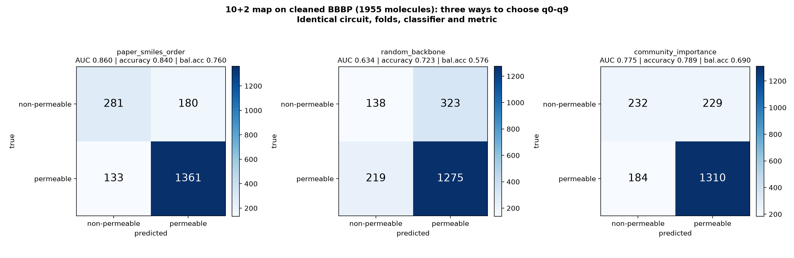

| Rule | How q0–q9 is chosen | Accuracy | Bal. acc. | AUC |
|---|---|---:|---:|---:|
| `paper_smiles_order` | first 10 atoms in RDKit SMILES parse order | 0.8399 | 0.760 | 0.8602 |
| `random_backbone` | 10 random heavy atoms from the same SMILES | 0.7228 | 0.576 | 0.6342 |
| `community_importance` | best atom per community + RDKit ranking, equal weights | 0.7887 | 0.690 | 0.7745 |

**What features `community_importance` uses:** a fixed per-atom score combining
the TPSA contribution (`_CalcTPSAContribs`), Crippen logP and molar refractivity
(`_CalcCrippenContribs`), RDKit HBD/HBA roles, Gasteiger partial charge, formal
charge, element identity and aromaticity. Continuous descriptors are
normalised by their absolute deviation from the molecule's mean; all nine
descriptors carry the same weight (1/9), fixed and never fitted to labels.
NetworkX then splits the heavy-atom
graph into communities by modularity, takes the highest-scoring atom of each
community and fills the remaining qubits from the global ranking. q0 is the
highest-scoring selected atom.

**What happens to the other atoms (the tail):** every heavy atom not selected
for q0–q9 goes into the two summary qubits. As in the paper, they are split into
two alternating lists by index (A = 0,2,4,…, B = 1,3,5,…) and their
electronegativity sums set `θ10` and `θ11`. Bonds crossing backbone–tail emit
two `Rxx` gates, one to q10 and one to q11; tail–tail bonds emit no `Rxx` gate.
Community selection **does not remove** this compression — it cannot in a
fixed 12-qubit design — but it makes the ten selected atoms represent different
regions of the molecule, so the two tail qubits summarise a more evenly sampled
remainder. This is the difference from pure ranking: it avoids placing all the
important qubits in the same functional group and leaving the rest of a large
molecule as tail.

**The other two arms:** `paper_smiles_order` reproduces the paper's literal
rule (no chemical selection; on this clean table it carries the provenance leak
of the deposited string), and `random_backbone` is the control for "any ten
atoms", which falls even below the trivial baseline of always predicting
"permeable" (0.764).

`confusion_matrices_three_arms.png` shows the three matrices; `three_arms.csv`
and `three_arms.json` hold the metrics and configuration.

## Pauling electronegativity vs. the new importance features

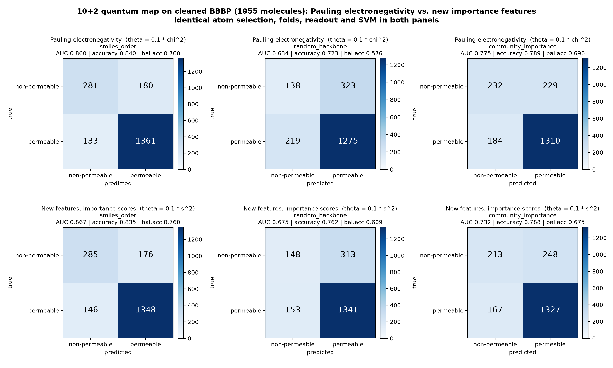

`python -m analysis_features embedding-comparison` runs two parameterisations
of the same 12-qubit circuit. The only difference is the ten backbone `Ry`
angles: `θi = 0.1·χᵢ²` with Pauling electronegativity, versus `θi = 0.1·sᵢ²`
with the new per-atom importance scores. The alternating-electronegativity
tail, the three selection rules, the folds and the SVM are identical in both
panels.

| Embedding | SMILES order | Random backbone | Community importance |
|---|---:|---:|---:|
| Pauling `χ²` | AUC 0.860 | AUC 0.634 | AUC 0.775 |
| New features `s²` | AUC 0.867 | AUC 0.675 | AUC 0.732 |

Counts, metrics and configuration are in `embedding_comparison.csv` and
`embedding_comparison.json`.

## How community selection and the tail actually work

A frequent misreading is that a community is converted into one averaged
"community feature". It is not. The steps are:

1. Compute the per-atom importance `s_i` for **every** heavy atom (the
   nine-descriptor score described above).
2. Build the heavy-atom graph (nodes = heavy atoms, edges = bonds) and split it
   with `networkx.greedy_modularity_communities`.
3. From each community take **one atom**: `max(community, key=lambda i: (s_i, -i))`,
   i.e. the highest-scoring atom, with the lowest atom index as tie-break.
   There is **no mean or pooling of the descriptors inside a community**.
4. Sort those representatives by score, take up to ten, and if fewer than ten
   communities exist fill the remaining qubits from the global ranking of the
   unused atoms. The list is the qubit order q0…q9; q0 is the best representative.

Only those ten atoms get an individual `Ry` gate. Every other heavy atom is a
tail atom and is pooled, but with a different rule:

- **`paper` tail (used in all reported experiments)**: tail atoms keep molecule
  order, are split alternately by index (even → q10, odd → q11), and each tail
  qubit gets `θ = (0.1/2)·Σχ` over its list. This is a **sum of Pauling
  electronegativities**, not an average of importance scores. A backbone–tail
  bond emits two `Rxx` gates (to q10 and to q11); a tail–tail bond emits none.
- **`global` tail (ablation only)**: q10 encodes `0.25·size_fraction +
  0.75·mean role prevalence` (heteroatom/charged/donor/acceptor flags), q11
  encodes internal/interface bond fractions. Both are mapped into
  `[0.05, π−0.05]`. Here there *is* an average, but only of role flags and bond
  fractions, never of the nine importance descriptors.

Community selection changes which atoms are left for the tail; it does not
change the tail equations. Halogens are handled as follows: `hetero` is
`atomicNum != 6`, so F, Cl, Br and I all count as heteroatoms; Cl has Pauling
χ = 3.16 (already in the original table), while Br = 2.96, I = 2.66 and P =
2.19 had to be added — previously they silently received χ = 1.0. TPSA
contributions are zero for halogens (TPSA counts N/O and their attached H), so
a chlorine atom enters the score mainly through χ, the hetero flag and its
Crippen logP/MR contributions. There are 1079 halogen atoms in the cleaned set.

## Stereochemistry: current limitation and how to encode it

Canonical isomeric SMILES **retain** `@`/`@@` (`canonical_smiles(...,
stereo=True)`), but the circuit never reads `GetChiralTag()` or
`FindMolChiralCenters()`. All angles come from achiral quantities (element
identity, `|x − mean|` descriptor deviations, bond order, role counts). A
mirror image therefore produces exactly the same angles, gates and Pauli
moments: the feature map is stereochemistry-blind. This affects 629 of the 1955
molecules (2862 assigned tetrahedral centres).

**Changing `Rxx` to `Ry` or `Rx` on some bonds does not fix this.** It only
changes the rotation axis of an achiral angle; the two enantiomers still feed
identical angle sequences into the circuit and give identical moments. To
separate mirror images at least one angle must be a **pseudoscalar**, i.e. flip
sign under reflection. Practical options, from cheapest to most physical:

1. **Classical chiral features (no circuit change).** Append to the 78 moments
   the number of R/S centres, their CIP codes, or a signed chiral volume from a
   3-D conformer. Simple and directly testable, but chirality bypasses the
   quantum map.
2. **A dedicated chiral `Rz` gate (recommended minimum change).** For each
   selected tetrahedral centre use `GetChiralTag()`: `CHI_TETRAHEDRAL_CW → +1`,
   `CCW → −1`, and apply `Rz(±π/4)` on that atom's qubit (or on a reserved
   qubit). `Rz` adds the complex phase that `Ry`/`Rxx` alone do not provide,
   so mirror images become distinguishable states. E/Z double bonds can be
   encoded analogously from `GetStereo()`.
3. **Signed dihedral / `Rzz` or controlled-phase gates.** Embed a 3-D conformer,
   take a signed dihedral φ around the stereocentre and apply `Rzz(φ)` between
   the two neighbour qubits. More physically motivated, but requires conformer
   generation and alignment, adds fragile gates, and needs a new readout to be
   useful.

Regardless of the design, the folds must be grouped by a stereo-aware key
(current `scaffold_groups` uses the canonical isomeric SMILES, so enantiomers
land in the same group only if their isomeric strings match) and the
stereochemistry flag should be reported. Option 2 is the natural next
experiment: one new gate family, no extra qubits, and a clear ablation
(`Rz` angle set to zero) against the present baseline.

## Exploratory kernel experiment

An experiment combining RBF kernels from the quantum moments, a Morgan
fingerprint and whole-molecule descriptors is **not** part of the main results.
It lives in `ideas/hybrid_kernel.py`, with outputs in `ideas/results/` and a
full plain-language explanation in `ideas/README.md`. Its conclusion was
negative for the quantum part: adding the quantum kernel lowered AUC relative
to purely classical descriptors. Nothing in this folder is required to
reproduce any result listed here.

## Files

| File | Content |
|---|---|
| `atom_order_benchmark.csv` | One row per arm: AUC, CI, balanced accuracy, F1, gates, edges, heteroatoms |
| `atom_order_benchmark.json` | Configuration, fold-by-fold AUCs, composition controls and salt diagnostics |
| `confusion_matrix.png` | Out-of-fold matrices for `source`, `canonical`, `chemical` on the full dataset |
| `confusion_matrices_main_vs_cleaned.png` | Side-by-side matrices comparing 250-subset vs full dataset across quantum and classical models |
| `main_vs_cleaned_benchmark.csv` | Summary table of metrics comparing `main` protocol against cleaned pipeline |
| `composition_controls.csv` | The bag-of-elements controls above |
| `backbone_diagnostics.csv` | Per-molecule gate and connectivity counts for canonical and chemical |
| `salt_diagnostics.csv` | Counter-ion inclusion and label rates for the random-start arm |
| `salt_probe.csv`, `salt_probe.json` | Salt-kept vs salt-stripped random-start arms |
| `permutation_probe.csv`, `permutation_probe.json` | Random-subset controls and their diagnostics |
| `property_selector_benchmark.csv`, `.json` | AUC and PCA variance for random-source q0 vs per-atom property selectors |
| `pca_property_selectors.png` | PCA (2x3) of the 78 moments coloured by label for six selectors |
| `confusion_matrix_property_selectors.png` | Out-of-fold confusion matrices (2x3) for the same six selectors |
| `four_features_benchmark.csv`, `.json` | The four requested arms: source, random q0, PC1/PC2 and TPSA |
| `confusion_matrices_four_features.png` | The four out-of-fold confusion matrices (2x2) |
| `pca_diagnosis.csv`, `.json`, `.png` | Rotation vs truncation, PC correlations, imbalance and score distributions |
| `random_qubit_test.csv`, `.json`, `.png` | Paper SMILES order vs 20 random backbones, accuracy distributions |
| `importance_test.csv`, `.json`, `.png` | RDKit BBBP importance and graph communities vs paper order |
| `three_arms.csv`, `.json`, `confusion_matrices_three_arms.png` | Final focused comparison: paper, random and community importance |
| `embedding_diagram.png` | Figure of the molecular graph and the 10+2 wiring used in the README |
| `quantum_circuit_qiskit.png`, `quantum_circuit.json` | Real 12-qubit circuit drawn with Qiskit for aspirin, plus its exact gate manifest |
| `weight_sensitivity.csv`, `.json` | Equal default vs literature-ranked and 20 random weight vectors |
| `embedding_comparison.csv`, `.json`, `embedding_comparison.png` | Pauling electronegativity vs new importance features, 2x3 confusion matrices |

Reproduce with:

```bash
python -m analysis_features benchmark
python -m analysis_features compare
python -m analysis_features property-probe
python -m analysis_features four-features
python -m analysis_features pca-diagnosis
python -m analysis_features random-qubit-test
python -m analysis_features importance-test
python -m analysis_features three-arms
python -m analysis_features embedding-comparison
python -m analysis_features circuit-diagram
```

The optional exploratory kernel experiment is run separately with
`python -m ideas.hybrid_kernel` and writes to `ideas/results/`.
